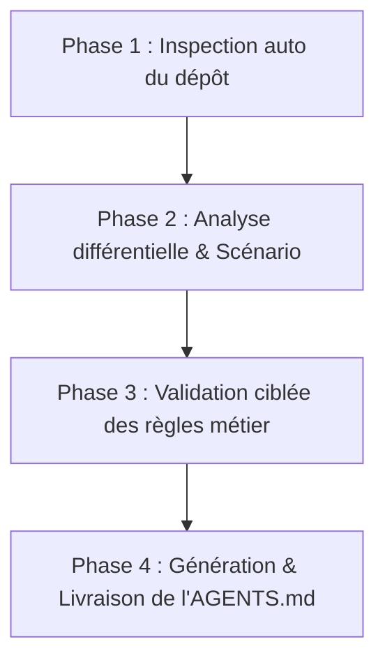

# Générateur & Rédacteur de fichier AGENTS.md

Cette compétence guide l'agent pour concevoir, auditer ou mettre à jour un fichier **`AGENTS.md`** à la racine d'un projet. Ce fichier sert de boussole opérationnelle pour toutes les intelligences artificielles de codage intervenant sur le dépôt.

L'objectif est de produire un document **frugal en tokens**, **hautement factuel** et **exempt de toute ambiguïté**, évitant ainsi les hallucinations et les commandes bloquantes.

---

## 1. Déclencheurs d'activation

Active cette compétence dès que l'utilisateur exprime l'un des besoins suivants :
- *"Crée un fichier AGENTS.md pour mon projet"*
- *"Génère les règles pour les agents IA sur ce dépôt"*
- *"Mets à jour ou audite notre AGENTS.md existant"*
- *"Migre nos fichiers GEMINI.md ou CLAUDE.md vers un AGENTS.md unique"*
- *"Configure les instructions globales de workspace pour les assistants de code"*

---

## 2. Déroulement opératoire en 4 Phases

### Phase 1 : Inspection & Détection automatique de l'environnement

Ne pose pas de questions sur ce que tu peux découvrir par toi-même dans les fichiers du projet. Analyse silencieusement et de manière autonome :

1. **Manifestes de dépendances et stack :**
   - Node / JS / TS : `package.json`, `tsconfig.json`, `pnpm-lock.yaml`, `yarn.lock`.
   - Python : `pyproject.toml`, `requirements.txt`, `Pipfile`, `setup.py`.
   - Rust : `Cargo.toml`.
   - Go : `go.mod`.
   - PHP : `composer.json`.
   - Java / Kotlin : `pom.xml`, `build.gradle`.
2. **Scripts et outillage de qualité :**
   - Commandes de build, de démarrage local, de test (`jest`, `vitest`, `pytest`, `cargo test`, etc.).
   - Linters et formateurs (`eslint`, `prettier`, `biome`, `ruff`, `black`, `clippy`).
3. **Fichiers de règles et documentation existants :**
   - Présence d'un `AGENTS.md`, `GEMINI.md`, `CLAUDE.md`, `.cursorrules`, `.copilot-instructions.md`, `CONTRIBUTING.md` ou `README.md`.

---

### Phase 2 : Analyse différentielle & Choix du scénario

Selon l'état du projet, sélectionne l'un des trois scénarios :

* **Scénario A : Création initiale (Aucun fichier existant)**
  - Utilise les informations détectées en Phase 1 pour pré-remplir la stack, l'arborescence clé et les commandes non interactives.
* **Scénario B : Audit ou Mise à jour d'un `AGENTS.md` existant**
  - Compare les commandes et règles du fichier actuel avec la réalité du dépôt (dépendances supprimées, nouvelles commandes npm/cargo).
  - Vérifie le respect des bonnes pratiques définies dans [references/bonnes-pratiques-agents.md](references/bonnes-pratiques-agents.md) (notamment l'absence de commandes bloquantes et le volume de tokens).
* **Scénario C : Migration / Unification**
  - Si des fichiers comme `GEMINI.md` ou `CLAUDE.md` existent, extrais-en les règles invariantes et propose de les consolider dans un `AGENTS.md` universel sans redondance.

---

### Phase 3 : Échange court & Validation des règles invisibles

Avant de générer le fichier, formule un récapitulatif ultra-condensé de ce qui a été détecté et pose **au maximum 2 à 3 questions ciblées** avec des options recommandées (*Smart Defaults*) sur les éléments non déductibles du code :

1. **Garde-fous métier ou sécurité :** Y a-t-il des répertoires sensibles, des fichiers de configuration ou des données à sanctuariser (ex: migrations de base de données, clés d'API) ?
2. **Conventions de développement strictes :** Un paradigme particulier imposé (ex: composants fonctionnels stricts, interdiction d'une bibliothèque tierce, pattern Result) ?
3. **Définition de Terminé (DoD) :** Quels contrôles l'agent doit-il obligatoirement valider avant de considérer une modification comme terminée (ex: `npm run lint && npm test -- ciblé`) ?

> ⚠️ **Clause Fast-Forward :** Si l'utilisateur valide l'analyse globale d'un mot ou demande d'aller vite, applique directement tes recommandations par défaut sans insister.

---

### Phase 4 : Rédaction & Livraison de `AGENTS.md`

1. **Formatage :** Base-toi sur le modèle modulaire [resources/template-agents.md](resources/template-agents.md).
2. **Critères d'excellence de rédaction :**
   - **Taille optimale :** Entre 50 et 120 lignes au total (environ 400 à 800 tokens).
   - **Commandes non interactives :** Assure-toi que toutes les commandes de test et de build disposent de flags pour s'exécuter sans confirmation clavier (ex: `CI=true`, `--watchAll=false`, `-y`, `--no-pager`).
   - **Style télégraphique :** Privilégie les listes à puces directes et les tableaux. Supprime tout verbiage narratif.
3. **Écriture du fichier :** Écris le fichier à la racine du projet sous le nom exact **`AGENTS.md`**.
4. **Restitution :** Présente à l'utilisateur un résumé succinct des sections clés créées et signale comment les agents l'utiliseront désormais.

---

## 3. Gestion des cas particuliers et robustesse

| Cas rencontré | Action corrective de l'agent |
| :--- | :--- |
| **Monorepo (Turborepo, Nx, Lerna)** | Créer un `AGENTS.md` racine pour les commandes globales (install, lint général) et mentionner les chemins relatifs vers les différents packages (`apps/`, `packages/`). |
| **Projet vide ou début de projet** | Mener une interview guidée en 3 questions rapides pour établir la stack prévue, le gestionnaire de paquets et les conventions de base. |
| **Absence de tests ou de linters** | Ne pas inventer de commandes de test. Indiquer clairement dans la section commandes : `Non configuré (priorité de mise en place recommandée)`. |
| **Conflit avec un fichier de règles existant** | Demander confirmation avant d'écraser un fichier existant ; proposer un diff ou une fusion prudente. |
