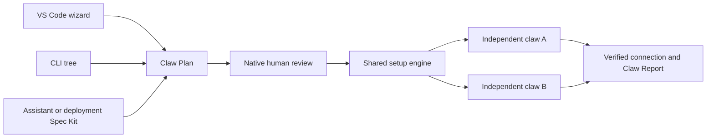

# Set up a separate NetClaw from VS Code

This workflow is included in **extension 1.3.0**, using **NetClaw source 1.13.0 or later** for Comms setup. See [Comms setup](COMMS-SETUP.md), [current release qualification](../specs/155-border-channel-setup/release-verification.md) and [underlying installer qualification](../specs/153-ide-installer/verification.md). It requires VS Code 1.109 or later; upgrading the extension does not upgrade an existing claw.

1. Open **NetClaw: Set Up a New NetClaw** in a trusted local macOS window or supported WSL2 Ubuntu window. No existing HUD connection is needed. Native Windows first shows the [WSL gate](WINDOWS-WSL-PREREQUISITES.md).
2. Run prerequisite checks, then select a published release, main/ref, or an explicitly reviewed checkout. Checks disclose contacts with GitHub, npm and PyPI. An older checkout without the setup protocol cannot run this workflow. Dirty source needs explicit as-is review.
3. Choose OpenClaw or Hermes, a provider, an exact model/API mode, then select one or more channels in **Comms**, or explicitly None. Comms also shows Twilio tools/voice and Zoom meeting integration with their eligible owners and prerequisites. See [Comms setup](COMMS-SETUP.md) for account preparation, WhatsApp's distinct paths and per-channel readiness. Installed local-model discovery does not run inference. When transfer size is unknown, download through the model manager after reviewing it there, then refresh.
4. Choose **Focused** for one claw, or **Risk** for a routing Border and separate members. Each member has its own harness, profile, provider and credentials. Members inherit the Border harness unless explicitly overridden; unsupported profiles stay unavailable. Shape Advisor asks about tool domains, credential separation, production, cost and growth, then shows estimates without changing the plan. On-demand members keep their local management services available while their routed worker sleeps.
5. Name each claw and select a new, empty absolute home. Review capabilities, settings, inventory, identity files, ports and service names. Enter secrets only in native password prompts. Choose testing or production explicitly.
6. Validate, then use **Review installation**. Native review shows the exact plan, homes, source, downloads and owned services. A saved plan, assistant draft or validation success authorizes nothing by itself.
7. Read the Claw Report. Files, tool discovery, runtime readiness and optional external checks are separate outcomes. Use **Save verified connection** only after authenticated runtime/HUD verification succeeds; review its name, harness, home and installation identity.

When the banner says **“Existing NetClaw detected. This setup creates a separate installation.”**, the existing claw remains independently manageable in Connections. The new setup cannot adopt its home, borrow its credentials or change its service. Detection covers saved bindings, known default homes and locations you select; it is not a disk-wide scan.

Closing or reloading the owning editor requests a pause at the next safe checkpoint. Installed services remain independent. Reopen setup, inspect the saved run and choose **Resume explicitly**. Unknown outcomes and surviving writers prevent automatic replay. An independently started CLI run is not owned by the editor.

Live model turns can incur provider charges. Every channel test separately reviews its exact destination and fixed message. Device verification selects one inventory device and reviews `show version`; setup never configures network devices. Default report export removes private identifiers structurally. Detailed local export needs its own review and still excludes secrets.

Production currently remains blocked without qualified installation-bound evidence for every mandatory control. Two legacy native components (`in2n-production`, `computer-use`), compatible Webex onboarding, complete on-demand service qualification and some safe-canary profiles remain open; see the evidence document before attempting a real installation. The scoped certificate adapter creates a private pinned-trust keypair; it does not register an ACME account or prove peer trust. Cleanup separately reviews owned services and files. It stops verified services before removing their journaled definitions and enable links, then removes unchanged run-created files. Uncertain service ownership retains the installation; shared or changed files, directories and audit evidence are retained.

## Static or dynamic pyATS inventory (Spec160)

Select pyATS, then choose **Testbed mode & sources** in the VS Code setup wizard
or static/dynamic in the terminal plan. Existing-runtime `scripts/setup.sh --testbed-only`
configures the selected home. Dynamic mode stores selected sources privately and
creates no dummy YAML; setup performs no inventory fetch or device operation.
Source service credentials and device login references remain separate.

The managed MCP requires scoped, complete, fresh records, then actual schema and
credential validation before explicit activation. Inventory belongs to one MCP
process; separate one-shot calls do not share it. Use a persistent client or the
bounded session helper. The HUD static editor and collector grants are separate.
Readiness reports source access, candidate, activation and execution independently.
See [Dynamic testbeds](DYNAMIC-TESTBEDS.md) for all source contracts, unavailable
reader gaps, restart behavior and feasible qualification. Existing runtimes require
an explicit reviewed component upgrade; source selection alone does not install it.
