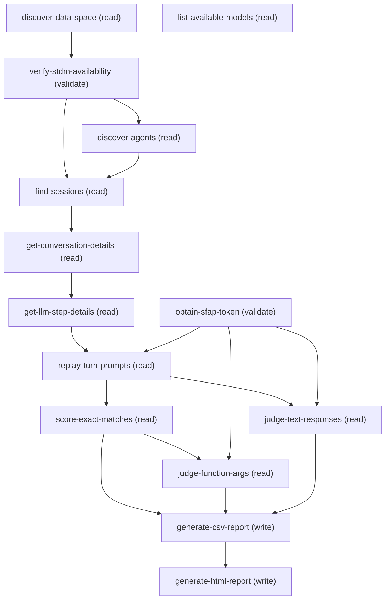

# Managing Agentforce Offline Experimentation

## When to Use This Skill

Execute this workflow when a user wants to test how a different LLM model would handle existing Agentforce agent conversations. Fetches session traces from Data Cloud STDM, replays prompts via the SFAP AI Gateway REST API with structured tool calling, scores across four metrics (topic agreement, function name accuracy, function argument accuracy via LLM-as-judge, text response quality via LLM-as-judge), and produces CSV + HTML reports with SAFE/REVIEW/UNSAFE verdict badges. Requires Data Cloud with Agentforce Activity data streaming enabled, an authenticated org, and a target model ID (llmgateway__ prefix for SFAP replay). Estimated runtime: 10-30 minutes for 10 sessions.

## Workflow

discover-data-space → verify-stdm-availability → discover-agents → list-available-models (if user needs help choosing) → find-sessions → get-conversation-details → get-llm-step-details → obtain-sfap-token → replay-turn-prompts → [score-exact-matches, judge-function-args, judge-text-responses] → generate-csv-report → generate-html-report.
WORKFLOW GATE: Do not proceed past Phase 0 until org alias (auto-discover from authenticated orgs), agent API name (auto-discover from STDM), and target model ID (ask user) are all confirmed.
SFAP JWT expires after ~2 hours. For 20+ session replays, refresh the token between batches. Each SFAP replay call takes ~1-3 seconds; keep under 20 sessions for reasonable wall-clock time (~10-30 minutes).
The scoring and judging steps (Phase 3) can run in parallel once replay completes. Exact-match scoring is instant; LLM judge calls add ~1-2 seconds per turn.

## Critical Constraints

**Preconditions:**

- Data Cloud is provisioned and enabled in the org (check: `DataCloudProvisioned`)
- Einstein LLM / GenAI Gateway is configured in the org (check: `EinsteinLlmEnabled`)
- User has an authenticated session to the target org (check: `OrgAuthenticated`)

## Operations Reference

Operations grouped by purpose. Use these as the building blocks for the workflows above.

### Summary

| Operation | Purpose | Status | Call | Depends on |
|-----------|---------|--------|------|------------|
| `discover-data-space` | read | implemented | `getDataSpaces` | — |
| `verify-stdm-availability` | validate | implemented | `queryCdpAnsiSqlV2` | `discover-data-space` |
| `discover-agents` | read | implemented | `queryCdpAnsiSqlV2` | `verify-stdm-availability` |
| `list-available-models` | read | implemented | `queryAiModel` | — |
| `find-sessions` | read | implemented | `queryCdpAnsiSqlV2` | `verify-stdm-availability`, `discover-agents` |
| `get-conversation-details` | read | proposed | `queryCdpAnsiSqlV2` | `find-sessions` |
| `get-llm-step-details` | read | proposed | `queryCdpAnsiSqlV2` | `get-conversation-details` |
| `obtain-sfap-token` | validate | proposed | — | — |
| `replay-turn-prompts` | read | proposed | — | `get-llm-step-details`, `obtain-sfap-token` |
| `score-exact-matches` | read | proposed | — | `replay-turn-prompts` |
| `judge-function-args` | read | proposed | — | `score-exact-matches`, `obtain-sfap-token` |
| `judge-text-responses` | read | proposed | — | `replay-turn-prompts`, `obtain-sfap-token` |
| `generate-csv-report` | write | proposed | — | `score-exact-matches`, `judge-function-args`, `judge-text-responses` |
| `generate-html-report` | write | proposed | — | `generate-csv-report` |

### Dependency graph

### Read operations

#### `discover-data-space`

Discover active Data Cloud data spaces in the org

**Call:** `getDataSpaces`   — status: `implemented`

#### `discover-agents`

Query STDM for distinct agent + version combinations that have session traces

**Call:** `queryCdpAnsiSqlV2`   — status: `implemented`

**Depends on:** `verify-stdm-availability`

#### `list-available-models`

List Einstein LLM models configured in the org to help the user choose a target model

**Call:** `queryAiModel`   — status: `implemented`

#### `find-sessions`

Find recent Agentforce sessions in STDM filtered by agent API name, version, and date range

**Call:** `queryCdpAnsiSqlV2`   — status: `implemented`

**Inputs:**

- `agent_api_name` *(`String`)* — Agent API name selected in discover-agents
- `agent_version_api_name` *(`String`)* — Agent version API name selected in discover-agents
- `start_date` *(`String`)*
- `end_date` *(`String`)*
- `max_sessions` *(`Integer`)*

**Depends on:** `verify-stdm-availability`, `discover-agents`

#### `get-conversation-details`

Fetch interactions (turns) for each session from the STDM Interaction DMO

**Call:** `queryCdpAnsiSqlV2`   — status: `proposed`

**Depends on:** `find-sessions`

#### `get-llm-step-details`

Fetch interaction steps including LLM inputs and outputs for each interaction

**Call:** `queryCdpAnsiSqlV2`   — status: `proposed`

**Depends on:** `get-conversation-details`

#### `replay-turn-prompts`

Extract structured messages (system/assistant/user) from STDM LLM step inputs, convert to OpenAI-format messages array preserving role positions, extract tool definitions dynamically from gen_ai.request.tools, classify each step as router (topic) or action based on tool signatures, and replay via SFAP REST API POST /ai/gpt/v1/chat/generations with tool_choice=required

**Status:** `proposed`

**Inputs:**

- `target_model` *(`String`)* — Target model ID (llmgateway__ prefix, e.g. llmgateway__OpenAIGPT41)

**Depends on:** `get-llm-step-details`, `obtain-sfap-token`

#### `score-exact-matches`

Compute exact-match scores for topic agreement and function name accuracy

**Status:** `proposed`

**Depends on:** `replay-turn-prompts`

#### `judge-function-args`

LLM-as-judge scoring of function arguments when function names match (exact or lenient)

**Status:** `proposed`

**Depends on:** `score-exact-matches`, `obtain-sfap-token`

#### `judge-text-responses`

LLM-as-judge scoring of text responses for turns that end with text output

**Status:** `proposed`

**Depends on:** `replay-turn-prompts`, `obtain-sfap-token`

### Write operations

#### `generate-csv-report`

Generate CSV report with per-turn replay results and aggregate summary scores

**Status:** `proposed`

**Inputs:**

- `output_csv` *(`String`)*

**Depends on:** `score-exact-matches`, `judge-function-args`, `judge-text-responses`

#### `generate-html-report`

Build a self-contained HTML analysis report with verdict badges, scorecards, and failure breakdown

**Status:** `proposed`

**Inputs:**

- `html_output` *(`String`)*

**Depends on:** `generate-csv-report`

### Other operations

#### `verify-stdm-availability`

Verify STDM (Session Trace Data Model) is queryable in Data Cloud

**Call:** `queryCdpAnsiSqlV2`   — status: `implemented`

**Depends on:** `discover-data-space`

#### `obtain-sfap-token`

Obtain an SFAP JWT token via org session authentication and the /ide/auth endpoint

**Status:** `proposed`

**Inputs:**

- `org_alias` *(`String`)* — Authenticated org alias for token resolution
