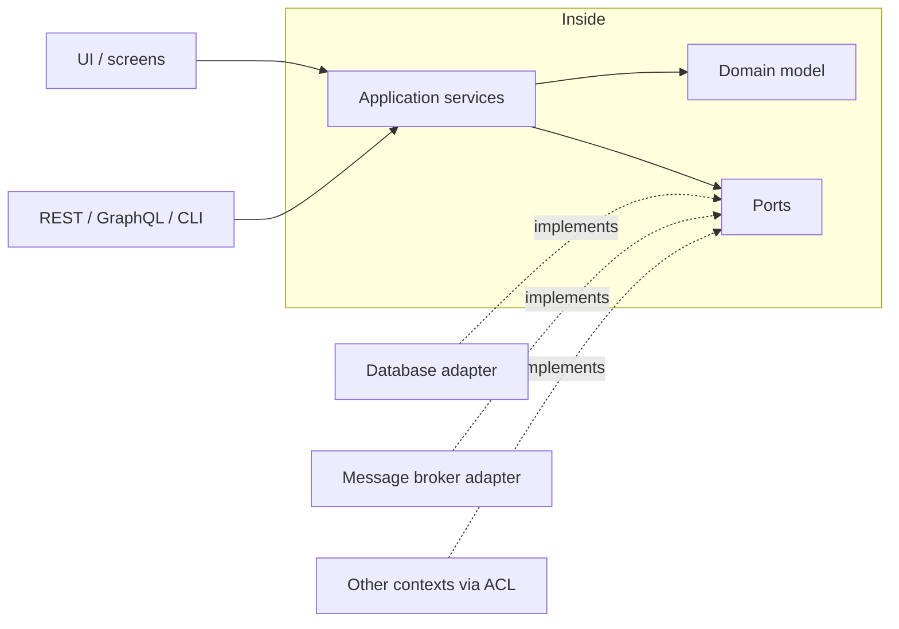

# Architecture around the model

The domain model needs a protected home. Evans's rule: domain logic never mixes with UI, persistence, or framework code, or the model can't evolve. His original answer was four layers (UI, application, domain, infrastructure). Vernon's default is hexagonal.

## Hexagonal (ports and adapters)

The domain sits at the center. Application services form its API. Everything external (UI, database, message broker, other contexts, devices, tests) connects through **ports**, interfaces the inside owns, implemented by **adapters**, technology-specific code on the outside. Dependencies always point inward.



| Ring | Holds | Never holds |
| --- | --- | --- |
| Domain model | Business rules, invariants, domain events, domain services | Framework imports, SQL, HTTP, UI state |
| Application services | One method per use case: load aggregates, call the domain, save, publish events; transactions and authorization | Business rules (an `if` that encodes policy belongs in the domain) |
| Adapters | Translation between technology and ports: controllers, repositories, message consumers, ACLs | Decisions the business cares about |

On a mobile app the same shape works: native modules (secure enclave, BLE, NFC), storage, and backend clients become adapters behind interfaces, so the domain and use cases test in plain unit tests without a device.

## Light contexts

A light context needs only the separation that keeps rules testable: handlers or components call a small module of functions or a service that owns the rules, and that module calls the database directly or through a thin repository. Plain CRUD over a database is a legitimate architecture for a supporting or generic subdomain.

## Modules

Group code by domain concept (`credentials/`, `presentation/`), not by technical type (`models/`, `services/`, `controllers/`). Module names are part of the ubiquitous language: low coupling between modules, high cohesion within. A bounded context is usually one top-level module, with its domain, application, and adapter code inside it:

```
src/
  credentials/          ← bounded context
    domain/             ← aggregates, value objects, events, ports
    application/        ← use cases
    adapters/           ← repositories, controllers, ACLs
  presentation/
```

## Module or service

A bounded context is a module in a single deployable until a reason makes it a separate service:

- different teams need to release on their own schedule;
- it must scale, fail, or be secured separately;
- it runs somewhere else (a device, an edge worker, another vendor's platform).

Without one of these, a service adds network failure, deployment, and eventual consistency for nothing. Keep the boundary in code (no imports across contexts except through their published API or events), and the split stays cheap later.

## CQRS and event sourcing

**CQRS** separates the write model (aggregates enforcing rules) from read models (denormalized views shaped for screens). Use it when screens need data shaped very differently from the aggregates (a wallet screen listing many small `Credential` aggregates is a read model, not an aggregate), or when read and write loads diverge.

**Event sourcing** stores an aggregate as the sequence of its events and rebuilds state by replaying them. It gives a perfect audit trail and questions about past states, at the cost of versioning events forever and harder queries.

Both are options, not defaults; each needs a stated reason and an ADR.
