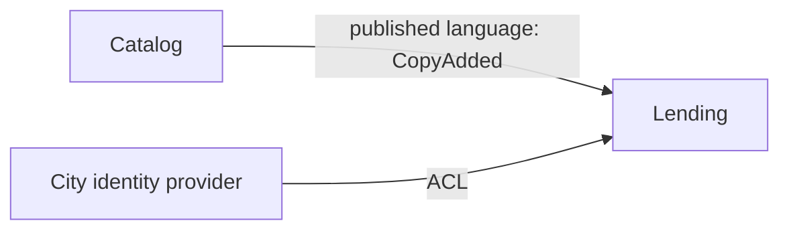

# File formats

Use these when the project has no format of its own. When it does (an existing glossary, context map, or ADR folder), follow its location, numbering, and template instead. Create files only when there is something to write.

## Glossary

`GLOSSARY.md` at the repository root. With a single context, terms sit directly under the title; once there are two or more, give each bounded context its own section, and let a term appear in several sections when it means different things in each.

```md
# Glossary

## Lending

**Loan**:
One copy of a book lent to a member, from checkout until it is returned.
_Code_: `Loan` (aggregate) · _Avoid_: booking, rental

**Renew**:
Push a loan's due date back by one loan period; allowed once, and not while a hold waits.
_Code_: `loan.renew()` · _Avoid_: extend

**LoanOverdue**:
The due date passed with the copy still out.
_Code_: `LoanOverdue` (event)

## Catalog

**Book**:
A title the library holds, whatever the number of copies.
_Code_: `Book` · _Avoid_: item
```

- One or two sentences per term, saying what it is in the domain, not how it is implemented.
- One word per concept, and the words not to use under `_Avoid_`.
- `_Code_` names the type, method, or event that carries the term, and its pattern when that helps (aggregate, value object, event, policy).
- Only the project's own concepts; general programming terms stay out.

## Context map

`docs/context-map.md`.

````md
# Context map

## Subdomains

| Subdomain | Kind | Depth | Why |
| --- | --- | --- | --- |
| Lending | Core | Full | Loan rules are argued over and change every term |
| Catalog | Supporting | Light | Titles and copies, mostly CRUD |
| Sign-in | Generic | Buy | The city's identity provider |

## Contexts

**Lending** (`src/lending/`): owns loans, renewals, holds, and fines. Not books' metadata, not members' accounts.

**Catalog** (`src/catalog/`): owns titles and copies. Not who has a copy.

## Relationships



| Upstream → downstream | Pattern | Integration | Notes |
| --- | --- | --- | --- |
| Catalog → Lending | Published language | In-process events | Lending keeps its own `CopyRef` |
| City IdP → Lending | ACL | OIDC | Translated to `Member` at the adapter |
````

## ADR

`docs/adr/NNNN-slug.md`, numbered after the highest existing one.

```md
# Lending is a separate module that Catalog can't import

Catalog changes weekly with the new acquisitions workflow, and Lending's rules are what members
argue about. Keeping them in separate modules, talking through `CopyAdded` events, lets each change
without retesting the other.

Considered: one shared `Book` model with loan fields (the optional-field sprawl we have today);
a separate Lending service (no team or scaling reason yet; revisit if a second team takes it).
```

- A title that states the decision, then one to three sentences: the context, the decision, and why.
- **Status** only when it isn't simply accepted: `superseded by [NNNN](…)` on the old record, `supersedes [NNNN](…)` on the new one.
- **Considered** when the rejected options are worth remembering, above all the ones the user turned down.
- **Consequences** only when the effects aren't obvious.
- A decision qualifies when a real alternative existed and a future reader would wonder why. Easy-to-reverse details and the only sensible option stay in the spec.
