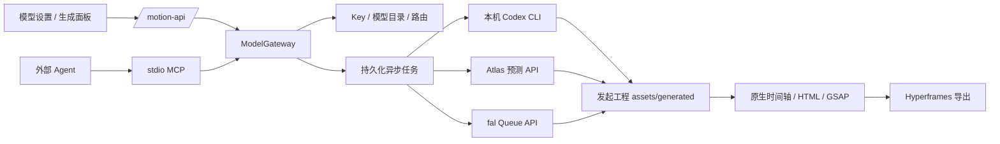

# Model Router / Gateway

Updated: 2026-11-15.

本文维护当前能力、接口和运行限制。跨模块的产品目标、对象归属、D1–D11 设计取舍、时间轴交互和扩展准入条件见 [素材生成设计与架构决策](product/media-generation-design.md)，整体分层见 [产品架构](product/architecture.md#职责分层与依赖方向)。

## 用户问题与交付边界

已有 Agent 用户需要在制作视频时知道哪些图片、视频、音乐或语音模型可以调用，并让生成结果继续参与手工编辑。此前只能自行生成文件后导入；Studio 与 MCP 没有共同的生成入口。

当前实现为工作区级 Model Gateway：本地 Agent 检测、供应商 Key、模型目录、默认路由、异步任务和素材落盘共用一个服务。工程格式、时间轴与渲染仍使用 Hyperframes。It does not itself run a conversational Agent; the [Assets conversation service](assets.md) orchestrates local Codex and submits library jobs through this same gateway; OpenDesign account authorization and subscription state are integrated through a separate connector.

在 OpenDesign 通用会话架构中，Gateway 服务于 Motion 产物：会话拥有产物，产物引用原生工程，生成任务固定该工程。模型设置管理工作区配置；The application rail opens a full settings center for providers, models and account connections in standalone and embedded editors.旧时间轴生成浮层保留为内部兼容接口。各入口复用同一 Gateway。创作模式与媒体模态、供应商模型的职责划分见[会话技术架构](session-architecture.md#会话编排与媒体生成的分层)。

验收条件：检测结果可解释；Studio 与 MCP 查询一致；真正生成的文件落在发起工程；可以预览、放入指定时段并撤销；重复提交、取消与失败不会产生静默重试；图片可以组合为可编辑工程并导出真实 MP4。

## Current editor and public MCP entry

The application rail and bottom account menu open the settings center. **Model providers** includes dedicated media adapters, the provider preset directory, custom connections and account models. Users can save/remove masked keys, enable providers, sync/search/filter models, add exact model IDs and select defaults. Environment keys remain separately identified. **Account** connects an OpenDesign identity, retrieves subscription/balance and synchronizes enabled models alongside BYOK. The existing OpenDesign Cloud origin/key configuration remains a separate connection. See [provider settings](provider-settings.md) for protocol coverage, private storage and account limitations.

The public `openmotion_media_use` Tool has inspect, reference, models, generate, status, cancel, retry_save and resume actions. The existing [shared material guidance](../skills/openmotion-production/references/materials.md#byok-provider-references) links to the provider references, including account and compatible API guides, available through action=reference and production workflow resources. Generate requires explicit projectId and stable requestId. Optional referenceAsset forwards one project-relative image to the existing capability-checked image-edit pipeline, including immutable snapshotting and project ownership checks. Dedicated media adapters can accept provider-native model IDs directly. Compatible/account generation uses registered or remotely discovered media models. The service reads credentials, constructs supported provider requests, persists the task, downloads and validates output, saves an immutable version in the local workspace asset library, and keeps an independent copy under the initiating project's assets/generated. Status returns libraryAssets (assetId/versionId) alongside the existing assets project paths. Saving failures retain complete local outputs and set savePending; action=retry_save with the original projectId/jobId and a stable requestId retries local saving only, without credentials, a provider request or another charge. Incomplete/interrupted provider generation is never resubmitted automatically. Poll the original job instead of submitting again. A completed task does not place media on the timeline; re-read current revision/version before editing project source.

fal, Atlas Cloud and WaveSpeedAI support image/video/audio model endpoints with model-specific parameters. Atlas Cloud reuses its prediction adapter; WaveSpeed submits to /api/v3/{model} and polls /api/v3/predictions/{id}/result. WaveSpeed discovery uses the saved key, while Atlas/fal catalogues are public. Environment alternatives are ATLASCLOUD_API_KEY and WAVESPEED_API_KEY. For speech, mode=text-to-speech maps the prompt to text. Cloud supports text-to-image, multi-reference image edits, text-to-video, first-frame image-to-video, speech (with returned timestamps) and music. Discovery preserves audio_speech/audio_music as separate modes; speech requires parameters.voice, while music sends provider-native parameters and the prompt to /audio/music without a voice requirement. Cloud uploads queued reference snapshots itself; other dedicated adapters do not upload local references. Parameters can include references already hosted according to the provider contract; local paths are not uploaded automatically.

Existing local Codex configuration, generation UI and legacy Gateway APIs remain internal compatible paths. Atlas Cloud is also exposed through the BYOK settings and public media-use tool. Default-route selection is available in settings and the application header; generation continues through the existing Agent and gateway interfaces.

## 能力状态与路由

| 状态 | 含义 |
| --- | --- |
| Agent installed | 发现可执行程序；不代表登录或支持生成 |
| authenticated / imageGeneration | Codex CLI 登录检查、功能开关检查通过 |
| provider configured | 存在本地或环境 Key；不证明权限、额度、余额有效 |
| available | 允许发起请求：供应商启用且本地能力通过，或云 Key 存在且没有已知拒绝 |
| verification unverified | 云 Key 尚无已记录的成功生成证据；公开目录不会验证 Key |
| verification verified / rejected | 云供应商生成请求返回过媒体结果，或收到 401/403；更换 Key 重置状态。验证通过不保证后续下载/入库或未来请求成功 |
| job completed | 文件已下载、类型校验并保存；不是仅收到远端任务 ID |

本地检测包括 Codex、Claude Code、Gemini CLI。当前只有 Codex 注册了本地媒体适配器，其他 Agent 的安装结果不会被当成生图能力。Codex 要求 CLI 支持 `--ephemeral`，`codex login status` 显示已登录，`codex features list` 的 `image_generation` 开启。使用用户已有 CLI 配置和登录，以独立临时工作目录运行 `codex exec`；不读取或复制 OAuth token，不调用私有后端接口。Success requires one newly created, regular raster file in the isolated job directory and the existing media-signature validation. The adapter reads bounded JSON completion/error events and relevant image-service diagnostics; it does not persist the raw CLI transcript. Reference files, stale outputs, symlinks and arbitrary paths in model replies are excluded. The CLI inherits the user's active Codex provider, endpoint and authentication configuration. A CLI login check does not establish image-service authorization. A proxy response of `personal engine key required` is reported separately from general authorization failures: verify that Codex `model_provider` selects the intended configured provider and that its endpoint and authentication match. Merely defining a provider does not select it, and signing in again does not supply a proxy key. OpenMotion does not edit Codex configuration or copy credentials. Other authorization failures direct users to inspect the active provider and account session without asserting that the login expired. No automatic retry or provider switch occurs.

请求中的明确模型优先，其次是该模态的默认路由，最后才自动选择可用的文本生成模型（图片优先本地 Codex）。已配置的路由不可用时明确失败，不自动换成另一个付费供应商。

`capabilities[].available` 表示至少有一个该模态候选允许请求；若配置的默认模型不可用，`selectedModelId` 仍可能缺失。调用方应同时核对所选模型、Provider 状态与具体操作能力。云 Key 的 `verification` 记录供应商侧证据；本地 Codex 使用安装/登录/功能检测和实际 job 结果，当前不会在成功后把该字段切成 `verified`。

Atlas / fal 通过公开目录发现模型，输出模态依据任务类别判定，例如 image-to-video 归为视频，image-to-text 不列为生图。保留标明来源的内置目录和最近缓存；目录访问失败显示原因，不伪装成实时结果。缺失端点可自行注册，目录查询按 `nextOffset` 分页。

## 结构与扩展

| 源码 | 职责 |
| --- | --- |
| `shared/gateway.ts` | 无凭据的 Model、Provider、Capability、GenerationJob 合约 |
| `shared/provider-registry.ts` | Shared registration metadata for dedicated media, compatible presets, account and local Codex; IDs, setup links, endpoint policy and credential environment names |
| `gateway/connections.ts` | Shared provider configuration, credential/endpoint resolution and default storage, retaining existing file layouts |
| `gateway/agents.ts` | 本地检测与 Codex 内置生图调用 |
| `gateway/catalog.ts` | 目录规范化、来源、模态识别与默认候选 |
| `gateway/providers.ts` | Atlas / fal / WaveSpeed submission, polling and supported remote cancellation |
| `gateway/network.ts` | HTTP 边界、响应脱敏、媒体下载与文件签名校验 |
| `gateway/service.ts` | 配置、路由、幂等任务、并发与工程绑定 |
| `studio/src/motion/gatewayClient.ts` | Studio 可复用的生成 API 客户端 |
| `studio/src/motion/MediaGatewayContext.tsx` | `openGenerator`、`usage` 与 `onComplete` 编辑器接入口 |
| `studio/src/motion/MotionTimelineMedia.tsx` | 选择范围与原生导入/放置的桥接 |
| `studio/src/motion/TimelineMediaBar.tsx`、`timelineMediaSelection.ts` | 片段/标尺/范围的上下文入口，项目素材定位与图片替换保护 |

Register dedicated providers in `shared/provider-registry.ts` and compatible presets through its imported preset directory. Dedicated media IDs derive the adapter-map type; implement `ProviderAdapter` and the provider's catalogue protocol without creating another configuration store or task queue. Account and CLI login remain separate authentication boundaries. Reference-image support still requires an explicit `supportsImageReference` declaration and an implemented adapter; model names do not establish support. Editor consumers may pass `usage: {compositionId, elementId, property}` and consume `onComplete`; only the timeline image-edit flow explicitly replaces its target. Complete films still require the Agent to generate assets, compose editable source, inspect and export.

## HTTP 与 MCP

所有 HTTP 写请求沿用本机 Host / 同源校验。

Studio 与 MCP 复用 `ModelGateway` 业务层及工作区文件，但不要求处于同一进程。`openmotion_generate_asset` 先确保工作区服务启动；HTTP 提交要求原生 Studio 服务就绪。持久化任务由 `server.ts` 的 worker 领取执行，关闭生成面板不会取消任务，本地服务停止则影响执行。

| HTTP | MCP |
| --- | --- |
| `GET /motion-api/models/capabilities` | `openmotion_get_capabilities` |
| `GET /motion-api/models` | `openmotion_list_models` |
| `PUT /motion-api/models/providers/:provider` | `openmotion_configure_provider` |
| `PUT /motion-api/models/routes/:modality` | `openmotion_set_model_route` |
| `POST /motion-api/models/custom` | `openmotion_register_model` |
| `POST /motion-api/generations` | `openmotion_generate_asset` |
| `GET /motion-api/generations/:id` | `openmotion_get_generation` |
| `GET /motion-api/generations?projectId=…` | `openmotion_list_generations` |
| `POST /motion-api/generations/:id/cancel` | `openmotion_cancel_generation` |

典型 Agent 流程：

1. `openmotion_get_capabilities` 检查状态；`openmotion_list_models` 取得模型键及生成模式。
2. 发起 `openmotion_generate_asset({modality:"image", prompt:"…", model:"codex:image-generation", idempotencyKey:"scene-1-image-v1"})`。
3. 轮询 `openmotion_get_generation({jobId})`。只使用 `completed` 且 `assets[].available !== false` 的素材。不要将任务 ID 当作文件。
4. 核对 job 的 `projectId`，读取该工程的新 revision，再将 `assets[].path` 写入 HTML 的原生 image/video/audio 元素。
5. 使用现有 lint、预览、导出和验证工具完成影片。

参考图修改使用同一 `openmotion_generate_asset`，增加 `referenceAsset:"assets/original.png"` 并选择 `supportsImageReference:true` 的图片模型。输入只接受发起工程内不超过 20 MB 的 PNG/JPEG/WebP 文件。提交时创建不可变副本并记录路径、SHA-256、字节数；原文件在排队后变动不会改变该任务输入。任务仍只生成新文件，MCP 调用方另行决定是否写入合成。

## 数据、并发与限制

Configuration, catalogues, jobs and staging files live under `MOTION_DATA_DIR/model-gateway/`, outside project source. `secrets.json` and `connection-secrets.json` are local plaintext credential files with `0600` permissions in private `0700` directories; no OS keychain is used. HTTP/MCP responses and project/distribution exports omit keys. Existing media adapters also accept `ATLASCLOUD_API_KEY`, `FAL_KEY`, `WAVESPEED_API_KEY` or `OPENDESIGN_API_KEY`. Saved keys take priority; an environment key can remain active after a saved key is removed.

- 任务提交时固定工程、模型和参数；切换当前工程不改变输出位置。前端的放置回调固定工程/合成，切换或卸载后拒绝旧放置操作。
- 凭据不进入任务快照；开始执行时读取当前供应商配置并复查可用性。服务关闭时中断本地运行，保留任务记录；当前不提供远端任务的自动续接或断点恢复。
- 图片替换还核对捕获的元素与原素材路径，并在源文件提交前再次检查。原图已被其他编辑替换、片段被删、合成切换或写入受阻时明确失败；不会覆盖新的选择。参考图副本在任务完成、失败或取消后清理。
- 最多 20 个待处理/执行任务，同时执行 2 个。工作进程消失后将运行任务标为中断，不自动再次请求供应商。相同工程与幂等键的相同输入返回原任务，不同输入被拒绝。
- 单任务总超时 15 分钟；Codex 子进程 10 分钟。取消停止本地执行和入库，fal 在支持时请求远端取消。Atlas and WaveSpeed remote tasks may continue running and billing.
- 下载仅允许公共 HTTPS（或媒体 data URL）；逐跳校验 DNS，禁止内网/本机目标，不将 Key 发送到媒体 CDN。限制大小 256 MB，并检查图片、视频或音频文件签名；Codex 文件另外限制 80 MB。
- 在工作区锁下将完整文件链接进目标工程并写完成状态；不修改合成，现有原生文件监听负责刷新素材库。源文件与素材的 revision 会随新增文件改变。
- 任务保留初始素材路径。之后在素材库重命名/删除，任务查询会将原路径标记 `available:false`；从素材库使用新路径。生成成功记录不会被改写成失败。
- Account subscription and available balance can be read from OpenDesign, with subscription management opened in its console. There is no cross-provider billing, price estimate, automatic paid retry or cross-provider failover. Entitlements and charges are decided by the actual account/provider.

## 验证与依据

服务端测试见 `tests/gateway.test.ts`；Studio 流程测试见 `studio/src/motion/MediaGateway.test.tsx`。真实账户调用与导出应在隔离工程中独立验收。云接口的协议测试使用受控响应；未配置云 Key 时不能将这些测试称为付费生图/生视频/语音的真实验证。

实现参考：本地 Codex Canvas 的能力目录与 Agent 检测分层，以及 [Codex Slides agents](https://github.com/nexu-io/codex-slides/blob/master/src/lib/agents.ts) / [image adapter](https://github.com/nexu-io/codex-slides/blob/master/src/lib/codex-image.ts) 的能力入口；本项目选用本机 CLI，不复制其中的 OAuth 私有接口方案。UI 参考用户提供的 Hyperframes Studio 截图，并复用仓库内 Hyperframes 0.9.7 的原生素材/时间轴逻辑。

供应商协议依据：[Atlas predictions](https://www.atlascloud.ai/docs/en/predictions)、[fal Queue API](https://fal.ai/docs/documentation/model-apis/inference/queue)、[fal 模型目录](https://fal.ai/docs/platform-apis/v1/models)，核查日期 2026-11-04。

## OpenDesign Cloud adapter

Cloud discovery is bound to the effective API key, origin and configuration revision in a private cache envelope. Missing or mismatched caches are refreshed on Cloud-specific model listing or explicit sync; general listings remain local so a slow Cloud connection cannot block other providers. Successful sync replaces the Cloud catalogue, including an empty result. Failures retain only matching cached rows, with a short automatic retry cooldown; explicit Sync models bypasses the cooldown. Legacy unbound Cloud rows are ignored. Late responses from an earlier connection cannot replace the current catalogue. Discovery never submits generation jobs.

For image models, only `capabilities.edits: true` enables references. Explicit `false` means unsupported for the current connection; absent or malformed values mean unknown. Unknown capability remains disabled and offers Sync models in Assets. Neither a model name nor generic image-input metadata grants editing support. Live capability fields survive custom label/default overrides. Assets reloads after provider settings changes without discarding the prompt, references or selected model; a removed model requires explicit reselection.

Cloud uses a workspace Bearer key and the supplied media API contract: authenticated models discovery, three-step uploads for reference images, image generations and edits, video tasks with an optional first frame, audio speech and audio music. Video jobs have a 30-minute local timeout (other media 15 minutes) because Cloud video can take over 15 minutes. Each remote submission sends a stable Idempotency-Key; task queries retain the returned task_id. Successful image/audio URLs are downloaded without API credentials; video content uses the same-origin authenticated content endpoint. Custom origins require public HTTPS, with validated and pinned DNS and no authenticated redirect forwarding. Queued jobs retain their Cloud origin and fail before submission if it changes. Local cancellation does not promise remote cancellation or refund. Cloud follows the workspace allowance/recharge billing policy; examples do not prove workspace entitlement or production rollout.

## Application settings and account boundary

The `/motion-api/settings/` endpoints expose the provider directory, custom connection CRUD, catalogue synchronization, model enablement and capability defaults. Account endpoints expose summary, login, cancel and logout. They share the existing Host/Origin write checks and never return keys. `connections.json` stores API connection metadata, registered models and language/embedding defaults; media defaults remain in gateway routes. Account runtime, CLI-owned credentials, session identity and cached models live under the data directory’s `account/` folder. The [settings guide](provider-settings.md) describes the exact boundary and connector installation.

`tests/provider-settings.test.ts` covers compatible catalogue protocols, key isolation, revision-bound queue execution and subprocess account authorization/media fixtures. `tests/byok-browser.mjs` drives the real editor HTTP server in an isolated Chrome profile. These deterministic checks do not prove live authorization, billing entitlement or paid generation acceptance.

## Audio operation selection

Audio includes speech, music and sound effects. Match the discovered model and native schema instead of treating every audio model as TTS. Speech and non-speech may use different endpoints, input keys and duration units. fal ElevenLabs SFX uses text while remaining text-to-audio; music uses prompt. Native parameters are preserved, with voice required only for speech operations that require it. Generic OpenAI-compatible connections still implement the standard speech protocol; this does not imply a portable music/SFX API for those connections.

## Model-specific creation controls

See [generation options](generation-options.md) for the shared Studio/MCP parameter profiles, native field types, model defaults, Codex reasoning controls and validation boundaries. Asset navigation and the creator can be resized by dragging or keyboard, with remembered widths.

## Original Cloud task recovery

Use resume with the original jobId and a stable requestId to check a failed/interrupted Cloud task with a known remoteId, without uploading inputs or submitting another paid generation. Cancelled jobs and confirmed remote failures cannot resume. Use retry_save only for retained local outputs (savePending); regeneration is a separate paid request requiring authorization. Studio offers Check original task on eligible failed jobs. Reference counts follow the selected model before any reference file is read; there is no fixed library count ceiling. Local Codex/account editing remains one image, video remains one first frame, and project referenceAsset remains image-only.

Cloud tasks keep bounded read retries (five attempts) and local timeouts (30 minutes for video, 15 for other media). Interrupted tasks remain failed until explicitly resumed; reconnection never retries upload or generation POSTs. Status and generated asset versions preserve bounded, redacted structured result metadata. Confirmed remote failures retain short error codes and retryable flags and cannot resume, even if the provider labels them retryable. Every returned output is saved with existing media validation. Non-empty parameters.images selects image edits; combining it with pinned local references is rejected before submission.
