# OpenMotion 产品架构

This document describes the standalone Motion runtime at the repository root. OpenDesign account access uses an installation-owned connector session; it does not share the main application's local credentials, sessions or deployment. See the [migration boundary](../repository-migration.md) and [account integration](../provider-settings.md#account-and-subscription).

Updated: 2026-11-18. Capabilities described as current are implemented in this repository. The public scope covers local creation/editing, MCP and standalone installation/distribution, with configured providers and external account services supplying model access.

The optional source-built [Docker Compose deployment](../../deploy/README.md) runs Studio, MCP and rendering in one local container with a persistent workspace volume. Compose publishes only on host loopback; Host/Origin validation remains browser protection rather than authentication. The default listener stays loopback, with `MOTION_BIND_HOST` allowing wildcard binding for containers. Compose identifies the running container through `MOTION_CONTAINER_NAME`; the Studio MCP handbook and connection downloads then generate host-side `docker exec` commands with the same container paths, data directory and port, instead of suggesting a second host installation. Local media must be mounted before import. The embedded web-browser tab remains unavailable because its Chromium sandbox cannot start under this container configuration; video preview and export use the renderer's existing behavior. Linux Chromium/FFmpeg versions come from Debian rather than pinned native targets. No container image is published, and this deployment remains outside npm/plugin distribution.

## 产品定位与目标

**对外主张是 Reverse engineering for any video：让用户的本地 Agent 成为全栈视频创作者。** 以参考视频和用户品牌为起点，研究叙事、镜头、动效与声音，用 HTML/CSS/JavaScript 重建可编辑工程，补齐素材并在同一 Studio 继续剪辑、预览和渲染。产品形态仍为 **All-in-One AI-native Studio for AI editing & Motion**；真人口播、原创制作、模板改编和局部改稿继续使用各自入口，参考重建不替代其他创作流程。

The optional source-checkout integration in `integrations/dsh/` can opt into `hostChrome=1` inside an iframe, hiding the application header, rail and project navigation while retaining the editor and its controls. Ordinary standalone pages retain their navigation. Its workspace dashboard, native Studio tab and MCP connection share one local data directory. DSH dependencies are installed separately and remain outside application distribution; model credentials stay in DSH. The maintained docs/install.md guide routes DSH workspace installation to one source installer that reuses locked dependencies/build fingerprints and preserves the current profile. Runtime activation and browser refresh are separate: a healthy MCP endpoint never establishes visible onboarding. Native onboarding uses DSH propose_action and opens the template library in the native right-hand pane, with the shared welcome and three recommendation cards in chat. DSH retains its branding, composer, tab chrome, resize handle and panel toggle; the plugin does not override the host grid or conversation layout. Template-card preview opens a local enlarged video dialog without sending a message, invoking the model or changing the right-hand tab. Release candidates seal a separately packed and scanned DSH tarball at the same application version and source commit. Manual application publication reuses those bytes and updates separate stable/test R2 download manifests after public verification; a built source runtime is still required. The independent main workflow updates only the development manifest. Retained pre-DSH candidates remain readable and never rebuild a plugin. DSH action-card support adds playable template recommendations in conversation, including the shared localized installation welcome and exactly three prepared IDs/order. The DSH installer enables the two native card components when absent, reuses inherited providers, and declares the frontend card-registry dependency before mounting its body. Server-side registration tolerates late service availability. Preview and selection carry the exact template ID into a user follow-up without creating a project. Other Agents receive the same card preparation and welcome; text with the same three recommendations is a fallback only for unsupported or failed card presentation. Project handoff after Agent creation is manual.

The application opens directly into the Motion editor, including `embed=1`, within a persistent left control rail and top navigation bar. The rail and header share one darker shell backdrop; the central workspace is an inset, rounded surface, white in the light theme and independently toned in the dark theme. Projects occupy a collapsible desktop sidebar; Settings replaces the central content while preserving the mounted editor and pausing preview playback. Settings includes Account, Subscription & usage, Model providers, Default Agent & models, Local Agents, General, Appearance, Privacy & data, Help and About. Users can create a blank project, work through an external Agent or use the template library. The initial project remains in the sidebar; first opening materializes the official `openmotion-welcome` template from `template-library/openmotion-welcome/` when its sources are absent, including after Agent-first creation. This 37.3-second, 1920×1080 welcome shares its maintained source with the library template, includes local artwork/audio and package-owned brand resources, and requires no catalog network request. npm retains the welcome’s exact shared font and Three.js dependencies, with their licenses, while keeping the optional Library showcase excluded. The initial project’s built-in name is “OpenMotion Sample Video” (“OpenMotion 示例短片” in Chinese), localized in all eleven interface languages across the project list, title and search. A persisted title key distinguishes that label from user names; explicit renaming clears localization, including when the saved name matches a built-in label. Legacy initial projects with the known default names adopt the label on read; other saved names remain unchanged. Language switching changes presentation only. Explicit New project actions continue to create an empty composition. Existing sources and legacy migration safeguards are retained. The underlying session, mode and Artifact model is retained, with Motion as the executable mode. Assets is an additional workspace surface, with direct media generation and a Codex-backed conversational runner scoped to asset work.

The **Brand Kit** rail destination extracts a public HTTPS website or imports a curated design system into a local style-only Motion Package. It shares the retained-editor pause boundary and opens a full-viewport collection using the template library’s masonry layout, introductory discovery tile, media cards, search matching, draft filters and sort controls. Surprise me selects from matching kits; Submit Brand Kit opens the repository contribution guide without uploading or publishing content. Collection search, filters and scroll position survive closing detail; previous/next follows the current collection order. Kit details open in a full-viewport dialog using the template library’s shared media stage, poster-to-video fade, loading/recovery overlays and independently scrolling information panel, with package actions, style inspection and previous/next navigation. Nested editors and menus keep their own dismissal boundary, and action feedback remains in the shared floating Toast layer. Rendering keeps measured styles visible; bounded, uncached status reads retain known data on failure and offer recovery. Its official collection bundles 152 design systems in 22 categories at a pinned OpenDesign revision. Discovery cards prefer OG and Twitter artwork from verified brand websites, followed by the first suitable image in page markup. The shared bounded public-HTTPS transport caches artwork outside the checkout and Motion Package. Catalogue kits have a locally generated style cover, and saved website extractions fall back to the captured screenshot or showcase poster. A persistent card footer links to the originating website or source design. Card playback starts on deliberate hover or focus, while detail playback retains the fixed brand showcase. Cover failures never block package preparation or change style-only semantics. Selection verifies canonical source hashes and creates a local editable package with a playable, sandboxed showcase. Initial catalogue imports do not start native video rendering; custom website captures and locally edited kits retain their render workflow. A Community catalogue is not implemented and has no navigation entry. Catalogue previews map representative tokens with system font fallbacks, while complete canonical design and token references travel with the package. Every kit uses the same 12-second brand-study showcase with different visual styling. The pinned public token/style extractors retain typography hierarchy, color usage, CSS variables, component variants, shadows, gradients and glass materials alongside a small showcase style mapping. Users review these measurements and multiple captured logos, add context files/folders and brand rules, correct styles, retry or cancel background jobs, download a verified package and copy a local-file Agent handoff. Context updates repack without rerendering; rescans preserve user context and style overrides. Uploaded files remain inert attachments with a hashed package inventory, not executable web content. Template structure and rhythm remain distinct from Brand Kit visual identity. Captured websites do not become Agent instructions; the brand data and authored showcase remain independent of application theme tokens. The route `page=brand-kit` opens the official collection by default. The optional `kit` value selects `mine` (saved kits), `new` (extraction), a saved kit ID or the explicit `official` alias. Public website capture, local package reuse and native rendering are implemented; automatic interpretation of uploaded PDFs, authenticated sites, hosted model enrichment and cloud sharing are not. Public capture uses isolated, bounded, DNS-pinned transport; proxy Fake-IP-only answers may be independently resolved with public DNS-over-HTTPS, while private/mixed answers remain rejected. The existing `openmotion_assets_use` tool exposes the shared Brand Kit library through `action=brand_kit`, with stable extraction receipts and revision checks for package selection and edits. See [Brand Kits](../brand-kits.md) for capture, security and verification boundaries.

The upper-left Back/Forward controls in the shell and template gallery traverse the current product visit, including settings, MCP and template routes. They share browser history and save guards, disable at the visit boundaries, retain their position across refresh, and discard the Forward branch after a new navigation. Only visit identity and numeric bounds are retained in tab-scoped storage. Individual template previews omit the global navigation/brand header and retain their close, previous-template and next-template controls; browser Back/Forward still restores preview routes.

Application navigation is URL-backed. `page=assets` identifies the independent asset workspace and preserves its mounted browsing and creation state when switching to other pages. `page=skills` identifies the Skills surface, with `skill` retaining the selected technique. Skills lets users browse upstream motion techniques, fill in a brief and copy an Agent instruction or connection command for an external Agent. `page=mcp` identifies onboarding, with `host` and `setup` retaining its client and setup method; `page=settings&section=…` identifies each settings section, with `provider` retaining a provider detail. The existing `templates=1` route also works from the rail and preserves its underlying page; `template` identifies an individual preview. Refresh, copied links and browser Back/Forward restore these destinations. Page changes preserve the mounted editor and its project hash, embedding and tracking context. Direct settings/MCP links do not require the retained native project to start; returning to the editor resolves that project normally. Project history changes still wait for saves, reject blocked transitions and restore the previous history entry without discarding Forward entries when both entries are owned by the application. Unknown page/section/client options fall back to the editor, General or Codex; missing template previews provide recovery. Search/filter drafts and unsaved forms are not serialized into links. See [workspace page routes](../editor-fork.md#workspace-page-routes).

Film planning and composition orchestration remain in external MCP clients. The Assets surface also runs local Codex app-server conversations in the product, with streamed replies, tool execution, approvals, persisted thread identity and cancellation. Both entry points use the same workspace asset operations and media gateway; neither implies a general in-app film-composition Agent.

MCP is the priority integration direction: creators work in compatible external Agents, while OpenMotion provides the persistent workspace for editable video projects, source files, assets and versions. Reuse comes from returning to saved work, adapting templates and continuing with another Agent connected to the same workspace. The MCP page serves as a visual handbook for these existing capabilities, with connection instructions, template entry points and task examples. This direction retains the current local transport and host compatibility boundaries; conversation context is supplied separately when changing Agents.

The editor toolbar offers **MCP** immediately before Export. Its non-modal popover identifies the current project and copies handoff details after pending editor saves complete. The brief carries the explicit project ID, workspace directory and local project/connection-guide URLs; it asks the Agent to read the latest content, preserve existing content and edit history, clarify missing edit requirements, and reopen the project preview. Revision/version checks remain part of the existing plugin editing contract. Copying neither starts an Agent nor verifies its connection. Clipboard denial exposes selectable text with floating feedback. The setup link opens the existing MCP handbook while preserving the editor's project route; switching projects dismisses the handoff. The initial interface copy supports English and Simplified Chinese, with English fallback for other locales.

Model Gateway is the shared media-generation backend for Studio and MCP. Generated-result placement, image replacement and cancellation use the shared Toast layer for operation feedback, while parameter validation stays in the form. Placement and replacement distinguish known refusals, project mismatches and unconfirmed writes; unconfirmed actions stay disabled for that open generator to prevent duplicate edits. Cancellation uses the returned job and subsequent polling rather than inventing a cancelled state; older polling snapshots cannot regress a newer terminal state. Eligible locally failed Cloud jobs can explicitly resume polling their original remote task through MCP or the existing Studio job card, without another upload or generation submission; worker interruption never automatically requeues them. Bounded, redacted result metadata is retained on jobs and generated asset versions. It retains local Codex and dedicated cloud adapters, adds registered OpenAI-compatible image/speech connections, and accepts OpenDesign account media through a separately installed connector. OpenDesign Cloud BYOK discovers speech and music separately and submits them to their respective audio endpoints; both share audio task polling and local asset saving. The public project media Tool also accepts a project-relative referenceAsset for implemented image-edit models, reusing immutable input snapshots. Audio execution follows the model operation and native input schema, including sound-effect models whose text field is not speech. The settings directory includes 68 provider presets, searchable capability categories, authenticated catalogue sync, manually added models and capability-specific defaults. Provider filters combine category, status and protocol; model filters combine type, capabilities, input modalities, status and source, with grouping and sorting. Model editors save names, groups, classification, token-limit metadata and default request parameters. Cloud live catalogues are credential/origin-bound and replaced on successful sync; Assets reloads capabilities after provider changes and distinguishes unknown image-edit support from an explicit denial. Live Cloud capabilities survive presentation/default overrides. Metadata overrides survive catalogue sync; per-request media parameters override saved defaults. OpenAI, Anthropic and Gemini catalogue protocols are implemented; language/embedding/reranker choices are saved configuration for future Agent integrations. Dedicated OAuth, local-network and vendor-specific protocols remain explicitly unavailable until integrated. Local Agent settings separately manage a registry of 29 CLI clients, install/login guidance, supported CLI/ACP model discovery and a persisted default Agent/model. Launch preparation quotes the selected model into a supported CLI flag or supplies it in a connection instruction; opening a terminal does not verify the external Agent connection. See [Local Agents](../local-agents.md) for discovery and platform limits. The gateway remains responsible for media jobs; the separate asset conversation service orchestrates local Codex through its app-server protocol. See [provider settings](../provider-settings.md) for supported operations, account installation and verification boundaries.

已确认的体验原则：

- Agent 与用户操作同一份工程，修改能在工作室继续编辑。
- The control rail provides one Home entry, Assets, templates, Skills, help, settings, a provider brain icon beside settings, a dedicated MCP plug, and an anchored account menu. Home toggles the project list in the current workspace without replacing the mounted editor. When the desktop list is collapsed, hovering Home previews the same searchable project navigation in an anchored, non-modal floating panel without changing the editor width. The preview reuses the pinned sidebar’s width, full workspace height, theme surface and internal spacing, and tracks the workspace bounds on resize. The preview remains usable while moving into it or typing in its search; pointer departure, outside click or Escape dismisses it. Clicking Home or the hover preview’s sidebar control pins the list open. The pinned sidebar’s same control collapses it again, preserving the shared search and mounted editor. Search state is shared between the pinned list, preview and mobile drawer. Returning from Settings through Home, Back to home or the persistent top-right Close settings button opens the project list; the sidebar close control and Alt+B remain available. The top-left sidebar control collapses the control rail, project list and settings navigation together, releases their width to the content, and preserves the mounted editor, project search and prior project-list state when expanded. Navigation width transitions over 200ms with a brief opacity fade; collapsed controls are immediately inert and excluded from assistive technology. Reduced-motion preferences disable transitions. The full-navigation preference survives reloads; the control remains available in the header at every width. The desktop project sidebar starts open at widths of at least 1000px; below that width it becomes a modal drawer, initially closed, with outside-click/Escape dismissal. Settings navigation becomes a compact section selector on smaller screens; provider list/detail becomes a drill-down below 680px. The opaque account menu opens Account, Subscription & usage, Appearance, Help and Settings; its language submenu updates the same persisted interface locale as General. What's new and Feedback link directly to the repository Releases and new-Issue pages, with the same destinations in Help and About. General retains language and Agent-connection setup. General, Help and About open the MCP connection page; Local Agents remains the separate settings destination for installation detection, official download links, CLI sign-in, model discovery and a project-scoped terminal handoff; the template library remains a separate destination. Workspace reachability is checked independently of the external Agent connection, and local stdio limitations are explicit for ChatGPT cloud. Project rows retain creation/switching save guards. Project navigation updates browser history in place, preserves the application header, rail and project sidebar, and remounts only the project viewer after native-context validation. Loading remains centered within the reserved workspace content; the prepared editor does not repeat the connection splash. The keyed viewer initializes under one inert loading surface using only the prior editor’s measured chrome geometry, then reveals after its own preview/timeline readiness, scoped status and layout settlement. Initialization suppresses control-color transitions; later editing, errors, loading and layout changes remain live. Visible startup failures bypass the presentation wait, and a five-second fallback exposes the existing slow-load/retry UI. Browser Back/Forward uses the same save guard before replacing the viewer. Settings and project navigation are available from empty/error editor states.
- An empty, loaded root composition shows a centered import/drop prompt over the mounted preview and hides transport controls, including the placeholder duration. The empty state requires both no timeline clips and no authored preview content; loading, failed previews and nested compositions retain their existing states. Import uses the existing timeline gateway and file-drop pipeline. The empty timeline retains its drop target and ruler, with a muted dashed track sketch instead of a duplicate import prompt or button. Empty timelines disable zoom controls. A confirmed empty composition blocks new exports at both the settings button and the shared editor render-start handler, while existing export history remains available. Properties distinguish no content from no selection and show guidance when a selected layer has no available controls. Composition reference hosts resolve to their parent source file, while their internal layers resolve to the referenced file; small panel empty states share muted text and icon sizing. Preview zoom percentage and Fit sit in the MVP preview header, outside the picture. Clicking the percentage opens 50%, 75%, 100%, 150% and 200% presets in a compact opaque menu. The MVP hides the corner position navigator; existing zoom gestures and Fit remain available. Browser fullscreen is unavailable in the MVP, including its playback button and keyboard entry; workspace preview expansion remains available as Immersive preview, with Escape restoring the editing layout. Playback controls respond to their own container width: secondary-button gaps narrow below 420px; below 300px they move to a second row so timecode, playback, volume, speed and loop remain reachable. Preview and track volume use upward floating vertical sliders, opened by hover or keyboard focus; clicking the speaker still toggles mute. Editor controls share one neutral hover background for both ordinary and selected states, including visible keyboard focus and highlighted menu items. Primary Export actions retain their dark action hover surface. Disabled controls share one foreground token without per-control opacity, and never gain hover feedback. Official animation-library controls use shared semantic theme roles; template artwork and timeline clip bodies retain their content presentation. The enabled play/pause icon uses the same action-color token as the header Export background, including hover.
- The composition list places the full video first, preserves the remaining clip order, and marks the live preview target. Queued, loading, missing and failed covers share a muted gray OD placeholder without failure text; decoded covers replace it automatically. A confirmed empty root is omitted from this list using the same loaded-preview content check; when no clips remain, the panel shows a brief empty state. The MVP omits the duplicate preview breadcrumb; composition switching and existing return shortcuts remain available.
- The application header owns the sidebar control, clickable 104px OpenMotion wordmark that switches to the shared compact symbol in narrow headers, with shared hover/focus feedback, Back to home action in settings, localized community link, GitHub star badge with a 10K fallback and provider/model selector. The nested editor toolbar is 32px high, with a content-sized editable project name centered independently of the controls on either side, automatic-save status on the left, and undo/redo, version history, layout and export on the right. The template library has one entry in the left application rail, identified by a clapperboard; the provider entry uses the same sparkle icon as the model picker, while a separate plug opens MCP onboarding. The toolbar does not repeat either the template entry or sidebar toggle, and shares the preview transport’s flat panel surface and subtle separators. Clearing the title and committing with blur or Enter saves the localized Untitled default; Escape cancels. The community link and GitHub star badge with a 10K fallback sit beside the model selector in the application header; the community link opens the public Feishu group for Simplified Chinese and the public Discord community for the other supported interface languages, with the matching logo, while the star badge opens the OpenMotion repository. External links open separately from the editor. The GitHub badge uses the official circular mark, a border and the same 28px height as Export. Application and editor header controls share a 6px radius. Narrow layouts retain the link icons while hiding the star count and model-selector text. Undo, redo and version history form one visual group with 4px internal gaps, followed by Export. A decorative 1px by 16px divider in the shared border color sits between history and Export without moving the buttons; it hides with the history group on narrow screens. Version-history empty text reads No edits yet in a subdued tone. Save status is event-driven and project-scoped: confirmed native file writes update the displayed save time, existing history supplies its initial value, and failed writes retain an unsaved state until the affected write recovers or the user discards it. Existing edit queues save incrementally; a 15-second check drains staged source, property and DOM edits without blurring the active input, overlapping an active edit/flush, or rewriting clean files. Rendering, history restoration and write guards suspend this check. Hidden pages stop periodic work and attempt one pending-only drain when backgrounded; abrupt browser termination cannot guarantee completion. This is an additional drain of the existing native save path, not a parallel project snapshot or history store. Workspace and export failures show concise causes and available next steps, with raw diagnostics behind expandable, copyable details. Workspace connection failures show one brief feedback toast per outage at the top center with a Reconnecting message and no buttons or diagnostic details. The notice expires after three seconds, or disappears earlier on recovery; repeated failed polls do not renew it. Automatic polling continues independently, waits 1.8 seconds after each completed attempt, has no overall retry limit or explicit per-request timeout and does not start a stopped service. Other notice dismissal does not bypass write guards. Editor toasts stack at the top center; editor, connection and template-copy feedback share a top-layer host inside the active native/shared modal focus boundary and above ordinary overlays, without taking focus. Template-copy feedback uses the shared top-center placement and three-second lifetime; identical notices replace their previous instance. Error toasts use the compact neutral feedback surface and concise recognized causes, with a dismiss button and no details icon or expandable diagnostics. Detailed error panels retain their diagnostic controls. Every toast without an operation expires after three seconds followed by the shared exit animation, regardless of error/info tone or feedback presentation; a close button alone does not make it persistent. Only toasts with explicit actions such as Undo, Retry or Download have no automatic timeout and remain dismissible until completed or displaced by the bounded stack, isolate action identities and prevent duplicate execution while pending. Action failures produce timed error feedback while leaving the original action retryable. Save-queue pauses use a brief, localized feedback toast without paths, diagnostics or a retry action; it expires after three seconds without clearing the write guard or claiming that failed edits were saved. Help also offers both README invitations, with Feishu first in Simplified Chinese and Discord first in other languages.
- The template library fills the current browser viewport with a single immersive video gallery, an introductory random-discovery action, persistent search, horizontal video-purpose categories, industry browsing, shared design-system radio menus for sorting and an icon-only, right-aligned multi-facet dropdown beside sorting. The non-modal grouped panel uses category tabs and a two-column grid, preserves draft choices across groups, previews their match count, and commits through Apply; dismissal discards the draft. Group clearing and clear-all retain the independent search. The TOP 100 brands capsule immediately after All filters the gallery to templates with published brand metadata without opening a menu. It shares the existing capsule surfaces and uses the design system’s bold serif collection title, green-to-theme-foreground text gradient and semibold brand label, with the full label set in italics. It switches directly with All and the video-purpose capsules; search and other facets still narrow the results. Purpose labels emphasize product launches, company introductions, fundraising, demos and campaigns. Localized catalog use cases normalize to stable discovery labels; reviewed funding entries retain a distinct purpose across locales. Published industry metadata takes precedence over a conservative brand-based browsing map; unknown brands remain unclassified. These discovery groupings do not rewrite source catalog metadata. It does not duplicate featured entries. Cards retain author avatars and reveal title, creator, duration and editability on hover or keyboard focus. One intersection observer budgets at most eight visible, muted looping previews (four on narrow screens); offscreen cards, hidden tabs and open detail dialogs release media sources. Autoplay has no toolbar toggle. Reduced-motion preferences disable gallery autoplay; data-saving connections require deliberate hover or focus. Surprise me samples the current results without consecutive repeats when alternatives exist. Published brand metadata supplies catalog logos in repository, hosted and CMS modes, with bundled legacy fallbacks and an initial when a logo fails. Repository metadata drives the source-checkout list; hosted main snapshots and cache updates drive NPM installations without the source catalog, while the website retains its CMS publication. The catalog selects the editor locale from a shared multilingual publication, falling back to English and then the Resource default; template-copy prompts support the same eleven UI languages. Previews, author/source links and editable-project opening remain available. Filters use non-modal shared dropdown menus with immediate results and individually removable condition chips; selecting multiple values keeps the menu open and leaves gallery playback active. A full-window detail dialog places a large video over a blurred poster backdrop beside an independently scrolling information panel; narrow screens stack these regions. It includes author/source, duration, template instructions, clickable metadata, related templates and previous/next navigation within the current result order. Related entries are ranked by shared brand, styles, use cases and tags. Hovering or keyboard-focusing a related card opens one enlarged, muted looping preview over the stage, with its title overlaid; clicking still opens the selected detail. The floating preview stays within the native dialog and viewport, moves above or below its trigger on narrow screens, and releases its video source on dismissal, scrolling, backgrounding or template changes. Reduced-motion preferences and missing video URLs retain the poster; failed or timed-out playback offers a retry without changing the selected template. The motion.md download action (`motionDocumentUrl`) remains above the collapsible guide content (`styleDescription`, `reviewFocus`, `motionGuideUrl`), with the guide iframe mounted only on expansion. Readable HTML guides adopt shared light/dark chrome inside the opaque-origin sandbox; nested demo artwork remains unchanged. Relative resources resolve against the final response URL and any authored base URL. Hosts that disallow CORS retain the original remote iframe. Template instructions remain separate from authored guidance. Recreate copies its Agent brief directly and reports success through the shared floating Toast viewport without changing detail layout; clipboard failure exposes selectable text in the same detail panel and a floating failure notice. A quieter Recreate and submit action copies a contribution brief for the exact selected template. A highlighted Submit video link opens the existing GitHub contribution guide. Every detail links to its repository source directory when registered, and the gallery and editor headers share a GitHub badge. Star counts come from the public repository API through a single in-flight request, a five-minute persisted cache and a one-minute failure cooldown; fresh cached counts remain usable; a 10K fallback is shown when no valid count is available. No action uploads media or creates a PR automatically. Gallery surfaces, controls, borders and frosted media surroundings use the shared design system in both light and dark editor themes. Shared semantic skeleton tokens reserve catalog, poster and instruction geometry while content loads; failed posters keep a title fallback, and failed detail video or instruction loads offer inline retry. Video duration stays in metadata without a duplicate stage badge. Catalog metadata is not represented as an original author prompt or publication date when those fields are absent.
- The asset panel shows only the current project, with compact search/import controls, type filters, and a dedicated scrollable list. Image and video thumbnails reveal a compact lower-right quick-add button on hover or keyboard focus (always available on touch), with a 95%-opaque dark surface and no artwork scrim; audio and font rows offer the same shortcut at the right edge, with a smaller 24px button and 14px plus icon for compact font rows. Fonts insert an editable three-second text clip bearing the font name, with a unique local font-face alias, through the shared serialized insertion/history path. The shortcut it uses the existing add-at-playhead operation without opening preview, blocks duplicate pending clicks and reports failures through the shared Toast layer. Delete remains in the asset actions menu. User-uploaded audio rows in My assets retain filenames with their original extensions, wrap within the panel for at most two lines and ellipsize overflow; hovering reveals the complete name only when truncated; the generic Audio label is omitted, while duration and specific BGM/SFX/Voice labels remain when available. Official library sources are unchanged. Official animation-library cards reuse the composition list’s muted gray OD placeholder when preview media is absent or all available preview media fail; healthy posters and videos retain their existing behavior, and catalog entries remain available. Assets referenced by the current composition carry an In use badge (已使用 in Chinese); unused assets have no badge. MVP My assets deletion invokes the existing file-deletion handler directly from the menu, without a second confirmation; the full editor retains its confirmation. This does not introduce a new undo mechanism or alter official catalog assets. Usage filtering is omitted; used assets sort first within each type, with the latest explicit library import temporarily revealed first. The single upload menu offers local upload and exact-version library import. Library import refreshes and verifies the owning project’s native file list, clears hiding filters and shows a floating success notice only after the imported path is available. Refresh failures remain retryable without repeating the copy; late completions cannot update another project. The picker preserves the sidebar layout. In both My assets and the official animation library, hover plays only the card thumbnail, while clicking opens a centered modal preview over a gray full-editor backdrop. The modal reuses Studio-styled playback, volume and speed controls; its play button stays centered, and secondary controls wrap in very narrow players to avoid overlap. Volume and loop icons are 16px inside 28px buttons, and playback speed text is 12px; closing it restores access to the paused composition; previewing media does not add it to the project. The global cache view remains in source but has no editor entry in the MVP.
- All supported content-insertion drops share persistent timeline feedback, including project images/video/audio, the composition list, official catalog items dropped on the timeline or preview, and local files dropped on the timeline or editor shell. Accepted drops immediately show a transient loading clip, including in an empty timeline; it remains until the saved clip appears, and failures remain dismissible at the placement. New loading rows reserve display space but remain unavailable as edit targets until discovery supplies their authored identity. Selected trim grips sit on the clip borders, with distinct hit targets even on short clips. A local-file batch immediately creates one loading clip per file, retains matching identities for accepted uploads, and refreshes the preview once after the batch saves; rejected files retain the upload handler's existing error feedback. Uploads retain the existing single multipart request. Catalog insertion buttons and overlays use the same state instead of progress toasts. Feedback resolves known row collisions before its first paint, reserves row geometry and scroll extent while loading, and settles to the saved host identity and measured duration. Unknown media durations can still require collision resolution when probing completes. Drop times come from the pointer on occupied, empty and newly opened lanes, using the same measured origin and centered row geometry as the ruler and clips. Editing a displayed spill row materializes distinct authored tracks within its source file and media zone in the same save transaction; existing visible lanes, timings and canvas stacking remain unchanged. A locked peer that would need renumbering refuses the operation. Discovery alone never rewrites authored tracks. Repeated drops remain independent. Composition insertions and catalog installs queue their writes; switching composition or project invalidates queued insertions and old selection changes. Known drag metadata bypasses duration probing, and concurrent requests for the same project asset share one in-flight probe without coalescing insertions. Unreadable durations fail visibly instead of inserting a five-second clip. Placeholders never enter project source or undo history. Drops on the Assets panel import files without inserting timeline content and retain that panel's importing state.
- Panel positions are fixed. The workspace uses continuous flat surfaces with thin resizable dividers, without outer panel padding, gaps or rounded card borders. A horizontal divider separates the main header from the panel tabs. Export settings and render history live in a compact popover below the header Export button, outside the right panel. Both side groups can temporarily collapse into 48px vertical icon rails, giving their width to preview; the rail toggle restores the previous width and tab, while a module icon opens that module. Collapse does not remove panels or remount the player. The MVP initially shows collapsed sides and sizes the timeline to its track content, toolbar and footer, capped at 42% of the dock height while reserving preview space. Wrapped narrow-screen controls contribute to the measured height. A deliberate pointer or keyboard divider resize stores a per-project pixel height; resizing the host clamps that preference without replacing it. Fit timeline to content returns to automatic sizing. Side visibility records user intent independently from responsive fitting. Newly opened sides use fixed defaults of 200px for the library and 230px for the inspector when no saved preference exists. Collapsing and reopening a side restores its last manually chosen width; temporary responsive compression does not replace that preference. Width fitting accounts for each actual expanded column and only 48px for a collapsed rail, then compresses expanded sides before preview when space is insufficient. As the editor narrows, expanded sides shrink proportionally through their available slack to a 160px library minimum and a 200px inspector minimum before preview gives up width. Manual divider drags may reduce preview to 240px independently of its preferred responsive width. Composition badges wrap beside thumbnails; narrow inspector names use the default arrow cursor and wrap to at most two lines with ellipsis. Full-label tooltips appear only while the text is truncated and disappear when resizing makes it fit; controls retain their alignment. Font names truncate and narrow slider labels sit above the track. Long translated dock tabs truncate within the scrollable strip and expose their full titles in tooltips only when clipped; composition names, paths and audio metadata use the same overflow check. If both expanded columns cannot leave 240px for preview, the less recently opened side temporarily becomes an icon rail. Below a 448px dock width, both icon rails remain visible with disabled expansion controls and a screen-too-small tooltip; the timeline retains its requested visibility. At widths that fit one side, both rails remain enabled: opening one automatically collapses the other when both cannot fit. Between 448px and 487px, the wider inspector may reduce preview to 200–239px so switching remains available. Collapsed groups retain their tabs, manual widths and state. Enlarging the editor restores the requested sides and preferred widths, while deliberate collapses remain collapsed. Resizing preserves the same mounted player and open modules. Divider hover and drag change only the thin line to green. The header Panels and layout menu remains available at every width. It activates or collapses each side module, independently shows or hides preview and timeline without unmounting them, offers Focus preview and Restore default layout, and restores the timeline to its content height. Hiding preview distributes its space between the open side panels; hiding all upper panels leaves the timeline available. Hiding the last visible timeline restores preview so the workspace cannot become empty. Restore default layout also resets side widths. The default editing preset expands both sides only when space permits. Explicit visibility and manual timeline height are remembered per project; responsive rearrangement does not overwrite those stored preferences. Panel positions remain fixed and tabs are not removed. Preview alone can temporarily expand within the editor workspace, keeping the host chat visible and the player mounted. Its header button or Escape restores the previous layout and playback position; expansion is not persisted across reloads.
- The MVP official animation library exposes Use in the lower-right corner of each card cover on hover or keyboard focus, without a separate action row; touch devices keep it visible. Pending and result states remain visible. Media previews use the same short action label in the upper-right header immediately before Close, without a separate footer action row. Clicking inserts at the composition playhead, on a new top visual track or the top of the audio section. Preview playback remains independent. Add actions show pending/failure feedback and use the existing serialized save and undo path; drag placement keeps the chosen drop position.
- MVP controls share a locally bundled Remix Icon 4.9.1 set with the reference design system. Menu selections consistently use check icons, and the language menu is 180px wide. Expanded side-panel tabs remain text-only; collapsed rails use the corresponding panel icons. Brand artwork and timeline geometry are separate from control icons.
- The editor startup shell and project/editor loading boundaries share a centered, theme-aware OD symbol without adding a minimum loading delay. Preview startup follows the runtime’s media preload policy: deferred clips do not block the first frame, metadata-only media waits only for metadata, and eager media retains its playable-data check. The asset-wait fallback measures elapsed time so throttled background timers cannot extend it by counting delayed polling ticks. Below 700px of workspace content width, the editor header stays on one row: undo/redo and version history hide, while layout and Export remain at the right edge. The editable project title stays centered and truncates when necessary; on very narrow hosts the save indicator retains its accessible status and tooltip while hiding its text. The global header retains product identity and model selection. Timeline tool groups wrap as needed. The MVP timeline toolbar omits the duplicate Import action; importing remains available in My assets and through file drops. Narrow player controls wrap into two rows when needed, retaining playback speed and loop controls. Short editor hosts reduce the preview height floor to reserve a complete track below the toolbar and ruler. The color picker constrains itself to the viewport with a scrolling body and a persistent close control.
- MVP audio-bearing tracks expose a single speaker button before visibility in the track header: click toggles mute, while hover or keyboard focus opens a compact volume slider, writing every audio/video clip in that row through native saves and undo. Video visibility remains separate, and preview-monitor volume remains a playback preference. Clip-count badges are omitted to make room for these controls. The audio-meter toolbar toggle, meter display and audio FX entry points (track presets, group effects and inspector rack) are omitted in the MVP. The media inspector exposes speed, media start, loop and Fit; Fit uses the same shared menu surface as font controls. It omits the source-path row, Position, path-copy, cutout controls, gain/volume automation, speed automation/presets, audio fades, mute and audio-track toggles. Color fields retain their selected preview until an asynchronous save settles, and roll back on rejection. Existing authored media/audio values remain intact, with track mute and volume available in the timeline. Track audio controls use cached source audio-track detection independently of mute and gain; unknown video sources retain controls until confirmed silent. Track volume sliders cover 0–100% and show effective zero output while muted, retaining the saved volume for unmute.
- The MVP timeline starts with a 132px track-control column, capped at one third of its measured viewport, with a 104px floor and no intervening gutter. Its vertical divider supports pointer dragging, arrow-key adjustment and double-click reset, remembering a preferred width up to 320px per project without overwriting it on narrow hosts; ruler, clips, playhead clipping and drag-scroll bounds share that origin. A continuous tinted control column, continuous 1px subtle column divider matching the workspace separators, track-type icons, row borders and subtle major-tick grid distinguish track controls from clip content. Sparse track groups center vertically below the fixed ruler, with balanced space above and below; overflowing groups retain normal vertical scrolling. Rendering, virtualization, selection, drag and external-drop hit testing share the same centered row geometry. Content-fit sizing uses intrinsic track height, excluding this viewport-dependent padding, to avoid resize feedback. In both themes, the empty timeline well, track lanes, control column and ruler use distinct shared surface roles. The ruler corner shows the live timecode through an isolated playback subscription. Track headers use icons instead of visible clip names, with names retained in tooltips and accessible labels. They expose visibility, audio mute/volume when applicable, lock/unlock and deletion. Track deletion removes only that row, leaves linked partners on other tracks intact and uses the native save/undo path; locked or cross-source rows refuse deletion. Lock changes immediately update move/trim capabilities and survive undo/redo. Controls wrap within the row on narrow hosts. The full editor retains its 232px label column. MVP timeline clips omit visible name bands, giving their space to thumbnails or waveforms. Videos with embedded audio show video frames only; independent audio clips retain waveforms. MVP fade handles are hidden while authored effects and trimming remain intact. The MVP also omits clip peak warnings, their red waveform marks and warning tooltips; waveform previews, audio controls and export audio processing remain available. Ruler ticks and labels move by translation during zoom animation so glyphs never inherit horizontal scaling. A shared solid downward-pointing playhead marker meets the green line without changing timeline coordinates. Track headers, hover titles, accessible clip names, the FX badge and track visibility controls remain available. Volume badges are omitted in the MVP; the track speaker retains the volume readout.
- Missing audio sources remain on the timeline and show a localized Media unavailable notice (素材已失效 in Chinese) when their waveform or source request returns 404/410. Other waveform failures retain the separate waveform-unavailable message; loading is not treated as failure. Both notices use a readable single-line badge with truncation and a hover tooltip. This presentation does not remove clips or change asset deletion, playback or export policy.
- Export history shows the filename and relative export time, without render-duration metadata. Filenames use 12px medium text, dates use 11px text with 4px top spacing, and the text block reserves an additional 8px before download/delete actions; long filenames truncate with the full value available on hover. Export offers native MP4, MOV, WebM and GIF. MVP GIF exports always loop indefinitely and omit the loop-count setting; the full editor retains custom loop counts. GIF retains its 30 fps limit. MOV uses a short format name; ProRes appears in the MOV format help. WebP is omitted from the format menu because its encoding backend is not implemented.
- The MVP omits the standalone timeline title strip to give its space to tracks, retaining the tool row and ruler.
- The MVP shows standalone Select (V) and immediate Split (S) actions. Split cuts eligible selected clips, or all eligible clips intersecting the playhead when selection is empty; invalid, locked or out-of-range selections never broaden the cut to unrelated tracks. Toolbar and keyboard use one guarded atomic batch and one undo entry, with repeat/overlap suppression. The MVP removes the blade dropdown and disables its keyboard entry. Split and Snapping (N) tooltips show only the action and configured shortcut; snapping uses a shared magnet icon. Tooltips add a short explanation for less familiar controls while simple actions retain a name-only hint. Overlay surfaces share subtle entrance motion; Base UI popovers and media-preview dialogs also retain their surfaces through a short exit. Tooltip hover delay is 200ms, with instant keyboard-focus hints. Reduced-motion preferences disable overlay transitions; dock expansion keeps its separate animation.
- The MVP does not open an Agent prompt or media-action popover from clip selection, time-range selection or ruler clicks.
- 模板先展示真实成片效果；作者、出处、内容种类和有来源的热度帮助选择。
- Template copy uses the same localized creative brief for repository and CMS catalogs, with the public GitHub repository installation link, the selected template title/ID, the requested HTML/MP4 deliverables and an empty requirements section. Internal template-reading steps remain in Agent workflows. Local connection guides remain available for workspace setup.
- Agent-assisted setup starts with the public GitHub README and the appropriate source or published installation guide. Its copyable instruction remains available while local discovery is loading or unavailable; it asks the Agent to reuse an existing installation/workspace, install or start only as needed, and verify actual tool access before opening the library. Exact machine-local configuration and downloads remain gated on live integration discovery. Setup does not authorize project creation or editing.
- 导出成功需要真实产物与验证证据；技术检查与画面、声音、播放器检查分别记录。

## 对外主张与 Motion.md 方向

The application and repository retain the **OpenMotion** identity. Website metadata uses **OpenDesign Motion — The fullstack agentic video editor**, with localized descriptions of motion creation, media and voice generation, editing, animation, reference recreation and brand video templates/design systems. This presentation does not change runtime capability or catalogue-coverage boundaries. README pages place the centered logo above the cover and retain a plain-text OpenMotion heading before the introduction. The cover and footer share the same identity. OpenMotion is on `main` in `nexu-io/openmotion`; daily development branches from the latest `origin/main` and PRs target `main`, following the [shared branch rules](../../AGENTS.md#repository-collaboration-instructions); the `motion` plugin identifier and environment variables remain compatible. The public workflow is reference → analysis and reconstruction → brand adaptation → multimodal generation → editing and rendering. It emphasizes editable HTML video, BYOA / BYOK, presenter stories, editable projects and the Motion.md community. English, Simplified Chinese and Japanese READMEs share examples, media and stable section anchors. README localization is maintained independently of the Studio interface, which currently supports eleven languages.

Codex plugin metadata and generated adapters provide the existing brand symbol in light/dark variants. Direct MCP initialization advertises the same embedded icons with protocol `2025-11-25`, without a remote asset fetch; earlier protocol revisions omit icons. Host rendering and refresh remain separate from package and protocol validation; see [adapter metadata](../agent-adapters.md#codex--claude-code).

“任何视频”是工作流的创作范围表述，不保证任意输入的获取、解析、还原度或传播结果。参考获取与媒体分析依赖宿主工具和用户材料，生成效果依赖模型配置，成片需按参考、简报与实际视听结果审阅。README 的发布部分明确区分当前 MP4 手动交接与规划中的平台连接、排期和反馈。外部产品来源和比较统一放在 README 最后的 Acknowledgements，技术依赖与具体出处仍保留在专题和源文件中。

AI 剪辑的当前路径是：用户提供素材、脚本或确认的时间码，外部 Agent 根据选段、删改、排序、字幕、声画与节奏要求修改真实工程，用户在 Studio 预览并继续调整；Configured ASR now supplies source-relative transcripts through the shared service; semantic selection and visual understanding still depend on Agent capabilities and reviewed material. 对外介绍以 OpenMotion 本身与创作者的完整工作流为主，Hyperframes 作为技术来源在文末致谢，具体依赖继续在技术专题中准确记录。OpenMotion is a standalone application. External Agents use Skills, MCP and the pinned CLI to operate the same local project; the Assets surface additionally supports an in-app Codex conversation runner through shared asset operations. Full-film orchestration remains in external clients. 核心原则是人和 Agent 共用作品、经验沉淀为规范和模板、源文件可检查与可延续。仓库已采用 [Apache-2.0](../../LICENSE)，保留上游组件与字体声明；这取代此前“统一许可证待确认”的过时状态，依据见 2026-11-06 的公开记录。

The public workflow remains **Input → Process → Output**: local video/audio/images, recorded speech, online references, text and SRT/VTT → shared transcription and caption review, Agent editing and composition design → pinned MP4s and editable projects. Transcript imports SRT/VTT; the timeline Record control captures microphone audio, while online retrieval remains host-dependent. Platform export is an Agent handoff in the Export panel: users choose an icon-labelled platform and a shortening, highlights or full-video adaptation goal, configure canvas, duration, highlight count and caption policy, then copy a brief bound to the saved project and workspace. The Agent duplicates the source, edits independent copies through the existing MCP operations, previews them and exports fixed-version MP4s. Suggested canvases are editorial targets; dedicated platform encoder presets and direct publishing remain unimplemented. Video remains the default native export workflow, with advanced settings disclosed on demand and a scene selector only when multiple compositions exist. Captions provides direct SRT/VTT download from the saved native timeline. The MCP main handbook exposes the same shared brief with explicit source selection, dependencies and the manual upload boundary. See [platform export stories and verification](platform-export.md).

[媒体事实包](../media-kit.md) 是面向报道、演示与内容 Agent 的可引用入口，区分可验证能力、产品方向和待验证主张。现有资料不能证明“99% 还原”或“覆盖 Claude Motion 几乎全部核心模板”；资源数量与来源仍以目录快照及逐条出处为准。

[Motion.md](../motion-md.md) remains explicit creative context for an Agent. The [Motion Package v0.2 draft](../motion-package-spec.md) adds a portable folder contract around that context: a manifest declares the motion/design entries, optional Skill, exact dependencies and hashed file inventory. New packages prefer `MOTION.md`; explicit paths retain existing `MOTION_DESIGN.md`, `MOTION.md` and gallery `motion.md` documents. The local `packages/motion-package` toolkit checks manifest structure, local paths and hashes, refreshes declared hashes and copies a verified inventory into a new directory. The toolkit does not parse creative prose into animation, lint upstream design/Skill semantics, resolve dependencies, auto-discover arbitrary packages or register Studio templates. The Brand Kit feature explicitly authors and validates style-only packages through this toolkit. Native HTML/CSS/JS projects and the video-to-template route's single `TEMPLATE.md` handoff remain unchanged.

Motion.md assembles the creative context through references. Its Design section links an independent `DESIGN.md`, preserving that document's visual tokens, prose and upstream tooling. Its Brand Kit section owns product facts, approved claims, voice and material permissions; existing `BRANDKIT.md` can remain linked material. Motion-specific timing and deliberate video adaptations belong in MOTION.md rather than a duplicated design token tree. Package design affects authored content, not the shared editor design system. The toolkit includes an original Product Story recipe with two fictional presets and a deterministic shot-plan helper; it is not an animated project or evidence of rendered visual acceptance. Its small toolkit, schema and sample are explicitly included in distribution, without new core Skills, installation behavior, MCP APIs or a registry.

### Motion Design Skill 包：从参考到可复用资产

Motion Design 的资源单位进一步明确为“创作规则 + Agent 方法 + 可编辑实现 + 替换输入 + 对比证据”。`MOTION_DESIGN.md` 记录保持项和运动意图，`SKILL.md` 记录使用方法，源码执行动画，preset 记录本次内容；真实 reference/remix 对照记录结果。参考片缺少源码时仍先走 `openmotion-recreate`；已有源码复用走模板路径；用户明确需要可复用模板时继续使用 `openmotion-video-to-template` 和其 `TEMPLATE.md` 交付，不新增核心路由。

[`openmotion-design-remix`](../../library/skills/openmotion-design-remix/SKILL.md) 是可选 Library Skill，包含六个已经收录为 registry 资源的上游动效源码 profile、各自的 Motion.md、可执行内容替换脚本与实际并排渲染示例。它固定上游源码版本、校验替换次数、拒绝覆盖已有输出，不解释 Markdown、不自动分析视频、不接入模板注册表；对托管工程的修改仍遵守现有 revision 契约。The six profiles remain separate from the four bundled native templates and five core production Skills.

[`openmotion-presenter-story`](../../library/skills/openmotion-presenter-story/SKILL.md) 补充知识口播、工作流演示和产品讲解三份 Motion.md 设计配方，采用“真人语音主线 + 源片段到输出时间的映射 + 字幕 / 画中画 / 动效叠层”的构造。它没有人物素材或可执行模板，展示的三组真人前后对比为目录已有的上游演示，不是新 Skill 的验证结果。README 还展示九条真人视频参考。

[`openmotion-growth-teardown`](../../library/skills/openmotion-growth-teardown/SKILL.md) 是可选 Library Skill：从公开资料整理一家公司的增长动作、指标曲线和三招可复制打法，生成九幕增长地图视频的 HyperFrames 源码和由画面事件驱动的合成配乐。所有数字和动作必须带来源；它不增加 MCP Tool 或核心制作路线。

[`openmotion-design-styles`](../../library/skills/openmotion-design-styles/SKILL.md) 是可选 Library Skill：提供 21 种设计风格和 2 种布局的风格卡（色板、开源字体、规则、动法、禁忌），以及计划校验和子集字体下载脚本，让 Agent 把内容按指定风格做成 HyperFrames 视频。风格要点参考 guanmo-ai/design-style 整理，文字为原创，不含其代码、图片或成片；它不增加 MCP Tool 或核心制作路线。

[实例说明](../motion-design-examples.zh-CN.md) 区分已有源码的改编与任意原片的重建；帧采样渲染证据不替代 Studio 导出、声音、目标机器或用户视觉验收。包内保留源码许可和字体声明。工作副本将 CDN / 字体替换为已收录的本地资源，原始源码与哈希保留；浏览器、Node、FFmpeg 等执行工具仍另行安装，不声称任意跨引擎可执行。借鉴 [MotionGit](https://motiongit.com/spec) 的内容、运行时、分发分层，并不构成 `.motion` 格式兼容。社区可以通过普通文件与 Git 分享、Fork、改进和评审；自动 marketplace 入库、数据回流学习与 RAG 仍为方向。

[Motion 资源索引](../collections/README.zh-CN.md) 已可使用，区分可观看参考与可编辑模板；OpenDesign 官网展示案例，公开的品牌／榜单专题集合站仍在规划。Motion Benchmark／Arena 为待讨论规划，无已发布榜单、排名或确定日期。

### Presenter Tech 本地模板包

[`library/templates/presenter-tech/`](../../library/templates/presenter-tech/README.md) 收入可再分发的固定版本源码包，提供本地 `.motion` ZIP、参数 / 运行器 / 字体 / 声音配方、Motion.md、制作指南与来源记录。公开展示名为 Presenter Tech，原始 Kinetic Tech 身份、MIT 版权与第三方条款保留在包内及 NOTICE；不主张上游模板为 OpenMotion 原创。

此条目使用包内 `adapter.py` 的 plan → prepare → preview → render 路线，依赖安装和输出均在 checkout 外的独立目录。它不是直接写入 Hyperframes 原生时间轴的模板，也没有新增 Studio `.motion` 解析、MCP Tool 或核心 Skill。This local Library package is separate from the four Studio-native templates and the 895-entry combined discovery catalog. Source integrity, local runner checks and human content acceptance are recorded separately in [verification.json](../../library/templates/presenter-tech/verification.json).

### README 与示例资源闭环

The [local resource contract](../readme/RESOURCES.md) covers the four English, Simplified Chinese and Japanese README files and their linked scene, comparison and collection media. It also covers the assets, browser scripts and fonts needed by six Motion Design projects, four showcase components, four Studio-native templates and the Presenter Tech package. README artwork and optional Library previews above 100 KB use immutable public R2 URLs registered in `repository-media.json`; small artwork, catalog assets and browser dependencies remain ordinary Git files. Full reference/demo videos and the optional Presenter Tech archive retain their paths and exact identities in Git LFS, with downloads excluded by default and scoped pulls documented in [repository storage](../repository-storage.md). Complete bundles hydrate those resources explicitly and reject unresolved pointers; selected Library handoffs require downloaded media. Materialized editable compositions retain local browser dependencies after hydration. Public README display URLs require internet access, even when optional local originals have been restored. Shallow clones avoid old history; this migration does not rewrite it. Transferred optional media is registered in `repository-media.json` and can be fetched by scope with `media:pull`; existing LFS media retains its original paths and identities. External official campaigns remain explicitly linked.品牌案例的来源与校验值另见 [展示清单](../readme/brand-showcase/manifest.json)，架构图的封面同款视觉、创作流程与 Motion.md 内部品牌层级见[图示及生成记录](../readme/diagrams/ARTWORK.md)；文字架构继续保留可检索的模块职责与边界。Resource checks validate local references, registered public URLs and original hashes; composition capture blocks non-loopback asset requests.All distribution formats retain a positive file list. The 895-entry discovery catalog remains an index; the selected local resources do not imply that every catalog entry is mirrored. Initial tool installation, cloud models and upstream websites remain outside the offline-resource promise.

### 创作资源与贡献架构

[`library/`](../../library/README.zh-CN.md) organizes reusable source resources into Skills, templates, Motion components, motion design systems and Brandkits. It contains the optional Brandkit Skill, six Motion Design Remix profiles, three Presenter Story recipes, the Growth Teardown research-to-film Skill, the Design Styles library (21 styles and 2 layouts), 96 single-style recipe Skills (talking-head overlays, narrated explainers, product promos and ads, brand and covers, motion effects and editing methods), each also listed on the Studio Skills page, an index of the four native templates, the title-reveal recipe, Ink & Water `MOTION_DESIGN.md` and the OpenMotion `BRANDKIT.md`. Native template sources remain maintained once in `template-library/`; indexing them does not add a second template registration.

Library resources are explicitly selected by users or Agents. The Brand Kit collection adds a maintained, pinned design-system import path; arbitrary package discovery, automatic template registration and a synchronized remote marketplace remain outside this boundary. Brand Kit extends the existing `openmotion_assets_use` MCP tool through `action=brand_kit`; the number of registered tool names stays the same. These Library resources do not change the five core production Skills or the workflow registry. Library 内的 Brandkit、Presenter Story、Motion Design Remix 与 96 个单风格配方 Skill 可分别选择使用，服务品牌整理、真人叙事设计、具体源码改编或单一画面风格，不增加核心制作路线。 Canonical Library folders own the only resource copy. The standalone installer and complete ZIPs include only canonical Library entries. The helper removes a retired forwarding folder only when its complete file hashes match the shipped original; customized folders, additional files and symlinks are preserved and reported for manual review.

Motion documents coordinate design references, brand facts, story, timing, sound and review. Components describe local reusable behavior; templates contain implementations; Skills describe methods. Independent design/brand documents can be reused through explicit references without duplicating visual definitions. The Library links the portable-package toolkit and sample without adding a second maintained copy. Contributions follow the [entry checklist](../../library/ENTRY_TEMPLATE.md) for provenance, license, editable inputs, status and actual verification; new distribution files remain individually allowlisted. References, recipes and verified editable works retain distinct evidence levels.

README 参考 OpenDesign 的产品导览和 HTML Anything 的贡献、来源表格与文字架构图。对外视觉采用统一蓝绿水墨肌理、奶油白留白与深色字体，详见 [Brandkit](../../library/brandkits/openmotion/BRANDKIT.md)；真实产品截图和参考作品保留原貌。该美术方向不改应用 UI tokens、工程格式、模型行为或价格。

### AI 原生时间轴：当前能力与产品方向

Constant video/audio speed edits in the media inspector preserve the selected source range by changing both playback rate and clip duration in one native undo transaction. Main-track magnet mode shifts subsequent clips by the duration difference, retaining existing gaps; optional main-track linkage carries eligible overlays with those clips. Other lanes retain neighbour start times and bound an extension to the available gap with a Toast. Linked audio/video members share the operation when Linked Selection is enabled; locked affected members refuse the transaction. Constant-speed edits pin the current timeline scale and synchronize saved timing through the existing soft-preview diff and runtime rebind, preserving the live media elements; unsupported diffs fall back to reload. Variable-rate automation remains a separate envelope-editing operation. Agent source edits use the existing revision-checked project tools and must explicitly author the corresponding timing changes; the source-save API does not infer retiming from a rate attribute alone.

核心产品是围绕时间轴持续改稿的 AI 剪辑应用。素材、叙事、图片替换、动效、声音与导出都归属同一份可编辑工程；Agent 执行剪辑意图，Studio 保留人工调整入口，导出使用固定版本。参考 [OpenChatCut](https://github.com/0xsline/OpenChatCut) 的连续编辑理念组织公开说明，本次未引入其代码或移植其能力。

| 产品主线 | 当前已实现路径 | 已确认方向，尚未实现为通用能力 |
| --- | --- | --- |
| 智能剪辑与组织 | 导入、排列素材，Agent 根据脚本/时间码落实选段删改与节奏要求，用户在时间轴调整 | 自动理解并选择内容、去除无关段落、按发布目标自动适配画幅 |
| 素材生成与搜索 | 配置 Model Gateway 后生成图片、视频、音乐和语音；参考图编辑、候选入库与显式替换保留时长和动画 | 跨媒体、配音、音乐与 Avatar 服务的资源搜索和统一选用 |
| Multi-platform input and output | Local media and host-supplied references; platform briefs copied to Agents for shortening, highlights or reframing in independent projects; fixed-version MP4 delivery | 更广的平台解析/导入、自动格式适配与平台导出预设 |

图片编辑的现有实现仅承诺支持参考图的模型路径，不将图片替换泛化为任意视频、音频或人物替换。模型配置与真实生成效果分别验证；Search catalogues, Avatar services and platform publishing remain future capabilities. Configured ASR and transcript/caption workflows are implemented below; general visual understanding remains host-dependent.

### 人与 Agent 协作创作空间 — is coming

已确认方向是在同一视频项目中支持人和 Agent 共同进行 AI 剪辑与 Motion 创作，并把评论、讨论、协作和评审关联到时间轴的具体时刻或范围，形成“反馈 → 修改 → 评审 → 继续迭代”的空间。README 的水墨协作图为生成式概念预览，保留 **Concept preview** 标记，正文明确其规划状态；它不是当前界面截图。

当前人和 Agent 可以先后修改同一份本地工程，沿用 revision 保护；时间轴评论、协作评审与多人同步编辑尚未实现。评论归属、修订关联、并发合并和协作状态的具体技术契约仍待设计，不能从概念图推导为已交付能力，也未承诺发布日期。

### 两个 Agent 接入方向

[README 产品演示](../../README.md#product-tour) 展示当前模板库、单模板详情和复刻指令，连接线上参考、Motion.md 与用户自己的 Agent。真实截图及使用步骤见[产品演示说明](../product-tour.md)。

- **从应用连接 Agent：** 用户先在 OpenMotion 打开工程，再通过 Connect Agent 为当前工作区配置 Codex、Claude Code 等客户端，将工程上下文和要求交给客户端执行，回到 Studio 审阅并继续改稿。
- **从 Agent 使用 OpenMotion：** 用户先在已有客户端安装 Skills、连接 MCP，按需使用 CLI；由 Agent 创建或读取工程、剪辑、预览与导出，随时打开同一 Studio。

Both project entry points share project data and service contracts. The separate Assets conversation runner uses the same asset operations as external MCP callers and is currently limited to Codex. Human and Agent project work must target the same workspace and explicit project, read the current revision before writes and retain conflict protection. See [Agent adapters](../agent-adapters.md) and [workspace assets](../assets.md) for current coverage.

## 目标场景与交付

| 场景 | 用户输入 | 期望交付 | 当前支持方式 |
| --- | --- | --- | --- |
| AI 口播剪辑与素材重组 | 录制素材、脚本/时间码与剪辑目标 | 精简、重排、配合字幕和声画的可编辑短片 | 外部 Agent 依据输入修改工程，Studio 预览与时间轴细调；媒体理解依赖宿主能力 |
| 产品演示与发布 | 产品事实、页面/素材、参考视频 | 可编辑的宣传或功能演示视频 | Agent 写原生工程，Studio 调整，后台导出 |
| 模板复刻 | 选定参考、模板 ID、主题替换要求 | 复用结构与风格的可编辑工程 | 模板清单、短指令、画廊/指引和 `openmotion_create_project` |
| 动态图形与信息表达 | 数据、文字、品牌元素 | 图表、流程、字幕和动画片段 | 原生 HTML compositions、GSAP 与素材 |
| 后续修改 | 已有工程、具体修改要求 | 保留工程上下文的局部更新 | 共享 edit 流程、当前源文件与 revision、保持项及后续延续检查 |

Agents reconstruct external references after analyzing their video or source; a catalog reference is not itself an editable project. Four bundled native templates, including the official welcome, and editable Prism publications can create independent project copies. The [template catalog](../template-catalog.md) documents catalog size, cover coverage and popularity metadata.

## 核心用户流程

1. The user creates a blank project or opens an existing one from the sidebar, asks an external Agent to create a project, or chooses a template in the editor. Bundled templates create independent project copies; external references require Agent reconstruction.
2. Successful Agent-led installation opens the editor template library in the current conversation without creating a project. Codex plugin setup invokes a packaged onboarding Skill through `extensions.com.openai.onboardingSkill`; that entry reads the same installation-success contract as npm/source setup, opens the calling chat’s right panel and uses the welcome copy matching the observed library/cards. The onboarding entry lives outside the five production Skill folders and is separately included in the Codex manifest’s Skill roots; otherwise the host resolves its onboarding metadata to null even though the document ships. The five production routes stay unchanged. The desktop’s setup offer/start is a separate host action; registered onboarding metadata is not proof of automatic display after Install. `openmotion_open_preview({target:"templates"})` returns a project-free page handoff; when the current chat has not loaded MCP, setup's `onboarding.preview` provides the same page URL and handoff after preparing the headless local service. The host presents and observes the library, or provides the actual link when browser/panel capability is unavailable. The library prepares the current saved project's scoped editor behind its modal; closing the library removes the templates query in place and reveals the same editor without document navigation or remounting. The legacy first-run placeholder defers native initialization until dismissal, so browsing alone still does not create a project. Preparation does not switch the workspace's active project or download template project source. Only the user's Open and edit action or explicit Agent creation request selects an exact template and creates an independent copy; Agent continuation reuses a GUI-created project. Preview startup failure does not undo successful registration or create fallback work. Registration and a prepared/queued URL do not prove active-chat loading or visible presentation. No invitation telemetry/state service is introduced. See [installation replies](../install.md#installation-success-reply) and [first-run defaults](../../skills/openmotion-template-to-video/references/first-use.md#first-run-experience-defaults). When native discovery is missing or stale, setup returns direct installed MCP commands that let the same chat continue without a new chat or restart. The client reads the selected host configuration and enforces ownership, enabled/tool policy, version and workspace before public calls; it preserves request deduplication and revision/version guards and does not claim to reload native discovery. User recovery instructions appear only when permitted access paths fail.
For catalog discovery requests (browse, compare or recommend), the template route prepares `openmotion_open_preview({target: "templates"})` and follows its page handoff in the same turn, respecting explicit text-only/no-opening preferences. The host must verify the visible library; prepared/queued URLs are not display success. Browsing preserves project content and selection and does not authorize template-source downloads, creation or export. Candidate recommendations use the current connection's catalog. Only a request to use a selected template enters creation. See the shared [browsing policy](../../skills/openmotion-production/references/templates.md#browsing-and-recommendations).
   Native MCP Apps connections can additionally present three previews chosen from the approved builtin examples and catalog references with the optional read-only `openmotion_show_template_recommendations` adapter extension. It is available only after explicit per-connection MIME negotiation and local resource verification; the domain API and non-UI discovery remain exactly sixteen names. Cards use bundled complete MP4s or existing content-addressed public reference-video URLs, muted looping playback and an immutable content-hashed presentation resource. The media policy allows Blob URLs and the exact public CMS media origin; preparation makes no shared-backend call, template download or render. Reference playback requires internet access. Cards remain in a compact three-column layout. A persistent top-left media badge displays the localized video purpose from the verified catalog record's `original.promotionalUseCases`; missing values are omitted, while the bottom-right enlarge-preview action stays separate. The badge uses the shared design-system media-label recipe and remains visible on narrow layouts. The Agent passes the latest user request’s language (or explicit output-language preference) as `language`; the seven-language card dictionary covers the welcome, descriptions and controls, while `shared/template-prompts.ts` supplies the same localized unsent brief as the template library, overriding host locale while preserving canonical template identities and media. Current installation onboarding uses `onboarding:true`: the maintained welcome appears above exactly three full-video cards in the persistent conversation component. Ordinary recommendations omit the flag; recovery after an already displayed welcome can use false for cards only. The result binds its negotiated immutable resource URI and recommendation-specific widget session. Library opening does not require detailed content or playback inspection. The component omits duplicated template descriptions, and the final welcome adds no verification/status paragraph. The Recreate template action appends the exact template title/ID and an editable brief to the active composer using the negotiated OpenAI message extension with send=false. It does not submit a task; unsupported hosts copy the brief to the clipboard and show a floating copied/paste Toast without a second input field. Only the user-sent brief enters the existing template or reference-recreation Skill and request-deduplicated creation/export path, honoring user requirements and attachments instead of legacy frozen sample defaults. Presentation never creates/selects a project, and redisplaying cards never authorizes a duplicate copy. When the current chat has not natively discovered the extension, the library and text path above remains usable; CLI direct access cannot substitute for native UI mounting. Host menus and display timing are outside the component's control.

3. `openmotion_open_preview({projectId})` opens the project directly. Project switching waits for pending saves and replaces only the project viewer after validating its native context, preserving the application shell. Opening a bookmark warms only its scoped native context without switching other editor tabs. Rendering and write conflicts continue to block unsafe switches. Original creation, reference recreation and template production automatically open the saved project before delivery; the open editor is the deliverable, and video files are handed over only when requested (video-to-template still delivers its template ZIP). Continued edits and restores return a project/revision/version-bound previewHandoff. Reuse the native project tab: present it when the calling chat is active, otherwise queue it without switching chats and resolve the latest version when the user returns. Only this turn's explicit `presentation=now` request permits switching back; explicit background requests suppress presentation. Codex IAB synchronizes visibility within the calling chat. A queued acknowledgment does not establish chat inactivity: hidden/unavailable panels retain presentation recovery, and only host-confirmed inactive-chat deferral waits for return. First delivery uses the same visibility checks; hidden automation playback, markDeliverable and export success do not complete editor delivery. A queued acknowledgment is separate from observed visibility and live-content freshness; `record_display` rejects stale content identities, and stored previewDisplay remains historical host-reported evidence. The shared [editable preview handoff](../../skills/openmotion-production/references/native.md#editable-preview-handoff) defines readiness, host checks and capability limitations.
4. Agent 根据本轮目标直接选择 Skill：openmotion-director 负责原创、局部/整体叙事动作声音重新设计和创作审片；openmotion-template-to-video 负责已有模板出片；openmotion-recreate 负责参考作品重建（已接入实际流程、独立参考与测量脚本）；openmotion-video-to-template 负责可复用模板生产；openmotion-production 承接既定决定下的工程操作、预览、技术检查、排错和导出。共享规则同源引用，已有 production/start 保留导航，无需前置总路由。项目来源与画面锁定不固定入口；保持项和已完成操作继续有效。
5. The Agent imports or generates media through the existing backend. In the editor, the user imports assets, edits text/solid color/opacity, previews, and edits clips on the timeline. Element, clip, time-range and official animation-library Ask Agent entry points are hidden in the MVP; users can continue requesting edits through their external Agent. Text controls include headings with explicit line breaks and preserve those breaks when edited. The MVP omits the layer-count heading and Add text field controls. Unselected off-canvas elements have no dashed markers in the MVP preview; selecting an element, including from Layers, retains its selection boundary. Text selections omit the separate Style group and background-fill control; element opacity remains in Text. For opacity-animated elements, the MVP opacity control saves an independent CSS filter multiplier, retaining the authored fade and existing static filters rather than writing over the animated opacity channel. The multiplier is part of project source, so preview and export use the same value. Other element types retain their Style controls. Generation, image replacement, advanced style/animation controls, code and inspector Layout settings are hidden without rewriting existing source content or removing Agent capabilities.
   Element deletion compares direct DOM lookup results before and after a simulated deletion, preserving receiver scope and detecting structural-selector changes in surviving inline scripts before either SDK or REST mutation, including computed static method names and legacy JavaScript MIME types. A dependency, dynamic lookup or unparseable executable script refuses the deletion with localized feedback and leaves source and history unchanged; files with executable inline scripts also refuse ambiguous or scoped hf-id handles because SDK and REST resolution can differ. Ordinary GSAP selector cleanup remains delegated to the native engine. This is a conservative guard, not arbitrary JavaScript rewriting or cross-file dependency analysis.

6. 完成画面、文案、声音检查后，按用户要求导出固定 revision 的快照，等待真实产物并验证。

An explicit HTML/MP4 request for an unchanged editable template follows the [unchanged file-delivery branch](../../skills/openmotion-template-to-video/references/unchanged-export.md), also exposed as `openmotion://workflow/template/unchanged`. It preserves the template source and completes any required editor normalization before pinning the revision/version. Immutable export, packaging of that same version and host presentation can then proceed concurrently. Technical verification and actual final-file full playback, seeking and replay remain required; editorial redesign is scoped to requested changes. Presentation recovery is bounded and its result is reported separately, so a display failure does not prevent delivery of verified files or imply that the editor was visible.

后续需求应注明改变了哪一步、影响哪些角色，以及用户能观察到的完成条件。

Project audio rows show a circular audition control, filename, usage status and clickable application intervals in the active timeline. The complete runtime clip manifest includes media inside collapsed sub-compositions; hydrated host rows supply source-file identity when the runtime omits it. Intervals use actual clipped timeline windows rather than source-media duration, and separate references remain independently selectable. Multiple uses collapse to a count that expands to the individual ranges. Clicking an interval stops audition, opens its owning composition when needed, waits for its rows, selects the referenced clip and seeks in that composition's clock. Pending navigation is discarded across project changes. At every panel width, usage information aligns directly beneath the filename in the text column; the audition button spans the heading and details on the left, and the actions menu stays at the heading’s right edge. Narrow text columns wrap status and intervals below the filename instead of moving them beneath the audition button. Used audio omits the duplicate file-duration readout; unused audio retains its duration. List waveforms and their peak requests are removed; detailed audio previews retain their existing visualization. Native audition still resumes a paused source, resets the previous source when switching and stops for full previews, project playback, hidden pages or row cleanup. Drag, rename and context-menu actions remain available, with failures reported through floating Toasts.

Audio asset previews use a compact 640px-wide, 280px-high dialog with 81 thin monochrome bars, mirrored horizontally and vertically. A live Web Audio spectrum drives stationary peaks with fast attack and slower release. The display fits the occupied frequency range, adds small shoulders around peaks and gates amplitude by measured RMS; it is an audio-reactive visual treatment, not a calibrated frequency plot or a scrolling sample history. Silence settles to a flat baseline. The neutral seek track and circular play control remain scoped to audio previews. Bars update during playback and freeze on pause; the existing seek control remains the time reference. The dialog uses the existing asset kind without probing or reclassifying media containers. Asset categories, composition source and video-thumbnail rendering remain unchanged. Video and image previews retain their existing layout. Analysis shares the preview's media element, volume, rate and loop without downloading or playing a second copy. Unsafe cross-origin sources retain native playback with an unavailable visualization; capture starts only after the audio context is running. Closing or replacing the preview releases its animation and audio graph, including development effect replays.

Asset selection, acquisition and replacement use the shared [material policy](../../skills/openmotion-production/references/materials.md) across all five production routes. Source priority is a host-Agent decision within existing workflow scope and user constraints; this does not add a search/generation backend or trigger acquisition for preview/export-only work.

## 职责分层与依赖方向

产品由“创作决策、素材执行、原生编辑、成片交付”串成完整流程。Agent 和人都可以提出修改，但媒体模型、编辑器与渲染器各自只承担本层工作。新增能力应先明确落在哪一层，再确定入口；不能因增加一个按钮就建立另一套工程或任务状态。

| 层次 | 当前负责的决定 / 工作 | 对下一层的交付 | 设计边界 |
| --- | --- | --- | --- |
| 创作与意图 | 用户或外部 Agent 明确目标、参考、分镜、文案及是否采用结果 | 可执行的素材描述、模型选择或工程修改 | Gateway 不负责判断影片主题与分镜是否正确；创作宿主的聊天模型与媒体模型分别配置 |
| 产品交互与接入 | Studio 捕获选区、属性和工程；MCP 暴露同一业务能力；skill 提供制作与验收顺序 | 带工程/上下文的生成请求，或带 revision 的源文件操作 | UI 可提供参数预设，凭据与远端媒体请求集中在 Gateway；MCP 和界面不是两套产品后端 |
| 能力与素材执行 | Router 选模型，Gateway 检查状态、排队、调用适配器并入库 | 发起工程内可用的图片、视频或音频文件 | 一次素材任务不自动修改合成，不代替完整影片编排；目录、可请求与真实成功分别表达 |
| 原生工程与编辑 | Hyperframes 管理片段、时段、布局、动画、声音、预览、保存和历史 | 可以继续编辑的原生工程 | 素材采用通过现有写入链；不新增平行时间轴或将生成界面状态当作工程真源 |
| 渲染与交付 | 固定 revision 快照、后台渲染、技术检查与视听/播放器验收 | 对应该快照的真实 MP4 和证据 | 模型产物、编辑成功和最终影片完成是三个不同完成条件 |

能力发现回答“有哪些可以尝试的执行方式”，素材执行回答“这次拿到了什么文件”，编辑回答“文件怎样用于作品”，验收回答“交付物是否符合任务”。这些边界使用户既能单独通过 MCP 生图/生视频，也能把多个素材组合成完整 motion 视频，而无需为每一种使用方式重新实现供应商调用。

### 应保持的架构约束

1. **Shared capabilities for MCP and product interfaces.** The confirmed development rule is that every new or extended core capability supports external MCP calls. Product controls and in-app Agents compose the same API or MCP operations according to developer and user needs. Transport adapters converge on one maintained domain implementation, persisted data, provider integrations and job authority, preserving applicable identity, version, deduplication, conflict and cancellation semantics. UI presentation state remains in the client. Current native manual editing retains its save/history path, while MCP source edits retain revision checks; this rule does not claim that every existing interaction already has an identical public operation. Public discovery, applicable UI consumers, documentation and adapter verification evolve together, following [the shared capability rules](../../AGENTS.md#core-capabilities-and-shared-apis).

   Studio and MCP share the Model Gateway contract and persisted data. On macOS, stdio adapters connect to one authority per data directory, sharing gateway, jobs and project operations while retaining a project binding per connection. Windows / Linux retain their existing lifecycle. The authority uses system file locks and private authentication; see [the shared editor](../shared-editor.md).

   Public phase-one MCP calls negotiate a stable API protocol and supported Tool independently of the editor version/build. Compatible plugin updates across release channels preserve existing stdio connections, workspace/project bindings and active exports; they do not restart the authority or replay mutations. Private authority identity and protocol checks remain strict, and internal legacy calls retain exact version/build checks. This boundary does not refresh host discovery metadata or revive a transport the host already closed; see [API compatibility](../mcp-phase1-tools.md#phase-one-api-compatibility).
2. **作品与执行配置分开。** 原生工程包含作品源文件与媒体；供应商凭据、模型默认路由和生成任务属于工作区。项目包可以交给别人继续编辑，使用者无需继承原作者的 Key。
3. **素材成功不自动成为编辑成功。** 生成任务产生候选文件，采用结果才触发原生放置/替换。撤销作品修改不删除候选文件，也不撤销已经发生的供应商调用或费用。
4. **上下文不能随等待漂移。** 提交时固定生成工程和参考输入，采用时验证编辑目标；切换工程、合成、删除或改换原素材引用后，旧回调不得覆盖新目标。
5. **成本选择显式可见。** 明确模型优先于默认路由；已配置路由不可用时报错，不隐式换成另一个付费来源。不用“已连接”替代账户权限、额度或本次成功证据。
6. **原生保存链是编辑边界。** Studio 修改保留文件队列、写入前校验与历史；Agent 文件工具遵守 revision。两者仍可能并发冲突，当前没有跨进程、多文件、供应商请求共同参与的事务。
7. **验证证据有范围。** 安装检测、协议测试、单机实际调用、工程检查、成片解码、视觉和播放器检查分别记录；任何一项成功都不能代替其余项，更不能证明用户留存或付费意愿。

多模态模块的对象、交互、关键取舍、故障语义和扩展准入条件详见 [素材生成设计与架构决策](media-generation-design.md)。这份设计文档解释理由，[模型网关](../model-gateway.md) 维护当前接口与运行限制，验收应按当前提交独立执行。

Timeline frame inspection is ephemeral presentation state: while paused, hovering over the ruler or clips opens a separate audio-locked native player in the preview corner. The time is aligned to composition frames and mouse moves are coalesced. Clicking the ruler commits the existing seek operation; hover itself does not mutate playback time, selection, history or source. Leaving, playback, gestures, scrolling, hidden pages and project changes dismiss and release the secondary runtime. Loading reserves a frame-shaped Skeleton; failure offers recovery by leaving and hovering again. External Agents open the same Studio through `openmotion_open_preview`; this adds no persisted operation or media-generation dependency.

## Shared interface design system

`packages/design-system` owns the application design system: one token source generates scoped browser variables and Studio/Tailwind aliases; shared controls, feedback, materials, loading, icons, fonts and brand resources use those roles. Studio, connection surfaces, template browsing and the component catalog consume the package. The template browser's semantic palette follows the shared light/dark theme. Provider lists, provider details and model choices share the package’s local brand artwork and explicit provider-ID mapping. The HTTP/distribution allowlist includes the artwork and MIT notices; custom provider names do not imply a brand identity, and missing artwork has an initials fallback. Feature modules retain layout, interactions and measured geometry; project iframes, user media, template artwork and export styles remain independent.

Current Studio control hints and full-name disclosures use the shared Base UI Tooltip. Rich export-format guidance uses the shared non-modal Popover with the same tooltip appearance: hover reveals a hoverable panel, click/Enter/Space/tap toggles it, and Escape dismisses it. The design system owns its N11 background and N0 text in both themes. Long metadata wraps without losing content; native modal dialogs host their own tooltip portals so hints remain visible above the dialog. Menu and popover triggers retain their original actions and keyboard focus behavior. Hover uses the existing 200 ms delay, keyboard focus opens immediately, and Escape dismisses the hint.

The final-video presentation result carries a fixed work/version/export identity and a direct-read transport marker. The native App reads verified MP4/poster bytes through `openmotion_get_project(includeVideo:true)` on its own server-tool connection, avoiding large private media in Agent execution envelopes. Initial loading and manual retry preserve the same identity and never start an export. The versioned player resource keeps cached older pages separate from this delivery protocol.

The Studio MCP connection page is a read-only onboarding destination inside the application shell. It keeps the editor mounted and uses the same settings visibility/pause boundary. Agent tabs select actual local stdio instructions and downloadable configuration from the installation metadata; ChatGPT cloud is explicitly unavailable without a remote endpoint. Copy actions do not register clients, change project content or invoke paid generation. The shared template catalogue supplies purpose-filtered selections with the same media cards and bounded, visible-only autoplay scheduler as the complete library. Previews respect reduced motion and data saving, pause behind the library, and retain posters on failure. Cards open the exact template in the guarded library detail view or copy its Agent instruction. Workflow and client compatibility comparisons remain separate; the FAQ, contact section and product footer link to actual creation, provider, documentation and community destinations. Benefits, example workflows, the client matrix, connection modes and FAQ describe current local capabilities, including provider-backed image/video/music/speech generation. The maintained capability map covers all sixteen registered domain names, including the asset compatibility name; negotiated template cards and final-video presentation are documented separately. Interface guidance distinguishes configured credentials, workspace reachability, host connection and successful media creation. Capability changes update this page and its translations with the contract.

Settings and model selection have local React error boundaries, so a failed panel does not unmount the editor or discard staged edits. Settings is loaded with the application shell rather than a deferred chunk that can disappear during a local rebuild. Missing interface chunks receive a resource-loading explanation instead of being classified as a disconnected workspace. Failed model selections keep the picker open and report a floating error; only another explicit selection retries the write.

The root remains one standalone npm application, with dependency locks kept at the root and no workspace-only package. The server serves an explicit package asset list at `/design-system/` and retains old `/web/design-system/` URLs as aliases. Distribution includes the required assets, metadata and licenses; source-only adapters compile into Studio. Stable documentation/plugin asset paths are generated mirrors checked against their package sources. Library Brandkit/art-direction entries link to the package's maintained documents. See [design system integration](../../packages/design-system/README.md) and the mandatory [Agent rules](../../AGENTS.md#shared-design-system--required-for-every-agent).

The visual design-system workbench is a separate authoring surface entirely inside the package. Its Node-built-in loopback service runs with `npm run design:dev`, or from a standalone package copy, without starting/importing Studio, project services, MCP or business modules. The page edits existing shared/theme token values and component token bindings, previews drafts, reviews changes and saves the same `tokens.json` that Agents edit. Package-owned generation updates shared CSS and consumer aliases; consumers use their normal reload/build path. Source hash checks and explicit conflict resolution protect workbench drafts from concurrent UI saves; arbitrary file editors still require coordination at the final write boundary. Polling refreshes clean previews and repairs stale generated outputs after Agent edits. The application-hosted catalog remains static/read-only, and distribution excludes the source-write server and tests. Adding tokens, restructuring component CSS and replacing assets remain Agent/source tasks.

Timeline pointer dragging uses the OpenReel placement resolver for every visual or audio lane. The pointer and grab offset determine the requested time, and the row under the pointer determines the requested lane. A pointer between two neighboring clip midpoints can request insertion when their gap is too small. Motion previews the dragged clip after the left neighbor and moves only the following clips needed to make room, along with their eligible linked clips. Release saves the preview as one undoable move. Other collisions preserve the requested time and use the nearest unlocked upper lane with room or open one directly above the requested lane. Media drops share that resolver once their duration is known. The adapter supplies Motion's audio/visual zones and protected composition/group boundaries, converts display rows to authored lanes, and refuses structural changes that would renumber a locked clip. Explicit lane creation at a valid boundary uses the same native lane persistence. Edge snapping adapts OpenReel's priority and pixel radius without playhead attraction, retained snap ownership or ruler subdivisions. Cmd/Ctrl bypasses snapping and N toggles it. Dense music beats use Motion's 5px radius. Trim snapping uses 5px acquisition and 7px release hysteresis. Centisecond source precision, nested clocks, group floors and held linked-media bounds still apply. The main-track magnet only affects deletion and trim reflow, defaults off, and respects saved preferences. Main track linkage is off when no preference has been saved. When enabled, selection highlights editable upper clips whose starts lie within the selected main clip. Pickup captures those clip identities for preview and drop. Linked media selection has its own control and state. Live composition trims update the runtime-preserved authored duration before rebinding. The native/MCP interfaces, paint order and atomic save/history paths remain in place. The OpenReel source revision and MIT notice are retained with the placement and snapping code and in the Studio bundle.

Untimed root text is discoverable as a full-composition text clip without editing sources on open, including runtime-inferred text windows. The first timing/lane edit materializes the authored window; text paste/duplicate writes timing, duration, lane and fresh identity, opens a top text track, preserves its look and selects the new layer. These are ordinary HTML clip attributes consumed by preview and export, and remain editable through the existing public native file-edit contract. Nested composition content retains its owning local clock and expandable child rows. A bottom-row stacking move at z=0 can raise the other resolved members of its paint scope uniformly without putting the moved clip behind the composition background. When legacy CSS ranks contradict the visible lane order, a vertical edit makes room upward among the moved clip and its overlapping neighbours in the same paint scope, retaining lower authored ranks and distinct same-lane ranks instead of compressing unrelated later scenes. Unranked structural wrappers are not assigned a neighbour stacking rank around their independent timed children; deliberately moving the wrapper itself remains a group operation.

Timeline pointer gestures and external dragover previews publish the newest sample once per animation frame after immediate pickup feedback. During dragging, Motion updates only transient projections, never the saved project source. Releasing recomputes from the release coordinates before the existing exactly-once optimistic commit, including a released pointer losing capture before pointerup. Cancellation, lost capture while a button remains held, and session changes discard pending work. Dragging defers expensive thumbnail work through the same motion-idle gate as zoom and trimming. Existing virtualization, keyboard editing, linked-media constraints, undo and failure rollback remain authoritative. The drag actor follows the pointer on both axes. A separate landing outline and track/time readout show the resolved destination. A file or asset drag shows a pointer marker before media metadata is available. The pending clip uses the resolved track and time from the save operation. Pointer track insertion previews a line at the chosen boundary, including above the first row and below the last, while keeping all track geometry stable. Keyboard pickup retains its explicit expanded insertion lane. On drop, a source track emptied by the move and the destination are reflected in the same layout update. The gesture commits through Motion's existing source ownership, lane/z and atomic save/history paths rather than copying OpenReel's per-frame project mutations. Large-input algorithm tests establish bounded lookup work for the existing indexed snap helpers, not a universal frame-rate or feature-parity guarantee.

## Workspace assets

All new Model Gateway generation jobs, including project-scoped media-use calls, save validated outputs as immutable local workspace assets while retaining independent files at the original project paths. Per-output job identities and content-hash receipts prevent duplicate assets/versions during local save recovery. Complete staged outputs remain private after saving failure or interruption; Studio and both public media/asset tools expose retry_save without another provider call. Project conflicts never overwrite changed files. This is local workspace storage, not account-scoped cloud storage, and historical completed jobs are not backfilled.

Assets provides a project-independent media library: type/source/search/sort filters, uploads, generation jobs, previews, version selection, references, rename and reversible trash. Its horizontal media-type navigation, source and sort menus, search, trash entry, flat asset grid and optional direct/Agent creator use the shared design system. The gallery has no category sidebar or date grouping. The creator combines colored media identities, model selection, reference-aware prompts and a persistent submit area. Model-specific parameter popovers consume the same maintained capability profiles exposed through MCP, preserve per-model drafts, and distinguish provider fields from Codex prompt preferences. The creator and asset-detail side panes support bounded drag/keyboard resizing with persisted widths. An empty library offers image, video and audio starting points. Direct and conversation views share compact generation-phase rows and collapsible failure details. A shared non-modal Tasks popover groups persisted model jobs and Agent conversations, nests Agent-owned jobs under their conversation, and supports search, type filters and status. A persistent Tasks entry in both the gallery and asset-preview headers shows active or awaiting-approval counts after the creator closes. Approvals and active work sort first; selecting a task reopens it beside the current preview without changing the selected asset/version. Polling failures retain known records and expose retry, while stale reads cannot erase new submissions or regress newer progress. History never shifts the asset grid or implies a measured completion percentage. A compact creator toolbar combines mode, task selection and new-task controls. The Agent tab and Agent task-type filter are temporarily hidden; existing conversations remain accessible through Tasks and can return to Generate. Selecting a direct task restores its explicit model, parameters, prompt and pinned references; selecting an Agent task resumes its persisted conversation, without starting a new request. Missing models or references require recovery rather than silent substitution. This is a client view of existing authorities, not a second task store. Opening an asset replaces the library grid with a resizable filmstrip, central version preview and provenance/version inspector. Gallery and filmstrip reuse one loaded collection and its filters, ordering and page; returning to that collection restores gallery scroll without a redundant list fetch. CSS allocates constrained pane widths while resize measurements only describe interaction limits, preventing sibling resize feedback and preserving saved preferences across viewport changes. The filmstrip stays on the left and shrinks to a 112px minimum; very narrow layouts place the inspector below the preview in the right column. Selecting a historical version pins preview, download and further editing to those immutable bytes; restoring it changes only the current-version pointer. New-version editing stays beside the preview. Successful trash/restore leaves the affected preview and refreshes the current collection without switching its filmstrip scope. Late reads and mutations cannot replace a later selected asset. A floating Removed notice restores its exact asset through the shared update operation, with retryable failure feedback and no forced navigation. Switching creator modes preserves the mounted conversation. Narrow layouts give creation the available workspace. Home and the logo restore the mounted editor; the Assets visibility boundary pauses project preview playback. Image and video posters reserve space. Gallery video cards play one muted inline preview on pointer hover or keyboard focus, retaining the poster until playback starts and on failure. Leaving the card, scrolling, resizing, backgrounding or leaving Assets releases the temporary player; touch and reduced-motion preferences retain the poster. Audio/video details request autoplay with native controls, preserve manual playback when the browser blocks autoplay, and pause the previous player when the asset/version changes or the surface closes. Audio details pair the existing native controls with an audio-reactive mirrored waveform; pause freezes the display, analysis failure preserves playback, and replacing or closing the preview releases its audio graph. English and Chinese asset interface copy is maintained; remaining interface locales currently fall back to English for new asset-specific labels.

`gateway/asset-library.ts` snapshots bounded local media, validates it with FFprobe/FFmpeg and commits private immutable files plus metadata under the workspace lock. Import receipts reserve identities and match content hashes. References pin exact asset/version IDs. Model Gateway jobs target either a project or the library; their original IDs survive polling and no interrupted paid request is automatically retried. Library workers check managed media readiness and verify that the configured FFmpeg/FFprobe binaries can run before invoking a model, so missing save dependencies do not incur model usage. A new batch creates separate assets; editing appends versions to the selected asset. Project imports copy one pinned version through the normal import/history transaction and do not place it on the timeline; later asset edits/trash do not mutate existing project copies.

Offline project sharing is implemented by `project-archive.ts`, with the public `openmotion_project_archive` Tool and a bounded browser upload/download adapter in `gateway/project-archive-http.ts`. The sidebar exposes All projects, Import projects and single-project export. The manager lists/searches projects and exports one, a checked selection, or all available projects as ZIP packages after the editor save guard. Exports snapshot current source, local assets, fonts and approved Studio manifests, with hashes and revision rechecks. The finished ZIP must pass the same clean-folder native validation as import before it becomes downloadable. Credentials, conversations, history, caches and rendered videos remain outside the package. All imported projects are staged and validated before one catalog commit, receive new project/session identities and retain the existing active selection. Durable request receipts deduplicate retries. Packages do not fetch external URLs or execute installation scripts; offline playback still depends on local source completeness. See [Project archives](../project-archives.md) for versioned format, raw native ZIP compatibility and limits.

For new Agent media work, the canonical route is media_use provider/reference/model discovery followed by assets_use generation, original-job status, pinned-version inspection and explicit import_to_project. Standalone candidates do not require a film project. Old media_use project jobs retain their original ownership, output paths and deduplication scope. The shared materials Generation boundary owns when generation is appropriate, including new audio over native visuals. If the saved setting is unreadable, the error directs the user there to save it again; Studio keeps the input available for repair.

`openmotion_assets_use` is the preferred asset entry; `openmotion_assets` remains a compatible public name. The sixteen registered names represent fifteen domain capabilities shared by stdio MCP, WebMCP and Studio HTTP calls. The read action snapshots and hash-checks an explicit immutable version, returning bounded PNG previews, timestamped video frames or PCM WAV clips without creating asset versions or projects. Stdio/WebMCP and the embedded Codex runner forward native media content, with metadata-only summaries and chat persistence. Browser uploads and range-enabled media reads use bounded same-origin routes. `gateway/asset-chat.ts` provides a separate local Codex app-server adapter, with persisted messages and thread identity, discovered model/reasoning choices, live tool steps, generation approvals and stop/recovery. It does not copy credentials into chat or pretend terminal launch means execution. Unsupported Agent protocols remain external MCP integrations. Image models that report supportsImageReference edit with up to their maxInputImages references (one for local Codex and OpenDesign account models), and Cloud video models that report maxInputImages take one first-frame reference; other configured model requests generate standalone media using provider parameters. See [Assets](../assets.md) for data/API boundaries and verification limits.

The sidebar and All projects list preserve the saved catalog order. Newly created and imported projects are added at the top; opening or renaming a project does not reorder the list. The selected sidebar row uses one continuous surface behind its title and trailing action menu, including in the hover preview and mobile drawer. Project menus in both the sidebar and All projects compose the shared `openmotion_manage_project` service: metadata/path lookup, optimistic title renaming, independent duplication and local file-manager reveal. Rename and duplicate retain stable request receipts; rename guards the persisted title and duplicate checks source revisions through the archive snapshot service. Copies reuse archive validation, limits and exclusions and receive new project/session identities without changing editor selection. Copy path writes the returned managed directory to the browser clipboard. Reveal uses platform-specific argument arrays without a shell and reports unavailable directories or launch errors. UI dialogs and floating Toasts consume the shared design system; external Agents call the same domain operations through MCP.

The project manager separates Projects and Trash. The sidebar and manager share project actions, and the manager composes the same explicit operations across checked project IDs. The workspace catalog retains recoverable projects in Trash, which ordinary project discovery and archive export exclude. One available project remains selected; restoring a project preserves its identity. Permanent deletion requires an already trashed project and a separate Studio confirmation. Independently shared archives and exported outputs retain their own lifecycles.

Project asset captions are a shared read model (`project-asset-names.ts`, `shared/asset-names.ts`) consumed by MCP and Studio. The import index preserves source names independently of UUID storage paths; parsed font metadata and localized type/sequence labels cover missing names. `motion-project.json` optionally pins a BCP 47 `namingLanguage`, chosen by the Agent from the user instruction or initial brief and preserved across interface changes. Existing projects remain readable without migration. The guarded `openmotion_edit_project` operation accepts metadata-only `assetNames` and language changes in the same version transaction as source edits. Studio asset renaming uses this operation; source-file renaming retains its existing file operation. Captions, project search and media previews share the resolved map. Duplicate captions receive display-only numeric suffixes; the underlying name, path and bytes remain unchanged. Project-scoped caption allocations are atomically retained under workspace `phase1/asset-names/`, outside source history, so adding or removing unrelated assets does not renumber existing captions or create source revisions on reads. Native file and directory deletion clears the matching import-name records and allocations under the shared workspace lock, preventing same-path replacements from inheriting deleted names. Studio and the public rename operation use one supported-format definition, including ICO and EOT. The shared materials document owns the Agent naming contract.

## Studio edit-history restoration

Studio keeps server-owned file history as the authority for Undo and Redo. Once the server confirms a restore, source-backed timeline rows are reconciled from the before/after file contents through the existing DOM parser, preserving runtime-only metadata and the current playhead. This includes adding or removing rows for split/delete restores; row feedback does not wait for media readiness. Unrelated or dynamically generated rows remain runtime-owned.

Preview synchronization follows that same restore: attribute-only edits across files and unchanged scripted sub-compositions update in place, while structural changes, changed nested scripts and ambiguous targets retain preview reload fallback. An old preview cannot rediscover stale clips over confirmed rows while its replacement is loading. Soft restores synchronize timing, audio/FX controls, expanded descendants and group state together. Unchanged media URLs are retained; script-dependent nested files are read only when a script actually needs rebuilding. Pending saves and live gestures still settle before their dependent restore, and asynchronous work is scoped to the project, composition and preview document that requested it.

## Studio import and export recovery

Studio keeps native renderer attempt IDs in a project-local export journal. Refreshing or manually checking an export reads the original task; it never submits another render. Cancelling remains pending until the renderer confirms its terminal state, and loss of progress or request delivery is shown as unknown rather than failed. Request identities correlate uncertain acknowledgements with history without adding automatic replay. Each attempt retains its own settings and reserved output name. View, download and delete validate that attempt’s output identity; a missing file does not erase a completed rendering result, and an unknown attempt cannot be deleted while its execution is unverified.

This journal covers the editor’s existing native render routes. It does not merge or replace the separate MCP export queue, change public Tool contracts, or restart jobs after a service restart. Without a live native worker, an unfinished journal entry remains unknown.

Manual uploads from My assets show per-file results. Users can choose fresh files for failed items while keeping confirmed successes. Lost upload responses remain unknown; checking project assets only refreshes the list and never replays the upload or claims that a same-named file proves success. These per-selection results are held in the current editor session; successful assets persist in the project independently.

## Speech transcripts and version workflows

Transcript provides segment/paragraph reading and correction. Captions opens a compact Auto captions / Add captions / Style workflow: select video or audio and spoken language, generate native captions directly, paste manual cues, or import SRT/VTT without media. The timeline T shortcut opens the same manual-caption entry, without a duplicate Text tab. Successful creation opens the created track’s style controls; native selection and CC track actions select that same managed identity. Legacy text tracks retain their T role and content while participating in style and visibility controls. Model setup is secondary and appears when needed. Automatic captions retain the transcript for review and reuse explicit source-range/offset/speed mapping. Manual and imported text use the public caption_add operation and native version history; both remain selectable, trimmable, splittable and editable. The timeline toolbar provides Record with explicit Add and transcribe, a Transcript shortcut and a CC menu with persistent On/Off status. `caption_toggle` atomically changes caption visibility, preserving ordinary text; first enabling creates a persistent empty native lane and subsequent subtitle creation fills it. Empty lanes use an invisible native row marker, contribute no caption cues or rendered pixels, and retain the same lock/history authority. Track badges identify video/visual, audio, text and caption rows independently as V/A/T/C. The main visual track retains its numbered V badge and is distinguished by the shared accent color, without replacing the badge or tooltip with a Main track label. Caption styles and visibility update the same native source and version history while preserving edited timing and text. Sentence captions and real-word-timestamp highlighting are original authored-video presets; the surrounding UI uses the shared design system. Recording stays local until explicit adoption through the shared media importer and native timeline editing path, with audition, download and retry after failed placement. Caption correction shows text first, with timing/speaker, export and placement controls disclosed separately. The shared transcription service reuses ProviderConnections, configured OpenAI-compatible ASR models and credential storage. Transcription is a model capability separate from generated Audio. Each job binds its project, source hash/snapshot, model parameters and provider identity; first-track audio is decoded into bounded mono WAV chunks. Persistent status/cancellation, request receipts and interrupted-worker recovery never automatically resubmit paid work. Browser WebM recordings without container duration are measured by actual audio decoding.

Versioned transcript documents retain original and corrected source-relative segments, optional real word timings and provider speaker labels. Search, source playback, correction and TXT/SRT/VTT/JSON exports operate on those documents. SRT/VTT can use the same source-range, offset and speed mapping as native captions, so sidecars match a continuous edited cut. Text-only provider results remain untimed. Transcript deletion/correction does not cut source footage. Applying a caption layer uses explicit source range, playback rate and timeline start, source-hash validation and the same native project history transaction as public edits, with both project identities and a transcript revision guard. Caption text is escaped and remains editable native HTML. Workspace transcript/job history is outside project ZIPs; adopted captions are ordinary project source. The shared caption_export read operation exports saved visible managed cues as SRT/VTT, including manual additions and native text/timing edits. It excludes hidden cues and scopes independent nested scenes to their own composition. Studio and MCP use the same operation. The existing export request also accepts compositionPath for a specific scene, retaining the immutable snapshot, revision protection, native rendering and technical verification; omitted paths still export index.html.

The timeline canvas control applies five aspect ratios and contain/cover framing directly through `openmotion_edit_project(canvas)`. Its shared source operation preserves the authored design container, IDs, clip clocks and audio, wraps it once in a centered fit frame, and persists output dimensions for both preview and export. Repeated changes reuse the original design dimensions; they do not accumulate scaling. This geometric operation does not detect subjects or perform editorial relayout.

The player fullscreen action and F shortcut use the browser Fullscreen API on the live preview container. Only fitted video and transient transport controls are presented; editing overlays and zoom/pan controls stay outside playback. Exiting preserves the player, position, selection, editor zoom and dock layout. The existing immersive-panel expansion remains a separate layout operation. Fullscreen is presentation state, not a composition edit or render; public openmotion_open_preview opens the same player, while browser entry requires a user gesture and host permission. Failures use shared floating feedback.

Export → Platform export defaults to full-video adaptation and retains captions. Platform and goal are primary; Customize version contains language presets, canvas, duration, caption policy and optional notes. Its project-bound brief discovers existing transcripts or requests ASR, creates independent platform/language copies, previews and exports through the existing MCP operations. The shared platform catalogue supplies creative canvas targets, not current upload limits.

Studio HTTP and external MCP compose `openmotion_assets_use(action=transcript)` with one domain implementation; the sixteen registered names remain unchanged. A complete workflow brief identifies the workspace/project/transcript. Its compact popover provides goal cards and platform/language multi-select presets, defaulting to highlights, one locale-appropriate platform and the source language. Platform choices reuse the shared creative canvas catalogue. Source links/search requirements, custom choices and editorial notes are disclosed separately. Closing the popover retains its choices within the current panel; copying still hands the shared instruction builder’s output to an external Agent. External Agents retrieve supported links with host tools, inspect speech and pictures, translate reviewed cues, duplicate destination projects, edit native clips/layouts, preview and export through existing operations. Platform export produces files, not social publishing. Source retrieval, visual analysis, translation quality and actual final playback remain separately verified. No built-in YouTube downloader, local Whisper backend, live captions, automatic text-based ripple editing, translated dubbing or publisher is implied. Default-caption preview preparation reuses bounded Inter font responses across text edits; explicit subsets and custom/CJK families keep native subsetting. See [transcript user stories and limits](../transcripts.md).

## Inline video delivery

Video authoring and editing run without chat preview/progress components. A persisted business work round still binds saved content and the final export, but ordinary open/save/review/display Tools have no App binding. Production saves defer editor presentation; once the final authored video is ready to preview, the Agent completes its right-hand editable Studio handoff. After MP4 export completion and technical verification, the Agent selects one preview route. Host-native playback takes priority; Codex defaults to one final-reply video embed. Only hosts without usable native playback use the negotiated read-only `openmotion_show_video` extension. The two players are mutually exclusive for the same delivered export, including pending or uncertain presentation; requested file/download links and the editable Studio remain separate. Native preview uses the verified export or a hash-matching, version-specific copy and retains host file-access limits. The component validates completed identity and private local media, expands only after decoding, and uses a Blob URL for manual playback, seeking and replay. Each final player retains its own immutable export when later edits or chat reopening occur. Non-App clients keep sixteen registered domain names (fifteen capabilities, including one compatibility alias); optional template recommendations remain independent. Verified exports up to 8 MiB embed their own bytes; larger ones embed a bounded, cached H.264/AAC preview so the MCP message stays under Codex's 16 MiB line limit. Local-only delivery and media identity checks remain. See [final delivery contract](../inline-video.md).

## 能力与模块

The Studio page also registers the sixteen public `openmotion_*` domain names (including the asset compatibility alias) through WebMCP. `shared/webmcp-tools.ts` reuses the schemas in `shared/phase1-tools.ts` and forwards calls to the existing same-origin `/motion-api/phase1/call` authority; it does not duplicate business handlers or change stdio MCP discovery. `OpenMotionAgentTools` lives at the Motion host boundary, alongside five editor-scoped `openmotion_studio_*` observation/navigation tools (`look`, `select`, `seek`, `frame`, `inspect`), and uses the same native detection, fallback, registration lifecycle and `agentToolsEnabled` preference. Video content changes use `openmotion_get_project` and version-checked `openmotion_edit_project` source-file writes; the seven atomic editor content-writing tools are not registered. Studio manual editing remains available. Calls retain explicit project/session inputs, request IDs, revision/version checks and existing service results. Registration does not grant browser/Agent permission. Closing the page removes its tools; an already-submitted mutation or export may continue. Transport failures report `applied=unknown` and never retry automatically. Local import paths and template-index paths keep their existing host-filesystem requirements; this is not a cloud upload or remote service. MCP resources and negotiated App presentation remain on the existing MCP connection. The shared WebMCP registrar measures all twenty-one page tools with invocation start/finish, correlated call IDs, observed outcomes, durations and `transport=webmcp`, plus one result per attempted registration. It reuses the existing Studio tracking registry and browser/local-service/Node transport, preserving consent, Do Not Track and private-field exclusion. Measurement is asynchronous and cannot alter or replay a tool call. Ordinary MCP and committed domain-result measurement remain separate. Asset invocation start/finish events on both transports carry a closed optional action category, including `read`, alongside observed outcome and duration on finish; unknown actions, media and raw arguments are excluded. Finished events supply per-action observed call counts, success rates and latency without counting registrations or domain completions.

一期公开 MCP 已按[16 个注册名（15 项领域能力）的 Tool contract](../mcp-phase1-tools.md) 实现本地适配与构建过滤，默认 phase1。发布清单同时控制发现/调用、HTTP 接入元数据及各分发包，原28项内部兼容实现和 Studio 服务保留。phase1.ts 负责明确项目、请求去重、批量素材/保存、具名任务与审阅；phase1-versions.ts 复用原生 history、补稳定 vN 和原生未留存媒体及保存恢复日志。恢复历史创建新版本并保留后续历史，区别于内容哈希和单文件保存。导出继续委托原渲染器并自动完整技术验证；取消区分受理和进程退出。Production Skills and MCP resource guidance share the same contract; BYOK references belong to the existing production workflow.此为本地实现，未据此宣布部署/平台/宿主业务验收。

MCP version availability is derived from readable, hash-verified native or retained blobs at query time. Read-only queries share streaming checksum results across scoped requests and concurrent version entries; filesystem identity, size, modification/change times and mode invalidate those results. The pinned native history layout supplies the read-only blob paths, including aside storage. Restore bypasses this cache, repeats the full check through the history API and stages verified contents before entering the existing write transaction. Missing or corrupt historical resources report project-relative paths with `VERSION_NOT_RESTORABLE` and `applied=false`, preserving current project contents and version identity. Availability can change between calls; Studio's native GUI history retains its own restoration semantics.

Workspace mutations and preview startup use atomically linked PID/token owner records on macOS and Windows. Only a confirmed exited PID can be reclaimed; a live or inaccessible PID is never evicted by age. Windows sharing violations have bounded retries. Unverifiable legacy empty lock files remain intact and require all OpenMotion processes to be closed before manual removal; the macOS authority retains its existing empty-file migration under its inherited system lock. Empty export/model queues avoid lock acquisition and recheck job state under the lock before claiming work. Project catalog reads use atomic metadata snapshots without entering the operation queue or opening native history; source/version reads, writes and recovery retain their existing serialization. Remote history calls for project/version reads time out after 30 seconds so a stalled Studio cannot hold the MCP queue indefinitely; write/restore calls retain their 120-second timeout. Export snapshots request copy-on-write cloning where supported and otherwise use independent copies; in-place source writes cannot change frozen render inputs. Historical retention and existing export snapshot lifetimes remain unchanged.

MCP restore refusals also reach the owning editor through its existing project-status polling and shared error toast. Toasts summarize the unavailable historical files without exposing paths or diagnostic controls, allow early dismissal and expire after three seconds when no operation is offered; repeated polls do not repeat a request's notice. The latest refusal is transient backend state, cleared on successful restoration or restart, and is separate from project source and history. Native history panel action failures reuse the same toast.

Preview/export preflight and the bundled OpenMotion lint command use the pinned native linter's Studio policy in an isolated, cancellable process. A structurally invalid project is rejected before editor opening or rendering; non-blocking warnings remain warnings. Guarded preview opening accepts only the immediate next content version whose complete inventory matches the pinned engine's deterministic editor-ID stamping of the checked source; other edits and same-content restores remain conflicts. The returned preview identifies the current stamped version. Export snapshots retain nested `dist` browser dependencies, including each template's own GSAP files, while preserving native history's existing revision inventory. The complete render-input fingerprint is checked against both the independent copy and live source before the job is committed; root outputs, caches and `node_modules` remain excluded. The npm CLI's `diagnose` command reads the installed host configuration and probes initialization, tool discovery and the expected workspace through an independent MCP process. It does not mutate configuration, create projects or prove active-chat connectivity. For existing legacy installations, the direct installed client can continue the task without refreshing native discovery; native host reconnection and a subsequent host read remain separate proof of native loading; see [connection diagnosis](../npm-installation.md#missing-mcp-tools-or-a-failed-connection).

| 能力 | 负责模块 | 当前边界 |
| --- | --- | --- |
| MVP editor and project navigation | `MotionApp.tsx`、`WorkspaceFrame.tsx`、`MotionHome.tsx`、`useWorkspace.ts`（位于 `studio/src/motion/`） | Root and project URLs open the editor directly; /?templates=1 without a project/session opens the project-free library. Closing this installation entry replaces it with the root editor URL while preserving embedding preferences; closing a library opened inside a project keeps that editor mounted. Pending or failed status reads disable project creation without blocking library dismissal or displaying creation progress; actual creation and editor write guards still block dismissal. The sidebar lists projects; switching retains native save guards. Home/session UI modules remain unmounted. |
| Speech transcription and captions | `gateway/transcription.ts`, `gateway/transcription-provider.ts`, `shared/transcript*.ts`, `shared/caption-style.ts`, `TranscriptPanel.tsx`, `CaptionsPanel.tsx` | Configured ASR, local recording/import, source-relative reviewed text and guarded native caption adoption; Agent-led platform/language variants |
| Workspace assets | `AssetsPage.tsx`, `gateway/asset-library.ts`, `gateway/asset-chat.ts`, `shared/asset-tools.ts` | Persistent reusable media, exact versions/references, direct generation, in-app Codex conversation and external MCP; project import copies pinned bytes |
| 项目创作会话 | `MotionSessionFrame.tsx`、`ProjectConversation.tsx`、`shared/session.ts` | Session identities, requirements and artifacts remain backend data. Conversation and Artifact browser UI are not mounted in the MVP. |
| 会话内网页浏览 | `browser.ts`、`WebBrowser.tsx`、`shared/browser.ts` | Retained browser runtime; no webpage/browser-tab entry in the MVP editor. See [browser runtime](../browser-runtime.md). |
| 编辑器与工作区交互 | `studio/src/`，尤其 `studio/src/motion/` | 完整 Hyperframes 0.9.7 Studio 前端源码；宿主通过插槽适配品牌和入口，预览使用独立 iframe |
| Panels and layout restoration | `studio/src/components/dock/`, `EditorLayoutMenu.tsx`, `MotionLayoutControls.tsx` | MVP allows preview, timeline, compositions, assets, transcript, captions, catalog, design and layers. Export settings and render history open in a compact popover below the header Export button; closing it does not cancel rendering. Fixed positions, resizable dividers, separate per-project `motion.mvp.dock.v1` preferences. |
| 撤销、版本保留与恢复 | `MotionHistoryPanel.tsx`、原生历史 API | Header undo/redo remains, alongside a version-history button that opens a popover below the trigger for viewing and restoring versions. The MVP hides version-pinning controls, filters and badges; the underlying pin API and existing data remain available. New layer-style edits replace the existing single-line history title with the target, localized property names and saved values; older generic labels remain unchanged when details are unavailable. The version list scrolls above a restore-only footer without file-change details; history does not occupy the right dock. Timeline history buttons remain hidden; native history and MCP restore continue to preserve later records. |
| Editor interface language | `studio/src/i18n/`、`web/i18n.ts` | Eleven languages; a valid saved preference wins, otherwise Studio selects the first supported browser-language preference (exact tag before primary-language fallback) and uses Simplified Chinese when none match. Clearing or invalidating the saved preference in another tab applies the same browser fallback. Detection does not persist a preference; explicit language choices do. Editor and embedded dialog labels update without remounting. Phase-one controls, export guidance, common edit-history descriptions and import/split failure messages have localized additions in all eleven languages. Retained advanced-editor controls outside the MVP may still fall back to English. Authored project content and existing instructions retain their source language; newly generated template-copy prompts use the current UI locale, and guide/download URLs come from that locale’s catalog; native-speaker review remains separate. |
| 多 Agent 薄适配器 | `scripts/export-adapters.ts`、`shared/integration.ts` | Codex、Claude、DSH、WorkBuddy Connector 共用外置运行时；本机生成，WorkBuddy 桌面待验收，详见 [适配器](../agent-adapters.md) |
| MCP 接入与指引 | `mcp.ts`、`mcp-tools.ts`、`shared/integration.ts`、`studio/src/motion/McpConnectionPage.tsx`、`web/connect.*` | 本机 stdio；macOS 业务由共享后台执行，ChatGPT 云端远程 MCP 尚未提供 |
| WebMCP access | `shared/webmcp-tools.ts`, `studio/src/motion/OpenMotionAgentTools.tsx` | Page-scoped public domain tools reuse the existing HTTP authority; five Studio observation/navigation tools accompany fifteen domain capabilities; content edits use `openmotion_edit_project`; ordinary MCP remains unchanged |
| Native template recommendation cards | `shared/mcp-template-recommendations.ts`, `mcp-ui/template-recommendations/`, `mcp.ts` | Optional connection-local presentation extension; three selected catalog references plus the three retained builtin MP4s, immutable presentation resources and existing Agent recreation/creation workflows. No project state, HTTP domain API, renderer or online catalog changes. |
| Codex 安装 | `install.sh`、`scripts/install-motion.command` | 远端源码下载、依赖安装与编辑器构建、本地插件注册和 MCP 握手；需预装 Git、Node/npm 与支持插件的 Codex CLI，保留安装目录，遇到已有目录停止；the source installation entry is available on main |
| Template discovery and reuse | `prism-templates.ts`, `shared/repository-template-catalog.ts`, `shared/hosted-template-catalog.ts`, `shared/catalog.ts`, `studio/src/motion/TemplateLibraryDialog.tsx`, `web/template-gallery.*` | One reader supplies repository-backed Studio and MCP, the latest hosted main catalog for NPM distributions, and configured CMS data for the website; exact IDs are retained |
| Blank projects, welcome and template copies | `workspace.ts`, `template-library.ts`, `template-library/` | Missing first-run sources use the official welcome template; New project creates an empty native project. Gallery copies use the same template source and preserve previous projects. |
| 封面、来源与热度 | `web/catalog/`、`scripts/*template*.ts` | 本地资源/快照；热度不代表实时查询 |
| 工程状态与素材 | `workspace.ts` | 本地目录、内容 revision、当前工程选择与插件写入锁 |
| Model routing, providers and account | `shared/provider-registry.ts`, `gateway/connections.ts`, `gateway/`, `shared/provider-directory.ts`, `studio/src/motion/SettingsCenter.tsx` | One registration source supplies dedicated providers, compatible presets, account and local Codex metadata. One configuration service resolves provider keys/endpoints and reads/writes defaults through the existing files without migration; settings and legacy HTTP/MCP entry points share it. The management list hides text-only providers while retaining their configuration/API access and allowing new custom connections to be classified. Dedicated execution adapters remain separate. Account login owns a separate private connector profile; source installations that run `npm ci` get the connector with their locked dependencies; otherwise it is prepared in the background after startup. It registers account models alongside BYOK; each sign-in attempt reports one telemetry event without account data; subscription/balance comes from the account service. Media routes reuse persisted jobs/import; language/embedding/reranker defaults do not execute a chat Agent. Keys and account credentials remain outside projects and API responses. Configured providers are not proof of entitlement or generation success. |
| Local Agent management | `gateway/local-agents.ts`, `gateway/agent-discovery.ts`, `gateway/agent-terminal.ts`, `shared/local-agents.ts`, `AgentSettings.tsx` | Private Agent/model defaults, bounded discovery and explicit project-scoped terminal handoff. Credentials remain Agent-owned; the separate Assets runner supports Codex conversations, while this directory retains detection and terminal handoff without automatic package installation. |
| 产品服务与代理 | `server.ts`、`editor-server.ts` | 通用会话 API `/design-api/`、兼容 `/motion-api/`，原生 API `/api/` |
| 引擎与生命周期 | `hyperframes.ts`、`preview.ts`、`editor-runtime.ts`、`shared/owned-studio.mjs` | 锁定 Hyperframes；macOS 共享后台与 Studio 守卫，校验身份/版本/目录并管理崩溃清理 |
| 导出与质量验证 | `server.ts`、`scripts/verify-export.ts`、制作 skills | 独立快照、后台渲染、技术验证；视觉审阅另行完成 |
| Skill routing and document resources | `skills/`, `shared/workflow.ts`, `mcp.ts` | The five creative routes share production context, edit/materials, decisions/state continuity, review, sound execution, and typography/font guidance through canonical IDs, hashes and registered links. Director owns creative design; its legacy decisions/review resource URIs and links to the old director paths resolve to the canonical production bodies; the old local forwarding files are removed. The supporting `openmotion-media` Skill remains available on demand and owns the BYOK provider references; older production provider URIs return the same bodies. A compact font index and per-family metadata support selected-resource preparation and project import. Reads do not execute production or force orchestration; see [the contract](../skills.md). |
| 动态叙事指导 | `skills/openmotion-director/` | v1.5.5 guides concrete visual events, material/motion design, representative prototypes and actual audiovisual phases; shared edit/verification preserve locked content and evidence scope. Five creative routes and editor-first handoff remain unchanged; the BYOK extension adds a twelfth public Tool (`openmotion_media_use`) and the on-demand `openmotion-media` supporting Skill (pure motion graphics stay native without invoking BYOK generation; media generation confirms user consent before spending configured keys). Cross-task reliability and native model audiovisual review remain unverified; see [director guidance](../openmotion-director.md). |

Production Skills select material sources by content need and prefer OpenMotion for operations its available capabilities can satisfy. Retrieval of original material is distinct from generation; external tools, including other video platforms' tools, can fill capability gaps within existing authorization without requiring the user to name a platform. Supported project operations remain in OpenMotion, with external contributions scoped to the needed operation. Hyperframes guides supply technical constraints; OpenMotion retains creative routing, provider selection and delivery policy. These are workflow instructions, not host-level enforcement of external tool access. See [Skill boundaries](../skills.md#media-tools-and-upstream-guidance).

源码位置的详细映射见 [编辑器开发指南](../editor-fork.md)，引擎适配见 [Hyperframes 集成](../hyperframes.md)。

```mermaid
flowchart LR
  User[用户] --> Studio[Motion MVP editor and project sidebar]
  Studio --> Viewer[Native project editing]
  Studio --> Session[Internal session and artifact ownership]
  User --> Host[Codex / Claude Code / DeepSeek Harness]
  Host --> MCP[本机 stdio MCP]
  Host --> WebMCP[Studio page WebMCP tools]
  WebMCP --> API
  Studio --> Hub[Template library]
  Hub --> Catalog[模板 / 封面 / 原帖热度快照]
  Hub --> Guide[短指令与参数化指引]
  Guide --> Host
  Studio --> API[产品服务与原生 API 代理]
  API --> Native[Hyperframes Studio 服务]
  MCP --> Shared[macOS 共享后台]
  Shared --> API
  Shared --> Workspace[本地工程与 revision]
  Shared --> Gateway[Model Router / Gateway]
  MCP -. Windows / Linux 原路径 .-> Workspace
  MCP -. Windows / Linux 原路径 .-> Gateway
  API --> Gateway
  Gateway --> Providers[本地 Codex / Atlas Cloud / fal / OpenDesign Cloud / WaveSpeedAI]
  Providers --> Library[本机工作区资产库]
  Library --> Assets[原工程 assets/generated 独立副本]
  Assets --> Workspace
  Native <--> Workspace
  Workspace --> Snapshot[固定版本快照]
  Snapshot --> Render[lint / render]
  Render --> Output[MP4：自检，用户要求时交付]
  Output --> Review[技术验证与实际视听检查]
```

## Repository template contribution boundary

The public motion guidance catalog has unpacked text source, local images at most 100 KB, existing CMS rendition links for larger images, stable IDs and eleven-locale metadata in `library/templates/catalog/`. Reference videos and duplicate ZIP downloads remain in the existing CMS. Contributors open HTML examples directly and refresh source manifest hashes after edits; viewing linked images requires internet access. Original large-image identities and CMS rendition identities remain distinct in metadata. New video/audio and large images/fonts can use Git LFS under each template's `source/assets/lfs/`, without CMS credentials or a required imported archive identity; optional `localMedia` provides local preview/poster paths. Pointer identities and staged LFS attributes are checked without downloading media, with 50 MiB per-file and 150 MiB per-template media limits. Clones can skip media and pull one template; local serving uses exact registered project-file downloads for unresolved LFS pointers only when the pointer, source manifest and published file identity agree, otherwise it returns a scoped pull command. Real local files remain authoritative and all media hashes are verified. Existing small imported assets remain ordinary Git. Remote LFS availability and independent external-account acceptance are separate checks. The policy job validates the final merge tree, metadata, archive identity, manifest hashes, size budgets, the 100 KB local image/font limit and remote asset identities after confirming Squash-only repository settings. A maintainer-started Prepare and merge PR Action runs trusted main code, reads PR blobs as data, uploads final changed media to immutable public R2 keys and hash-verifies public downloads before appending a cleanup commit to the original PR. Fork edits require a maintainer user token and contributor permission; the default CI token is insufficient. Source manifests retain original identities, guide links become public URLs and Studio/MCP share these remote-media records. Upload failures or PR changes stop the write; the Action never approves the PR. A separate job without R2 credentials waits for the exact prepared head's CI and required review, checks unresolved threads and holds, then calls GitHub's SHA-guarded Squash merge API. Changed heads, CI failures, change requests and conflicts stop merging; pending checks/review time out with the PR open. Ordinary code PRs skip upload and cleanup without requiring fork edit permission. This explicit Actions entry does not hook the native Merge button. This replaces repeated draft uploads with a final-review preparation; no automatic upload is triggered by contributor pushes. Workflow registration, token setup and a real fork/R2 activation check remain necessary before operational use. A CMS-compatible metadata exporter produces review files without upload credentials. Source checkouts default to this repository catalog. Studio and MCP use the same reader; local template Tools return a JSONL index, actual Markdown content and absolute source paths without starting a backend. Studio serves allowed guide files and small assets through local read-only routes. The source is resolved from the loaded plugin, not the caller working directory, and local edits are read on the next request. Explicit CMS mode and installations without catalog files retain publication caching. The complete catalog and developer tools remain excluded from application distribution; only the three selected onboarding references' small identity/guidance records ship with presentation. Catalog source detection requires catalog.json, so these partial records do not select repository mode. New npm builds consume the hosted main catalog and its immutable source snapshots; explicit CMS mode and website builds retain CMS publications. Reference guidance remains distinct from verified editable projects. See [the contribution/publication boundary](../template-repository.md).

Template merges on main automatically upload content-addressed source objects and immutable metadata snapshots before updating the hosted main catalog pointer. This explicitly authorized workflow reuses the existing shared R2 release-bucket credentials only in its final upload step; it does not provide storage-enforced template-only permissions. Publisher and workflow edits require trusted main review. npm publication retains its separate manual workflow. Successful test and stable releases update the same versionless templates/releases/catalog.json entry after uploading their candidate source snapshots; recovery and superseded releases preserve this pointer. NPM discovery continues reading templates/main/catalog.json independently of the software version. See [automatic template synchronization](../release-workflows.md#automatic-template-synchronization).

## 数据与边界

Local asset import through phase-one MCP and internal legacy tools allows at most 500 MB (500000000 bytes) per file, using a shared byte check before and after copying. The OpenMotion workspace host enforces the same decimal threshold before forwarding Studio uploads to the pinned engine, counting each complete multipart request including all files and form overhead; it rejects oversized requests before saving files, including streamed uploads without Content-Length. Existing project media and historical restoration are not re-imports.

The shared typography guidance resolves purposeful text roles, actual-copy choices, mixed-language relationships and observed reading conditions through the existing creation/edit/review routes. A [curated 40-family catalog](../fonts.md) (including Chinese, Japanese, Korean, Arabic/Persian, Devanagari and Latin roles) ships as small metadata with the production Skill. MCP exposes a compact index and individual family resources; a host preparation script fetches selected, size/SHA-256-pinned upstream font files and licenses into a separate user cache. It does not mutate projects or install system fonts, and complete font binaries are excluded from distribution. First preparation requires network access; verified cache entries are reusable offline. An optional offline specimen script verifies supplied prepared fonts/licenses and writes portable actual-copy comparisons plus a resource/input record in a new host-selected directory. It performs no acquisition or project edits; its coverage checks and HTML output do not establish aesthetic acceptance. The existing batch asset Tool imports local fonts with parsed family/weight/style, relative CSS and optional license text in its normal version transaction. Font-only batches do not require media executables. Catalog use cases and pairings are editorial guidance, not verified aesthetic outcomes. This catalog does not change the Studio picker's local-font discovery or add public Tools.

The font picker offers detected local fonts, imported project fonts and fonts declared by the current composition, retaining the selected family even when it is unavailable. It does not suggest remote catalogs or uninstalled presets. Studio preloads the installed-font list when the project connection is ready and shares it for the page session. The picker keeps a stable height, shows a localized loading status and placeholders while discovery is pending, and offers an explicit retry on failure without removing known project/current fonts. List preparation still waits for input to become idle. Installed-font discovery reads actual family/weight metadata from the engine's system font directories; selecting a family copies its nearest upright regular face into project assets. TTC faces are extracted with their original glyph and shaping tables. Imports use the same metadata and collection preparation, then require successful browser decoding before upload and application. Project listings retain font metadata across reopening, and composition fonts are discovered from the preview document rather than Studio chrome. Reads and preparation retain the shared 500 MB cap and no-follow file guard; original imported collections and authored declarations are not rewritten automatically.

| 数据范围 | 当前内容 | 可移交 / 恢复语义 |
| --- | --- | --- |
| 原生工程 | HTML/CSS/JS、媒体、字体、Studio manifest | 是继续编辑与渲染的输入；按工程打包，不依赖生成供应商的临时输出 URL |
| 会话与网页浏览 | 会话/产物索引、消息与本地 Tabs 偏好；网页 Chromium Context | 会话数据持久化；浏览历史/登录态临时，关闭 Tab 不删除产物 |
| Workspace execution configuration | Provider keys, account connector profile, enablement, model metadata/default parameters, local Agent/model preferences, catalogues and generation jobs | Shared by Studio/MCP outside projects. Keys and account credentials are excluded from exports. Account models retain service entitlement flags; queued tasks bind their account session or compatible connection revision. |
| 本地临时执行 | Codex 工作目录、参考图副本、下载暂存 | 服务完成/失败/取消后清理；中断运行任务不自动再次请求供应商 |
| 编辑会话 | 当前选区、目标元素、待放置时段、生成面板状态 | 辅助当前操作；与作品文件、持久化任务区分。当前没有完整生成表单的跨会话恢复 |
| 导出快照与验证 | 固定 revision、预期规格、真实 MP4、校验报告 | 证明该次导出的结果；后续编辑不能沿用旧文件的验证结论 |

- **Data directory:** `MOTION_DATA_DIR` takes precedence. Otherwise, the resolved default gains a `-dev` suffix in DEV template environments: macOS uses `~/Library/Application Support/OpenDesign` unless the checkout already contains the legacy `.motion-data` directory; Windows and Linux use that checkout-relative directory. `projects.json`, `projects/<uuid>/`, `phase1/`, `asset-library/`, `model-gateway/` and `account/` share this root, including provider keys and account credentials. On POSIX, [credential and gateway configuration writers](../../gateway/settings-storage.ts) request `0600` files and `0700` directories; account credential persistence also restricts its config file. This is not an owner-only permission guarantee for the entire data root. Project directories can follow the process umask, and [copied project/media files](../../workspace.ts) can retain source modes. Keep the root out of version control and treat backups, synchronization and migration as user-data operations. Moving the default outside the checkout requires a separate product and migration decision; this describes the current implementation.
- **工程真源：** HTML、CSS、JS、媒体和 Studio manifest 位于各自工程目录。新会话 ID、产物 ID 和工程 ID 分离；`projects.json` 原子保存两个索引、产物归属和当前选择。旧工程按原 ID 兼容为会话，需求继续在 `sessions/<sessionId>.json`，通过会话 HTTP 接口及一期 `openmotion_get_project` 暴露（旧 openmotion_get_session 为内部兼容），独立于视频内容 revision。Agent 每次写入前读取当前工程与 revision。一个原生服务进程按 projectId 分发多个工程；页面固定自己的工程，其他会话的打开操作不会替换它。工程状态请求也携带 projectId；未知工程和冲突身份拒绝处理。
- **History authority:** Native Studio history owns file revisions, checkpoints, pins and restores; the host does not create a parallel Studio history store. The workspace host only offers undo/redo steps whose required contents are readable and whose recorded files have no known later conflict. Unavailable steps disable the matching toolbar button and do not dispatch a shortcut mutation. Native execution still validates current files before writing, since files can change after the availability check. Restores wait for pending saves and create a checkpoint before reloading the editing session; subsequent history remains available subject to native retention and content availability.
- **UI state:** The application sidebar has transient open state, settings sections are URL-backed, and navigation bounds are retained per browser tab; fixed Dock sizes persist per project under a separate key, so old free-layout preferences cannot reopen excluded panels. Theme and `motion.studio.locale` remain independent of project source files. Embedded Studio (`embed=1`) shows the same Light, Dark and System switcher in Appearance settings and defaults to System, which follows the host browser’s `prefers-color-scheme` before first paint and on live changes; Codex supplies its selected scheme through that media preference. An explicit Light or Dark choice in embedded mode overrides the host and persists under its own `embeddedTheme` key (absent means follow the host), so it never overwrites standalone theme preferences; the top-bar quick theme toggle stays hidden in embedded mode. Standalone Studio offers Light, Dark and System preview cards, persists the selected preference, resolves System before first paint, follows live device changes and synchronizes preferences between tabs. Startup failures and editor crashes share a centered, theme-aware recovery surface with expandable diagnostics, recovery actions and local diagnostic export; copy and download feedback use floating Toasts. Legacy browser preferences are retained but unused by the MVP route.
- **参考数据：** 模板原始目录、封面和热度快照与用户工程分开。热度按模板 ID、视频地址和原帖身份匹配；同源片段不累加查看量。
- **导出输入：** 后台任务使用不可变快照并记录期望规格；后续编辑不改变该任务的本地输入。远程媒体需要稳定复现时先导入本地。
- **Capture recovery:** Studio and MCP render children preload an in-memory compatibility fix for pinned Hyperframes 0.9.7. Canvas injection supports both legacy and current HTML-in-Canvas attributes without editing project source. Managed macOS arm64 installs use the complete pinned Chrome for Testing application, avoiding the headless-shell GPU child ICU lookup crash; screenshot compatibility gates and accelerated-frame self-verification remain active. `ERR_NO_BUFFER_SPACE` is a transient browser resource failure. Parallel disk capture retries missing frames once with fresh sessions and half as many workers, including when the first attempt produces no frames; repeated buffer failure stops with the original cause and manual-retry advice. Existing content validation, cancellation and sequential transient recovery remain authoritative. The fix does not edit dependencies, projects or snapshots and does not establish the cause of host resource exhaustion.
- **后台与编辑器启动：** 仅导出启动后台服务，不初始化或补写当前工程；冷启动套模板直接创建选中的模板工程。Studio starts when the Agent calls preview for an existing project, including the automatic handoff after production HTML is ready; the existing background service is reused. 健康检查区分服务 `ready` 与 `editorReady`，不靠自动替换 expectedRevision 消除冲突。
- **Service boundary:** The application service runs on loopback. Media work uses local Codex, dedicated BYOK adapters, registered compatible endpoints or a signed-in OpenDesign account. Account authorization, billing and entitlements belong to the account service; OpenMotion does not implement subscription checkout or team collaboration. The local Assets conversation runner reuses the installed Codex login; other Agents remain external MCP clients. See [Model Gateway](../model-gateway.md) and [provider settings](../provider-settings.md).
- **Editor URLs:** OpenMotion and its native engine listen on separate loopback endpoints. `npm start` invokes the existing `preview.ts` launcher used by MCP: compatible services for the same workspace are reused, macOS selects a port dynamically, and other platforms try `PORT` (default 4173) and the next nine ports. The launcher reports the actual address and exits while the service remains in the background. Application launchers, preview and project/template/session responses hand off the OpenMotion origin through `previewUrl` and `studioUrl`; project links retain their explicit identity. The native address is diagnostic `nativeStudioUrl` in health responses, while upstream child-process readiness fields remain internal. Preview clients reconstruct application links from verified discovery even when reusing an older compatible backend; this does not hot-reload that backend's HTTP handlers or frontend. See the [engine boundary](../hyperframes.md).
- **模型与凭据：** 配置和任务独立于工程，Key 不通过 API 返回。安装、配置、允许请求、生成成功是不同状态；任务固定发起工程，失败不静默重试。完成后的素材参与工程 revision 与导出快照。
- **并发边界：** macOS 同目录多个 MCP 连接共用后台，各自绑定工程；工作区使用一个原生 Studio 服务进程，按需保留多个工程的原生上下文；后台仍只有一个等待/运行的导出。导出固定工程与快照，重启将中断任务持久化为失败且不重放。文件锁和 revision 保护工具写入；人工与 Agent 同时编辑同一文件仍需协调，不能当作跨工具数据库事务。
- **数据归属：** 产品文档描述数据类别与流程，不复制用户的私有工程、访问凭据或个人机器配置。

The template library's opt-in `brandStoriesPreview=1` surface groups the existing
catalogue into brand posting histories, reached from TOP100 or sparsely interleaved
masonry cards. It reuses template media, instruction builders and full details;
there is no parallel project catalogue or automatic creation. Discovery samples
brands and positions, then ranks the sampled groups using work count (59%) and
exposure-weighted work CTR (41%) from a pinned snapshot; production statistics do
not refresh automatically. Series-card exposure and intentional history actions
share the existing Studio tracking transport. Opaque catalogue-series identity,
result-set/view UUIDs and copy/download attempt IDs preserve entry and ranking
attribution across full details without duplicating ordinary template-card clicks.
Brand Kit identities remain separate. Collection still honors installation opt-out
and DNT; the local review proxy disables it. See the [series contract](../../tracking/README.md#brand-story-discovery-and-reuse)
for trigger, deduplication, privacy and observable-result boundaries.

### Local diagnostic export

Test and stable distributions share `scripts/diagnostics.mjs`, its browser-safe redaction helper and the existing dependency-free ZIP writer. Studio Privacy settings and the crash screen download the same local diagnostic archive through a same-origin POST route; `openmotion diagnostics` and the standalone script can collect without a running editor/MCP or native executables. Collection does not launch probes, replay operations, change projects or upload data.

The collector uses an explicit file/field allowlist, bounded log tails and job sampling, excludes links/non-files and records missing or truncated inputs. New local failure records cover installer, phase-one MCP, export and browser errors, with current/previous log rotation. Browser errors and selected workspace/native request breadcrumbs are redacted before bounded in-memory retention and batched local persistence/delivery; collection applies redaction again. Errors retain a separate budget from activity. Healthy polling, playback/selection updates and asset reads are not logged; fixed route categories, page-local request IDs, statuses and header-response timing exclude user content. A five-second pending-only timer, per-page rate limits, duplicate suppression, single-flight delivery and a three-second delivery deadline keep logging off the user-operation completion path. Archive receipt and browser download dispatch are distinct diagnostic-export stages, with dispatch not asserting file-save completion; a subsequent archive or CLI log can contain those stages. UI archives include loss counters, and process termination can lose buffered records. Logging is independent of usage analytics. Existing engine/service log retention is unchanged. Full project/media/conversation/provider/host data is excluded, while arbitrary private text in old logs still requires user review. HTTP export has a single-collection guard and cooldown, never accepts source/output paths, and streams no persistent server-side ZIP. See [diagnostic export and limits](../npm-installation.md#export-a-local-diagnostic-zip).

## 成功标准与验证

Canvas selection checks distinguish missing source files, denied access, failed reads/connections, unmatched source targets and unsupported element namespaces. A negative native probe reads the named source once per batch to explain the refusal; an absent target alone never establishes script generation. Unverified targets stay blocked, temporary failures retry on selection, and existing source-write, conflict and undo paths remain authoritative. Static SVG visual editing is still unsupported.

当前交付标准：连接可验证、模板可定位、工程可继续编辑、预览与源文件一致、导出存在真实文件、检查结果有证据。相关实现由 `tests/`、`npm run test:studio` 的原生单元/DOM 与宿主回归、类型检查、设计检查和按需浏览器验证覆盖；没有执行的检查不能记为通过。

The runtime includes an explicit-event tracking package shared by MCP and Studio. All application environments and versions collect by default, including stable releases and test/prerelease/local builds. Application version and environment remain event properties rather than collection gates. Shared-backend discovery relies on API capabilities without an additional release-channel tracking policy. A persistent user preference can stop collection for the whole installation and resume new reports when enabled again; discarded events are not replayed. Environment force-off controls still take priority. Studio submits allowlisted events to the local service; Node adds a random data-directory installation identity and an OpenMotion-scoped HMAC of a validated OS device identifier before asynchronous ingestion into the existing OpenDesign PostHog project. Device hashes are stable across directories, versions and hosts. PostHog distinct_id remains the persisted installation UUID to preserve historical identity across upgrade; default unique-user charts and person-based funnels/retention remain installation-level. Device analysis explicitly deduplicates device_id with device_id_source=platform and measures unavailable coverage separately. Raw OS identifiers are never stored or sent. Historical directory-based device fields are not backfilled or aliased by this change, and device counts do not identify people. OM events carry product=openmotion; queries must distinguish products. An OM-only transformation preserves coarse country/region/timezone and removes raw IP and precise location after the existing GeoIP transformation, without changing other OpenDesign events or global project settings. The implementation covers tool results, selected domain operations, current project/template interactions and all 78 retained Studio event names through an explicit safe-field adapter. Export work rounds now have an installation-local task ledger with acceptance deadlines and terminal outcomes; host run boundaries, preview delivery, quality checks, worker queue snapshots and confirmed incidents are emitted from their authoritative local producers. Hidden feature and SDK gates remain unchanged; a registered event is not proof that its feature is visible or that indexed data exists. The adapter removes private messages, paths, source identities and feedback text before queueing, retaining numeric/category summaries. It does not establish a product analytics baseline or implement every proposed event.

Studio and MCP share the model gateway as the single owner of [media-generation telemetry](../../tracking/README.md#ai-asset-generation). Requests, persisted jobs and saved output are observable separately for image, video and audio.

Video-work conversion uses the existing work-round identity across generation, Studio editing and export. The Agent declares artifact completion through `openmotion_open_preview(action=complete_generation)` as soon as the requested native video artifact exists. The service verifies its current source version, authored content change, positive duration and native lint independently of saving, preview display and rendering. Work-round state retains first occurrence times and deduplicates events across retries. Studio manual edits join by project and occurrence time. Studio backend render receipts and MCP export jobs retain the originating work identity across later edits and new rounds. Historical work without this protocol has no inferred generation success.

Host Agent metadata is captured from the declared MCP client per connection/request, with bounded launch-environment fallback when no declaration exists. The immutable context follows domain results and export jobs. Editor handoffs carry a stable opaque metadata token associated with their opener by the local service; project navigation preserves it. A bounded, 24-hour in-memory map prevents shared-backend callers from reassigning other pages to the last-used Agent. A manual, missing, expired or restarted context is unknown. These self-declared analytics properties are not authentication, installation detection or model-provider identity. Upstream engine telemetry and automatic experiments remain disabled. See [tracking configuration, privacy and coverage](../../tracking/README.md).

The following product measures still require agreed observation windows and validated evidence:

| 指标 | 建议定义 | 用途 |
| --- | --- | --- |
| 激活 | 首次接入后创建或打开工程，并完成一次可见修改及预览 | 连接是否转化为可体验的价值 |
| 首支可用作品时间 | 从明确需求到用户确认可用作品的用时 | 判断制作摩擦与返工成本 |
| 复刻完成率 | 选定参考的任务中，交付可编辑工程并通过约定检查的比例 | 判断模板链路价值，复制按钮点击不算完成 |
| 复用 | 在约定观察窗口内完成第二个工程或实质性修改 | 判断需求是否持续 |
| 交付可靠性 | 导出成功率、返工次数与失败原因 | 决定可靠性投入优先级 |

开始采集前需记录事件定义、观察窗口、样本来源和隐私边界。人物、商业和指标实验的证据写回对应文档，不能用开源仓库热度或模板原帖播放量替代。

## Primary Skill distribution

The GitHub-discoverable `skills/openmotion/SKILL.md` is the primary setup and first-use entry. It follows the source-first installation guide, reuses existing workspaces and reads specialist guidance through MCP resources after connection. It is not another creative workflow and is excluded from the runtime's specialist package list. Source plugin discovery includes it; user-facing commands use `npx skills add`, while automatic installation uses the pinned official Skills CLI. Default Codex source setup and default Codex/Claude npm setup install that entry only when missing, respecting host/profile boundaries and telemetry opt-outs. Optional Skills CLI failures do not roll back a working application or block onboarding. skills.sh discovery/counts are external service results, not installation acceptance. MCP verification resolves filesystem aliases when identifying a workspace; another directory remains a mismatch. npm Codex workflow bundles occupy `openmotion-workflows`; only matching installer-owned legacy bundles migrate transactionally, preserving standalone/foreign entries. Adding another host while that legacy Codex bundle remains defers public-entry installation with explicit Codex migration guidance.

## Application npm distribution

Default onboarding samples three entries from the four-reference pool, then embeds those projects' prebuilt silent WebM (VP9)/JPEG previews in a self-contained HTML fragment. Source/media hashes and the document size budget are checked; no rendering or media download occurs during installation. The final reply streams the welcome followed by the published cards reference, independently of native MCP discovery. These project renders do not establish fidelity to the original films. Native MCP Apps retain original reference playback with its declared media origin; explicit original-reference document requests return `native_required`. Actual visibility, playback and content acceptance remain separate checks.

Codex installation checks the existing host for the calling chat, reuses healthy native discovery, and requests one supported MCP configuration reload only for missing/stale discovery or a mismatching card-resource identity. Refresh completion is verified after the host tool boundary, through an immutable source/npm installation receipt that preserves the application, workspace, chat, language, selected IDs/order and library URL. Recovery does not reinstall, resample, restart the library or reload again. The same-chat workspace read verifies the connection; visible welcome/cards remain separate. A private-stdio host without a supported reload entry blocks automatic-activation acceptance. Presentation is accepted independently: an already working native connection can display the welcome and three full-video cards together in one persistent component, without a separately streamed welcome. Registration, an independent probe or visible cards cannot prove automatic activation, and user restart instructions are not a substitute. The installer never starts a separate app-server as evidence of loading this chat. Source and npm adapters share this boundary.

For self-contained project previews or explicit builtin media, a calling Codex host that supports inline HTML documents can use an explicit chat-readable `--onboarding-output` path. This mounts the shared production view with a separately streamed welcome and the real template-library handoff. The standalone bundle omits native MCP negotiation; the native adapter uses the same view. This presentation path creates no additional project; it does not establish automatic current-chat MCP activation. Domain operations can use the registered CLI transport, without claiming native discovery. Without a negotiated unsent-composer bridge, cards copy the complete brief to the clipboard and show a floating copied/paste Toast, without a second textbox or task submission. Clipboard failure is reported accurately; an explicitly negotiated native draft extension retains send=false. Native and inline presentation are alternative host adapters, with preparation, actual visibility and playback kept distinct. Lightweight npm packaging positively includes all four prebuilt project previews before requiring optional showcase media; full bundles still require their complete media list.

The shared onboarding contract, source setup, main Skill installation and npm guide live in `docs/install.md`. Root `install.md` only forwards there; the release generator strips source-only blocks and fills the npm identity from the frozen package. Source installation is a single measured bootstrap: command-local LFS filters preserve optional pointers even with a broken global LFS setup; a read-only source check runs before dependency work. A verified uninstalled local OpenMotion marketplace can be rebound transactionally, while active and foreign sources are preserved. Local phase timings and full onboarding details are saved under `.artifacts/install/`; terminal output leads with installed/pending status and the exact handoff. Codex pending states never authorize the library-only success welcome. Source download remains network-bound; the 120-second target is not an unconditional cold-install guarantee or native onboarding acceptance.

Native template recommendation assets are required core presentation files on the same positive distribution list: the manifest, browser bundle/CSS, three retained builtin MP4s/posters, notices and the selected references' small catalog/source identity records. `shared/onboarding-templates.ts` owns a four-reference curated pool and samples three distinct IDs once per onboarding preparation. Inline/native handoffs and the fallback installation catalog share the same ordered selection, frozen for that prepared presentation. A new preparation may choose another set. The catalog exposes the first selected card as its advisory recommendedTemplateId, not as user acceptance; failed preparation returns no replacement candidates. Native onboarding rejects builtin or mixed selections. Agreement to one named recommendation retains its exact source ID through creation, route changes and recovery; references without editable source use the recreation workflow, and a blocked source is reported without switching samples. The accepted-selection contract lives in the shared production/templates workflow and is linked from installation onboarding. Reference videos/posters stream from existing content-addressed public CMS URLs and require network access. After exact-ID detail retrieval, `hasHtmlProject` determines creation routing: reuse editable source through `openmotion-template-to-video`, preserving unchanged content when no customization was requested, or use `openmotion-recreate` for reference-only sources. Presentation kind does not determine editable-source availability. The CSP allows only that media origin alongside Blob media; connection origins remain empty. npm includes these selected identity records even when optional showcase content is excluded. The browser App SDK is an exact build dependency; the installed runtime serves prebuilt bytes and keeps existing production/native dependency identities. Asset/source fingerprints are verified without Git. Source packaging also verifies a stable build identity over browser TypeScript/CSS/types/configuration, the build script, the exact SDK/Vite identities and generated JS/CSS hashes; direct package calls reject stale or missing output before producing artifacts. Installed MCP reads prebuilt resources and does not require those development source files or import Vite. The final resource response has a 1.5 MiB build budget. Missing UI assets during source development disable only optional presentation; distributable packages require the complete validated asset set. Release metadata lists the UI extension separately from the fifteen domain capabilities. `OPENMOTION_TEMPLATE_CARDS=0` disables it for new connections without restarting the authority, changing user data or stopping active exports. Existing mounted cards and old connections retain their immutable bytes. Native discovery, visible card delivery and media playback have separate acceptance results. Image decoding, advancing video playback and enlarged-preview checks belong to development/release acceptance and never gate installation completion. Installation opens/reuses the template library once, using only the opening result or initial page state; additional visibility, screenshot, inventory and media audits are development work. Failed or queued opening changes the welcome heading to the actual result and usable link, without invalidating installation. Prepared HTML delivery never requires the native card tool; setup’s verified same-chat workspace read is reused. Source reinstallation reuses only fingerprint-matching build inputs/outputs and locked dependencies, rebuilding stale sources before plugin registration; sealed prebuilt distributions retain their editor.

For existing legacy installations, the `@openmotion/app` npm tgz contains installer scripts, the prebuilt application archive and its pinned default manifest. Setup needs only that tgz, stages the checked application into a managed writable directory, installs production npm dependencies from its lock and registers the selected host's MCP Tools and production Skills. The application server and projects never run in the npx cache. Node/Agent remain user-provided. After successful setup, a detached worker prepares pinned FFmpeg, ffprobe and browser assets concurrently. MCP and the local editor backend start without waiting for native downloads. Installers and running apps share platform/hash cache locks and atomic component status; Studio polls readiness and displays measured download bytes, percentage and a remaining-time estimate when transfer size and speed are available inside the Export panel. Retry stays available during preparation. Downloads use a five-minute inactivity timeout and retry transient failures up to three attempts before reporting the cause; completed components remain reusable. The header Export action opens that panel while dependencies are unavailable; readiness updates without reloading. Media import checks the media components before applying work; automated capture and export require the full local runtime because captured compositions may contain media. Selected Studio imports are retained in memory for explicit retry in the same project; preparation does not create or replay exports. Explicit prepare remains a blocking wait/retry, completed assets are reused across app versions sharing the cache, and interrupted transfers restart only the incomplete asset. Existing plugin and complete platform ZIP channels remain available.

Recreation also bundles `skills/openmotion-recreate/assets/reconstruction.js` as editable-project source. Its parameterized Canvas helpers preserve complete moving texture and render source-coloured sprite particles with a shared release mask and motion exposure. The managed source observer batches declared-time mark-size, brightness and spatial-extent measurements and prepares sprite crops. The Agent supplies reference-specific materials and timed controls through the existing native project save. The rendering guide and runtime source are readable through the existing workflow resource transport.

Recreation registration, visible-motion measurement and custom analysis scripts share `skills/openmotion-recreate/scripts/vision-tools.mjs`. Its `register`, `measure` and `python` commands use a private Python interpreter with pinned NumPy and headless OpenCV from `scripts/runtime-lock.json`. `scripts/vision-runtime.mjs` reuses verified downloads, shared cache locks and atomic installation, with isolated Python imports and offline wheel installation. First use prepares the environment on demand; explicit npm `prepare` also waits for it. Complete platform ZIPs include the exact Python archive and wheels for offline first-use preparation. Source and copied Skills resolve the owning runtime through source layout or installation metadata. The vision environment stays outside projects and does not participate in editor startup, export readiness or rendered project dependencies. This vision build supports macOS 13+ arm64 and Windows 11+ x64. The native integration test exercises cold preparation, concurrency, offline reuse and both helpers when run on a supported target. Host permissions and model-created visual quality remain separate boundaries. Python, NumPy and OpenCV licenses remain inside their original archives and installed distributions.

Unmanaged source startup resolves explicit native-tool paths and then reuses completed, executable browser/media assets from the default production and DEV installation caches only when their platform and completion hashes match the source runtime lock. Both current and legacy cache layouts are recognized before Studio children start. This read-only discovery neither adopts the installed application's workspace/configuration nor downloads missing assets; system-tool discovery remains the fallback, and custom installation homes require explicit paths. Managed npm installations retain their own manifest/cache and preparation lifecycle. See [source runtime setup](../usage.md).

Agent-led source and npm installations return prepared onboarding directly to the installing Agent for delivery in the same turn. Installers never inject internal instructions as queued user messages. Cards and the headless library prepare concurrently. The Agent verifies compatible native discovery, opens the library once without a detailed content audit, then calls the native Tool with `onboarding:true` to show the maintained welcome above three full-video cards. Explicit self-contained builtin fragments instead use document publication and separately streamed welcome text before their cards-only reference. Presentation acceptance and automatic current-chat MCP activation are separate; neither is inferred from the other. After the library opens, a blocked native recommendation route returns only the three localized welcome paragraphs (heading, introduction and discovery) in the final reply. Installation status, blockers, links and recovery details remain in diagnostics and the immutable receipt; onboarding stays incomplete. Rendering and actual audiovisual acceptance remain host/user boundaries.

When a missing source checkout prevents Codex plugin inventory reads, source preflight uses a bounded, short-lived stdio `config/read` process to inspect that profile's effective marketplace/plugin configuration. Only a missing local source with no configured plugins, including disabled entries, can be rebound. Unknown state, foreign sources and installed plugins remain protected. This read does not connect to the desktop host, refresh native discovery or establish onboarding delivery. Terminal summaries retain the pending reason and publication action even when inline content is already prepared; locale tags normalize to the supported presentation languages, with English as the fallback.

Prepared inline onboarding is a runtime artifact, not an authorized host content reference. The active host publishes its verified bytes into its explicitly permitted chat visualization directory before emitting a reference. The publisher preserves the component/media and rejects changed hashes or conflicting files. This separates runtime write permission from chat read permission and avoids invalid visualization read requests.

Source setup and npm setup share `prepareInstallationFlow`; the desktop plugin setup Skill invokes the same installed entry when no result is available. Codex preparation returns a self-contained project-preview fragment with separate welcome text, or native `onboarding:true` arguments for the combined welcome/reference-card component, alongside the real library handoff. Inline publication reads the frozen document language and returns one complete `finalReplyMarkdown` containing the maintained welcome and card reference; an explicit already-delivered flag returns cards only. Agents emit that field verbatim and report connection diagnostics separately. This reduces reply reconstruction but does not enforce Agent compliance or prove host rendering. Its existing-host adapter resolves only the configured or current-profile default control entry, including a current-user-owned symlink to a current-user-owned socket in a current-user-owned directory without group/world write access. The CLI proxy uses the verified canonical path; current-chat identity is checked before reload. It neither scans unrelated endpoints nor starts a replacement host. User-requested reconnection is manual recovery, not automatic-activation acceptance. `onboardingStatus` and `onboardingComplete` cover presentation only: a ready library remains `awaiting_host_delivery` until visible delivery is confirmed. `hostHandoff.automaticActivation` and `hostSessionVerified` retain the independent activation check and its blocker. This does not make standalone CLI installation run the desktop callback, or add a display API to a host without one.

Optional `--bundle-runtime` npm builds include the locked production dependencies in an XZ application archive for the build machine OS/CPU. Setup checks the target before changes and validates the embedded lock/marker and direct package versions before skipping npm downloads. The application hash covers these dependencies; lightweight universal builds retain the existing installation path. This mode includes no browser/media runtime and changes no publication workflow. Studio-only libraries are build dependencies rather than target-machine runtime downloads.

The npm packaging implementation produces explicit test/DEV and stable/prod artifact metadata with candidate/stage defaults; source manifests, unversioned builds and channel/environment mismatches stay private. New public test versions use DEV template routing; catalog access still depends on service network/authentication. No private catalog payloads or credentials are bundled. Existing versions retain their original defaults. Packaging does not publish, update users, move main or rename the repository. DEV packages embed their template source, default to a separate installation home and refuse cross-environment reuse. Application, project data, host configuration and dependency cache retain distinct ownership. See [installation](../npm-installation.md) and [test/stable acceptance](../release-guide.md).

Mac arm64 installation and complete-bundle startup impose no additional macOS version floor. Platform/CPU matching and native executable checks still apply; the target machine must run its Node.js and pinned browser/media tools. Build/test OS versions are evidence for those runs, not installation minimums or acceptance of every older macOS version. Windows x64 retains its Windows 11 requirement.

The MCP handbook media example initiates provider inspection before gathering missing generation requirements. Media inspect refreshes signed-in account billing and exposes advisory mediaEntitlement, normalized plan and boolean hasBalance without raw balances. Ordinary status reads return cached advisory hints without refreshing billing or exposing raw balances. Account availability remains tied to sign-in; signed-out and reauth-required accounts omit mediaEntitlement, while unknown billing for a signed-in account does not disable model discovery or generation. Free/Go without a known positive balance receive Plus-or-above guidance only when the balance is valid and non-positive; missing/malformed balances stay unknown. The shared account reason also appears in the Studio provider directory without changing its public connection fields. When setup is needed, the shared preview contract supports `target=providers` and returns a project-independent Model providers page handoff. Credentials remain in settings. The Agent re-inspects after the user confirms saving and continues the original task. Host presentation remains necessary to make the page visible.

## 演进约束

Source automatic installation is the default repository route. With no arguments, the public bootstrap clones the selected source and registers its plugin after one dependency install and Studio build. Published npm application installation is an explicit alternative through the same docs/install.md guide, which selects a published stable/prod or isolated test/DEV guide. Codex can also use an explicit --package with an exact version or hash-verified candidate; other hosts use their published setup commands. Source and npm setup share onboarding while preserving the selected installation/workspace. Existing packages retain their own embedded behavior. Candidate-build, npm-publication and snapshot-recovery entries are manual; merging source changes does not publish or update hosted guides. Existing user data, credentials and unrelated host settings are preserved. PR CI scans tracked source without publication credentials for every change. Only explicitly allowlisted presentation documents with unchanged installation sections and code blocks use link/media-reference checks instead of Studio, rendering and package validation; Skills, installation guides, examples, assets and unknown paths retain the full gate, including both npm archive scans. Rendering package downloads are reused by runner image version, with a weekly fallback when image-version metadata is unavailable. Code and configuration changes also receive maintainability analysis. Separate manual candidate-build and npm-publication entries implement build → local testing → manual publish. New candidate builds, npm publication and snapshot recovery run only from main in nexu-io/openmotion. Frozen receipts from the former repository name and feature/motion producer runs remain readable with their original run/hash identity. The build freezes the selected dispatch commit (or an explicitly integrated source SHA). Test builds use DEV; an empty test version uses the next source patch plus short test.N from the workflow counter and historical offset, without rewriting the source baseline. Reruns add an attempt suffix. Stable builds require an explicit new version and prod configuration. Each immutable candidate includes candidate-install.md, an identity-filled acceptance checklist and a hash-bound release-notes.md draft. Stable candidates first read reviewed English/Chinese descriptions from docs/CHANGELOG/v{version}/ at the exact frozen application source SHA. Unreleased copy is not substituted. Missing descriptions warn and retain an automatic draft; malformed supplied copy fails before sealing. Test candidates and stable fallbacks derive changes from read-only same-channel published Release/tag history. The build summary shows the sealed Notes and discloses automatic missing/truncated baselines. The root CHANGELOG is a stable-version index; source descriptions are excluded from application/npm/plugin distribution. Short or repeated comparison pages retain unique entries with explicit incomplete counts instead of blocking the candidate build. Automatic acceptance focus and known issues remain unfilled review inputs; authored descriptions state remaining issues and checks without inferring acceptance from CI. Schema-3 receipts require notes, while schema-2 receipts remain compatible. Publication resolves a unique unexpired artifact from a successful registered build, checks official ZIP/file hashes and source integration, then records the actual operator. No acceptance checkbox or independent approval environment is enabled; the receipt is not proof of private tests or review.

Test publishes the same tgz under npm candidate, promotes test in an npm-OIDC-only job with bounded propagation retries, then archives and advances the DEV guide. Mac/Windows cold installs follow as non-blocking checks with visible warnings. Stable uses the same trusted workflow filename and publicly stages the exact prod tgz under stage. Both matching Mac/Windows installation reports must pass before latest advances; test is preserved, prod snapshots follow, and the stable guide advances last. Stage is public. A separate read-only installation workflow can recheck an exact public test or stable version using the shared registry-download retries. npm and R2 are not atomic; storage failure can leave the guide on the earlier version. Builds can continue during acceptance; publication serialization, version checks and ETag writes prevent an older completion from regressing the guide. Snapshot-only recovery requires an identical existing npm version and never moves tags or the default. No private template contents or credentials are bundled. npm trusted-publisher configuration must name the renamed repository and remains a separate activation prerequisite. Hosted-catalog packages additionally require live main catalog reads without fallback, public template MCP calls and real Chromium gallery/guide/video/editable-example checks in both native installation reports; screenshots are retained. Older CMS packages retain discovery-only coverage. Real Agent creation and human audiovisual acceptance remain separate release responsibilities. See [release workflows](../release-workflows.md) and [package checks](../test-packages.md).

Downstream publication jobs consume immutable producer artifact IDs retained across partial retries; native Mac and Windows jobs expose separate report identities. OIDC authenticates publication, but automatic npm provenance is disabled for prebuilt candidates because the publication workflow SHA differs from the application source. Candidate/manifest/hash records provide traceability without claiming a signed build attestation. Test and stable share source/hash/scanning and retry controls; stable release records additionally retain both matching native reports. Skills marketplace/platform publication is not implemented. The bundled Skills are installed into local hosts only.

The manual publication definition includes an isolated GitHub-only Release-notes job after successful npm and guide delivery. It creates an exact-source draft before publishing; test is a Pre-release and an unsuperseded stable release may become Latest. For new candidates, Notes reuse the sealed draft and add install links, source/hash and verification scope; a separate github-release-notes.md holds the final body so immutable candidate files are unchanged. Older schema-2 candidates retain publication-time generation. First-channel notes declare their history-range limitation. Conflicting tags/releases are preserved; retries keep published maintainer prose. Notes failures warn without undoing package delivery, and archive-only recovery never creates Releases. This extension does not change npm workflow activation itself. Publication ordering treats the reserved historical 0.6.x namespace as older than the active series beginning at 0.0.1; standard SemVer comparison remains separate. npm channel guards, default-guide supersession and Release-note history share that order. Automatic test numbering reads latest/test/candidate tags and ignores historical tags as active baselines, so source 0.0.1 produces 0.0.2-test.N. Old candidates cannot overwrite active channel entries; same-series downgrades still fail. Existing packages, immutable snapshots, version ranges and lockfiles retain their original semantics. Only separately authorized publication may move latest and the default guide; merging this policy does not do so.

已确认方向是继续支持多 Agent 接入、可编辑工程与一个工作区内的发现/制作闭环。

每次变更整体审视本文，判断产品定位、核心流程、模块职责、依赖、数据与接口边界、当前能力和限制是否仍准确一致。确有变化时按需修订相关章节，保持全文一致并保留必要的决策理由；架构仍准确时无需修改文档或新增变更记录。

通用会话 API、模式工厂、Viewer 注册与嵌入参数的技术细节见 [会话技术架构](../session-architecture.md)。

## 视频转模板与模板出片扩展边界

本分支的两条 Skill 是按需使用的扩展，不覆盖上述团队通用流程、模板目录或编辑器。工程直接交付、直接读取；旧自定义本机入库接口退出默认服务。可选比较工具仅输出诊断证据，视觉由用户验收。Public plugin/server names use `openmotion`, Tools use `openmotion_*`, Skills use `openmotion-*`, and workflow/engine URIs use `openmotion://`. Old Tool/resource names remain compatibility aliases outside default Tool/resource discovery; retired Skill entries are removed. The dispatch boundary preserves internal request/telemetry identities and unchanged engine/data contracts. Installation replaces owned bundles and removes obsolete flat Skills for the same host/home, with rollback before registration takes effect; Harness retains a confirmed registered bundle after later failures, reconciles owned profile/state divergence on retry, and records superseded bundles for explicit offline cleanup, avoiding Windows directory sharing violations; user-owned configurations and unrelated installations are preserved. Saved Skill invocations must use canonical names, and hosts must refresh Skill discovery after upgrade. 安装、数据目录和端口沿用团队底座，详见 [扩展范围](../motion-extension-scope.md)。

### README 与线上模板资源（2026-11-12）

README sections retain examples, four product capabilities, technical documentation and community. Presenter references have no online template entry; Motion cards link once to their current public detail at `https://open-design.ai/templates/`. Large previews use registered public R2 media, with original bytes available through scoped `media:pull`. A reference preview establishes neither an OpenMotion recreation result nor editable source. Legacy Library source remains separate from the current online catalog.

模板库、详情和复刻指令截图使用已安装的 0.6.5 运行时、隔离演示工作区和生产模板目录，分别记录中、英、日三种语言。全栈工作流部分另保留用户提供的真实 Studio 使用截图，其来源单独记录，不据此推断运行时版本。Screenshot and preview provenance and SHA-256 remain in `docs/readme/live-product/manifest.json` and `docs/readme/live-templates/manifest.json`. Complete bundles restore registered optional originals before hash verification; normal clones do not download those media.

Library Skill discovery shares the MCP template index through `kind=skill` rows; exact-ID reads return SKILL.md and a supporting-file inventory. Repository reads include local paths; hosted main catalogs embed instructions without local paths, while CMS remains template-only. Skills never enter template galleries or onboarding recommendations and cannot be copied as template projects.
